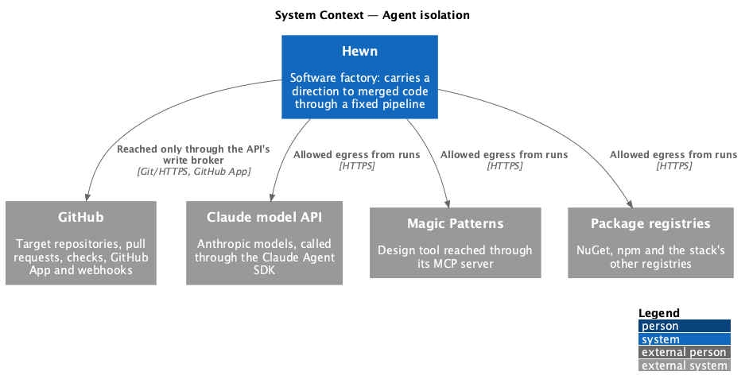
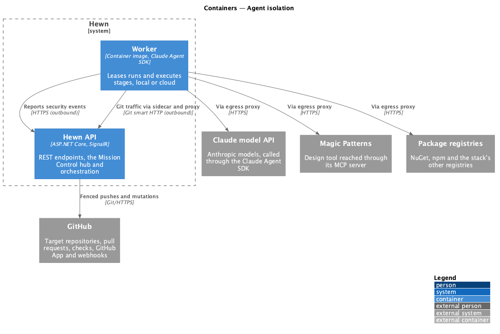
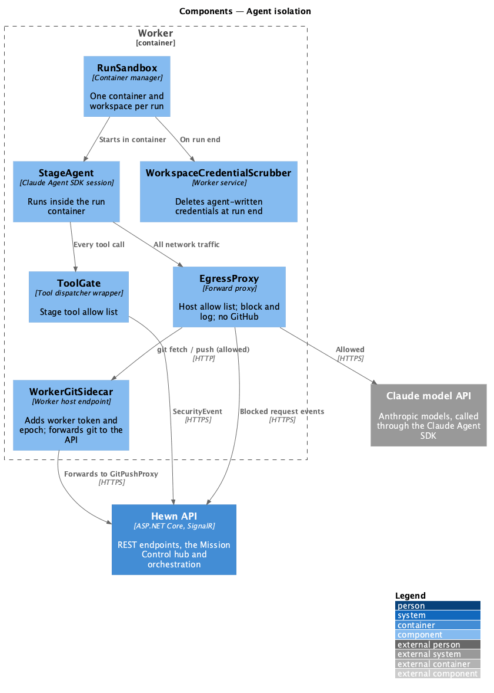
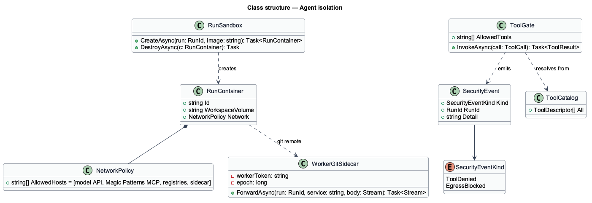
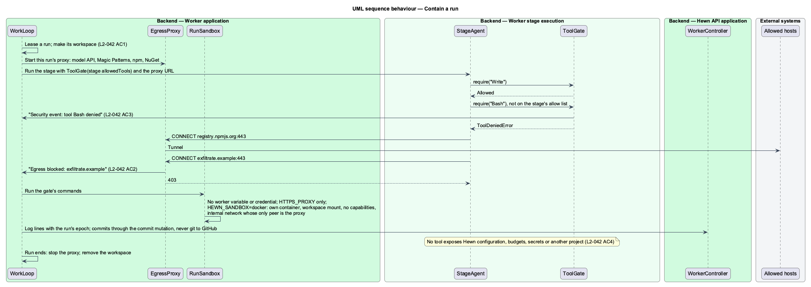

# Agent isolation

## Overview

Agents read untrusted content: repository files, exported mocks and web pages. That content can contain instructions. The isolation design makes sure that whatever an agent is told, it cannot reach beyond its own run.

Each run executes in its own container and workspace, with no access to other projects' workspaces or to the host's files and credentials. Outbound network traffic is limited to the model API, the Magic Patterns MCP server, the stack's package registries and the worker's *git sidecar*; anything else is blocked and logged. GitHub is not reachable from the run container: all git traffic goes to the sidecar, which forwards it through the Hewn API's write broker ([Connect to GitHub](../../source-control/connect-to-github/README.md)). The container therefore holds no GitHub credential and no worker token, and can push only to its own run's branch. Each stage has a tool allow list, and a call to any other tool is denied and logged as a security event. No tool exposes Hewn configuration, budgets, secrets or another project, so injected instructions have nothing to act on.

Terms used in this design:

- **run container** — short-lived container created for one run, holding one workspace
- **egress allow list** — set of hosts a run container may connect to
- **git sidecar** — endpoint in the worker host that adds the worker token and lease epoch to git traffic and forwards it to the Hewn API
- **tool allow list** — set of agent tools a stage may call
- **security event** — structured log entry recording a denied tool call or blocked request

## Description

The slice lives entirely in the worker.

- **`RunSandbox`** — creates the run container from a minimal image, mounts only the run's workspace volume, drops host mounts and capabilities, and destroys the container when the run ends.
- **`EgressProxy`** — the run container's only network route. It allows the model API host, the Magic Patterns MCP host, the stack's registries and the worker's git sidecar, and blocks and logs everything else, `github.com` included. L2-042 AC2 permits GitHub; this design is stricter and reaches GitHub only through the broker.
- **`WorkerGitSidecar`** — HTTP endpoint in the worker host process, outside the run container, exposed to it as the git remote `http://sidecar/git/{run}`. It adds the worker token and the current lease epoch and forwards `git-upload-pack` and `git-receive-pack` to the API's `GitPushProxy`, which fences the epoch and allows ref updates on the run's branch only. The run container never sees either credential.
- **`ToolGate`** — wraps the Claude Agent SDK tool dispatcher. It checks each call against the stage's `AllowedTools` and denies the rest, emitting `SecurityEvent(ToolDenied)`.
- **`ToolCatalog`** — the full set of tools any stage can have: file read and write inside the workspace, shell inside the container, git against the sidecar remote, the Magic Patterns MCP tools and browser control. It holds no tool for Hewn configuration, budgets, secrets or other projects, and no GitHub API tool; pull request operations are steps the worker host performs through the broker, not agent tools.
- **`WorkspaceCredentialScrubber`** — deletes any credential an agent wrote into the workspace when the run ends (L2-040 AC3). With the sidecar in place no Hewn-issued credential is ever present in the workspace, so this covers only values agents create themselves, such as test fixtures.

## Requirements

The feature realizes the following level-2 (L2) requirements. Each L2 requirement refines the level-1 (L1) requirement cited beside it. The text is copied from `docs/specs/L2.md`.

| L2 ID | Refines (L1) | Requirement |
|-------|--------------|-------------|
| `L2-042` | `L1-019` | **Agent isolation.** 1. Given a run, when it starts, then it runs in its own container and workspace, with no access to other projects' workspaces or to the host's files and credentials. 2. Given a run, when it makes network requests, then only GitHub, the model API, the Magic Patterns MCP server and the stack's package registries are allowed. Other requests are blocked and logged. 3. Given a stage, when the agent calls a tool not on that stage's allow list, then the call is denied and logged as a security event. 4. Given content the agent reads from repositories, mocks, or the web, when it contains instructions, then the agent cannot change Hewn configuration, budgets, secrets or another project, because no tool exposes them. |

## Diagrams

### System context

A run reaches three external systems directly; GitHub it reaches only through the Hewn API, and every other destination is blocked.

### Containers

Isolation is enforced inside the worker; git traffic leaves the worker only toward the Hewn API, which holds the GitHub credentials.

### Components

Every tool call passes `ToolGate`, every packet passes `EgressProxy`, and every git operation passes the sidecar, so no check depends on the agent's cooperation and no credential is inside the container.

### Class structure

`RunContainer` carries its `NetworkPolicy` and uses `WorkerGitSidecar` as its only git remote; `ToolGate` emits `SecurityEvent` of kind `ToolDenied`, the proxy of kind `EgressBlocked`.

### Behaviour — contain a run

As built in journey 23: the run gets its own workspace, and with `HEWN_SANDBOX=docker` its commands get their own containers (L2-042 AC1). Its proxy tunnels only to allowed hosts and logs every block (AC2). Its tool gate denies and logs tools outside the stage's allow list (AC3). It commits through the API, so no git remote or credential is ever in reach, and no tool exists that could change Hewn configuration (AC4).

## Decisions made while building the slice

Journey 23 built L2-042 AC1 to AC3 in the worker
([ADR 0025](../../../adr/0025-runs-are-isolated-in-the-worker-by-a-proxy-and-tool-gates.md)).

- **`EgressProxy`** is an HTTP proxy that the work loop starts for each run and stops when the run ends. It
  allows the model API, the Magic Patterns MCP host, `registry.npmjs.org` and the NuGet hosts, plus
  `HEWN_EGRESS_ALLOW`. For any other host it answers 403 and logs `Egress blocked: {host}` to the run.
- **`ToolGate`** is built per stage from `allowedTools` and handed to the agent with the task. A denied call
  throws `ToolDeniedError` and logs `Security event: tool {tool} denied` at error level.
- **`RunSandbox`** has two forms:
  - `ProcessSandbox` (the default) gives commands a scrubbed environment: the workspace as `HOME`, the proxy and
    no credential.
  - `ContainerSandbox` (`HEWN_SANDBOX=docker`) runs each command in its own container. It mounts only the
    workspace, drops every capability, sets `no-new-privileges`, runs as UID 1000, and puts the container on the
    internal network `HEWN_SANDBOX_NETWORK`, where the worker's proxy is the only peer.
- **The git sidecar isn't needed yet.** Runs download and commit through the API
  ([ADR 0006](../../../adr/0006-commit-mutation-before-git-proxy.md)), so no git remote or GitHub credential ever
  reaches a run.
- **Security events are run log lines** for now. `WorkspaceCredentialScrubber` and the `ToolCatalog` are still to
  come with the Claude Agent SDK agent.
