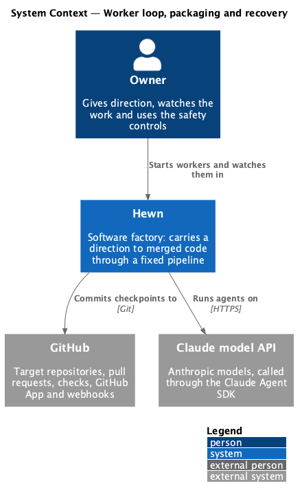
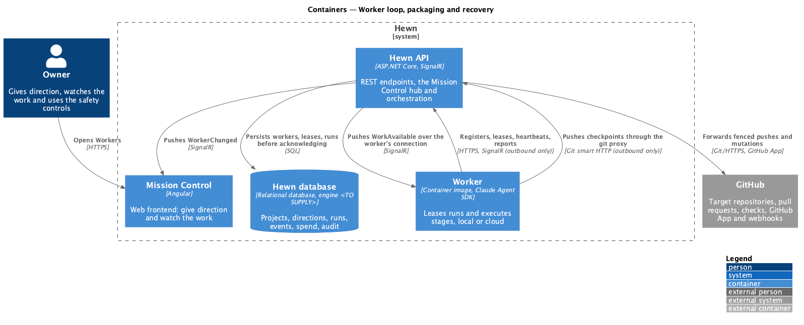
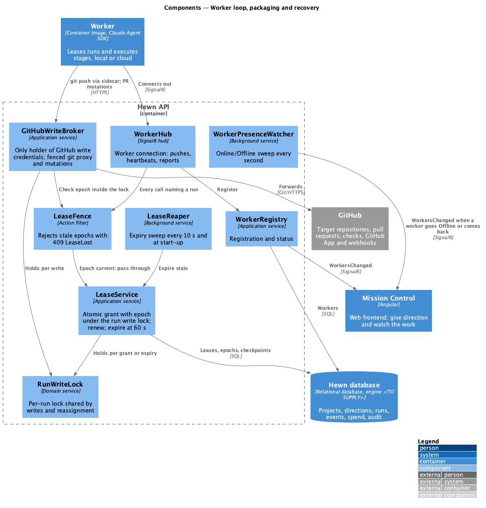
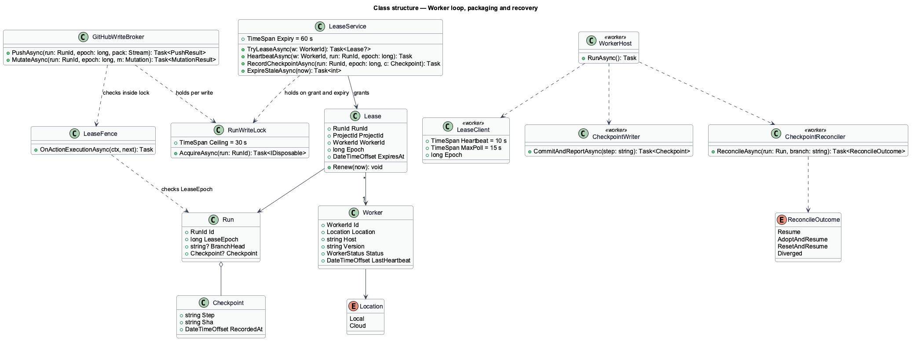
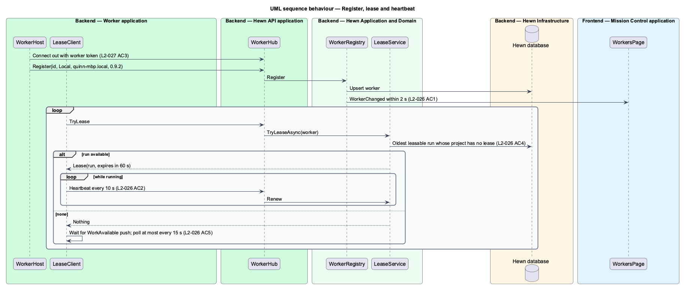
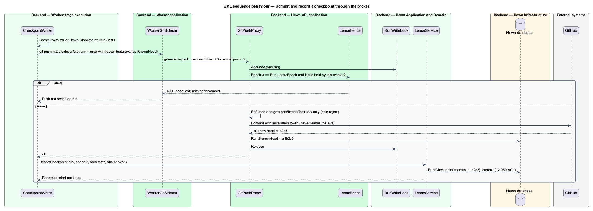
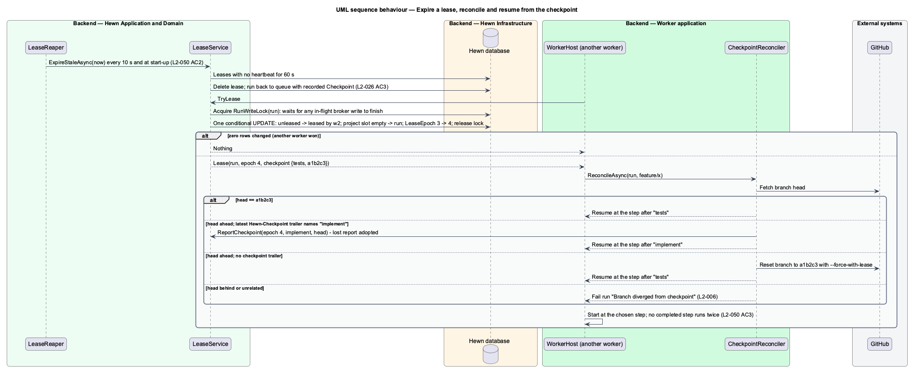
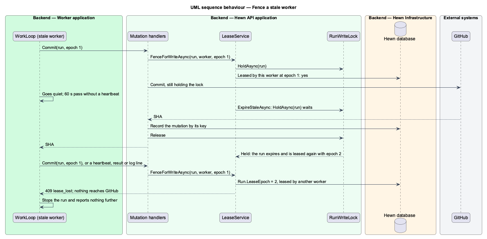

# Worker loop, packaging and recovery

## Overview

A *worker* is a process that runs agents. It starts with a worker token, connects out to the Hewn API, registers its ID, location (Local or Cloud), host name and version, and appears on the Workers page within 2 seconds. It then loops: when work is queued and it is free, it leases one run, heartbeats every 10 seconds, and holds the lease only while heartbeats arrive. When idle it waits for a server push, falls back to polling no more than every 15 seconds, and stays under 1% CPU.

One container image serves both locations; configuration alone sets Local or Cloud, and the same direction produces the same stages, validations and outputs in either place. A Local worker uses outbound connections only. At most one worker holds a lease per project at a time.

Work survives failure. A run checkpoints at the end of each completed step by committing to its branch and reporting the commit to the API; a checkpoint counts only once the API has recorded it. If a worker stops heartbeating for 60 seconds its lease expires and another worker resumes the run from the last recorded checkpoint, so no completed step runs twice. The API persists every direction, run and event before acknowledging it, and after a server restart each lease is either kept by its worker's next heartbeat or expires as above.

A worker whose lease has expired may still be alive, cut off by a network partition or a long pause, and may still try to write. Such a worker is *fenced*. Workers hold no GitHub credential: every write to GitHub, whether a git push or a pull request operation, goes through the Hewn API's *write broker* ([Connect to GitHub](../../source-control/connect-to-github/README.md)), which checks the lease epoch and takes a per-run write lock before it touches GitHub. Lease reassignment takes the same lock, so a mutation either completes under the old epoch before the new lease is issued or is rejected after it; nothing interleaves. The stale worker can therefore neither report work nor change the repository. When a run resumes, the new worker first *reconciles* the branch with the recorded checkpoint, so a step that finished but whose report was lost is adopted rather than repeated, and partial work is discarded.

Terms used in this design:

- **worker** — process that runs agents, Local or Cloud
- **lease** — time-limited claim by one worker on one run, renewed by heartbeats
- **heartbeat** — message a leasing worker sends every 10 seconds
- **checkpoint** — end of the last completed step: a commit on the branch plus the API's record of it
- **lease epoch** — number on the run that increases by one each time the run is leased; sent with every call the leasing worker makes
- **fencing** — rejecting writes from a worker whose lease epoch is no longer current, before any mutation is executed
- **write broker** — the API component through which every GitHub write passes; the only holder of GitHub write credentials
- **run write lock** — per-run mutual exclusion held while a GitHub mutation executes and while a lease is granted or expired
- **reconciliation** — comparing the branch head with the recorded checkpoint before a resumed run starts

## Description

The slice spans the worker host, the lease service in the API and the Workers page.

- **`WorkerHost (worker)`** — entry point of the container image. Reads `HEWN_API_URL`, `HEWN_WORKER_TOKEN` and `HEWN_LOCATION`, opens the outbound SignalR connection, registers, and runs the loop. It stops the run container within 10 seconds of two missed heartbeats or of any `LeaseLost` response, and reports nothing further for that run.
- **`LeaseClient (worker)`** — requests a lease when free, sends heartbeats every 10 seconds while running, and listens for `WorkAvailable` pushes; without a push it polls at most every 15 seconds. Every call it makes for a run carries the lease epoch.
- **`WorkerGitSidecar (worker)`** — small HTTP endpoint in the worker host process, reachable from the run container as the git remote `http://sidecar/git/{run}`. It adds the worker token and the current epoch and forwards `git-upload-pack` and `git-receive-pack` to the API's `GitPushProxy`. The run container therefore holds neither a GitHub credential nor the worker token; an agent that reads an injected instruction has nothing to exfiltrate and nowhere to push but its own branch ([Agent isolation](../agent-isolation/README.md)).
- **`CheckpointWriter (worker)`** — after each completed step commits to the branch with a `Hewn-Checkpoint: {run}/{step}` trailer and pushes through the sidecar with `--force-with-lease={branch}:{lastKnownHead}`. The broker fences the epoch and records the new branch head on the run; the writer then reports `{step, sha, epoch}`. The checkpoint exists only once the API accepts the report.
- **`CheckpointReconciler (worker)`** — runs before the first step of a resumed run. It fetches the branch and compares its head with the recorded checkpoint SHA. Equal: resume at the next step. Head ahead by commits whose latest `Hewn-Checkpoint` trailer names the next step: that step finished but its report was lost, so the worker reports it now and resumes after it. Head ahead by commits without such a trailer: partial work, which the worker discards by resetting the branch to the checkpoint with `--force-with-lease`. Head behind or unrelated: the run fails with "Branch diverged from checkpoint" and the retry policy applies (L2-006).
- **`Idempotent external steps`** — every step with an effect outside the branch checks for its own effect before acting, keyed by `{run}/{step}`: open a pull request only if the branch has no open one, and adopt it when it does; merge only if the pull request is still open, and treat an already-merged one as success; create a repository only if the project records none; add a label only if absent. Pull request bodies carry `Hewn-Run: {run}/{step}` so a resumed worker recognizes its own work ([Open and merge the pull request](../../increments/open-and-merge-pull-request/README.md), [Connect to GitHub](../../source-control/connect-to-github/README.md)).
- **`WorkerRegistry`** — API service storing worker ID, location, host, version, status and last heartbeat; it publishes `WorkerChanged` (L2-031).
- **`LeaseService`** — grants a lease with one conditional update that moves the run from unleased to leased by this worker and the project's single lease slot from empty to this run, in the same statement; when another worker got there first the statement changes zero rows and the caller gets nothing. Each grant sets `Run.LeaseEpoch = LeaseEpoch + 1` and returns the epoch with the recorded checkpoint. It renews on heartbeat and expires leases with no heartbeat for 60 seconds, returning the run to the queue.
- **`LeaseFence`** — API action filter on every worker endpoint and hub method that names a run: heartbeat, log lines, checkpoint reports, results, control acknowledgements, git proxy requests and GitHub mutation requests. It compares the request's epoch and worker with `Run.LeaseEpoch` and the current lease; a mismatch returns 409 `LeaseLost` and changes nothing. For git and mutation requests the check happens inside the run write lock, so it cannot be overtaken by a reassignment.
- **`RunWriteLock`** — per-run mutual exclusion in the API, implemented as a row lock on the run (`SELECT … FOR UPDATE`) with a 30-second ceiling. `GitHubWriteBroker` holds it for the duration of one mutation or one push; `LeaseService.TryLeaseAsync` and `ExpireStaleAsync` hold it while they change the lease and bump the epoch. A reassignment therefore waits for an in-flight write to finish, and every write that arrives afterwards carries an epoch the fence rejects.
- **`LeaseReaper`** — background service that runs the expiry sweep every 10 seconds and once at API start-up.
- **`WorkersPage (Angular)`** — lists host, ID, location, version, status, current project, last heartbeat and connected time; Owners also see New worker token and Revoke.

Durable acknowledgement is a rule applied across every write endpoint: handlers commit before returning success (L2-050 AC1). The CPU target in L2-026 AC5 is measured in the container with no run leased.

Because no GitHub credential ever reaches a worker, fencing does not depend on token expiry or revocation: a stale worker's pushes and pull request operations are refused at the broker by epoch, inside the same lock that reassignment takes. `--force-with-lease` and reconciliation remain as defence in depth: the first catches a push whose base is stale for any other reason, and the second handles the case where a push succeeded through the broker but the checkpoint report never arrived, by adopting a completed step or resetting partial work to the recorded checkpoint.

Routing pushes through the API puts the API in the data path of every push. A Local worker on a laptop pushes through the cloud API, and a large repository makes the proxy the bottleneck. The proxy streams and keeps no state, so it scales with API instances; the latency cost is accepted for the isolation and fencing it buys.

## Requirements

The feature realizes the following level-2 (L2) requirements. Each L2 requirement refines the level-1 (L1) requirement cited beside it. The text is copied from `docs/specs/L2.md`.

| L2 ID | Refines (L1) | Requirement |
|-------|--------------|-------------|
| `L2-026` | `L1-014` | **Worker loop.** 1. Given a worker starts with a valid worker token, when it connects, then it registers with an ID, location (Local or Cloud), host name and version, and appears in Mission Control's Workers view within 2 seconds. 2. Given queued work, when a worker is free, then it leases one run, sends a heartbeat every 10 seconds, and holds the lease only while heartbeats arrive. 3. Given a worker stops heartbeating for 60 seconds, when the lease expires, then the run is offered to another worker and resumes from its last checkpoint (L2-050). 4. Given a project, when runs are leased, then at most one worker holds a lease for that project at a time. 5. Given no queued work, when a worker is idle, then it waits for a push from the server, falling back to polling no more than every 15 seconds, and uses under 1% CPU. |
| `L2-027` | `L1-014` | **Same behaviour locally and in the cloud.** 1. Given the worker, when it is packaged, then one container image runs either on a developer machine (Docker) or in the cloud, and the location is set only by configuration. 2. Given the same direction and repository, when it runs on a Local worker and on a Cloud worker, then the same stages, validations and outputs are produced. 3. Given a Local worker, when it connects, then it uses outbound connections only, needing no inbound ports on the developer machine. |
| `L2-050` | `L1-022` | **Durable state and recovery.** 1. Given a direction, run or event, when the API acknowledges it, then it has already been persisted to the database. 2. Given the server restarts during a run, when it comes back, then no direction is lost, and every lease is either kept by its worker's next heartbeat or expires per L2-026 AC3. 3. Given a run is resumed after a crash, when it restarts, then it continues from its last checkpoint (the end of the last completed step, committed to the branch). No completed step runs twice. |

## Diagrams

### System context

The Owner starts workers on a laptop or in the cloud; the workers call Claude and commit checkpoints to GitHub.

### Containers

The worker opens every connection outbound (L2-027 AC3); the API pushes work and control over that same connection.

### Components

`LeaseService` enforces one lease per project and stamps each grant with an epoch; `LeaseFence` rejects stale epochs on every run-scoped call; `GitHubWriteBroker` is the only path to GitHub and checks the fence inside the `RunWriteLock` that `LeaseService` also takes, so a write and a reassignment never interleave. `LeaseReaper` expires silent leases, including after an API restart (L2-050 AC2).

### Class structure

A `Lease` ties one `Run` to one `Worker` until `ExpiresAt` and carries the `Epoch` that `LeaseFence` checks against `Run.LeaseEpoch`. `GitHubWriteBroker` and `LeaseService` share `RunWriteLock`. The run's recorded `Checkpoint` and `BranchHead` are what `CheckpointReconciler` compares with the branch when a run resumes.

### Behaviour — register, lease and heartbeat

The worker registers and shows on the Workers page within 2 seconds (L2-026 AC1), leases one run and heartbeats every 10 seconds (AC2), with at most one lease per project (AC4). Idle, it waits for a push or polls at most every 15 seconds (AC5).

### Behaviour — commit and record a checkpoint

A checkpoint is a pushed commit plus the API's record of it (L2-050 AC3). The push leaves the run container without any credential, gains the worker token and epoch in the sidecar, and is fenced and locked in the broker before GitHub sees it.

### Behaviour — expire a lease, reconcile and resume

After 60 seconds without heartbeats the lease expires and another worker leases the run atomically with a new epoch (L2-026 AC3). Before its first step the new worker reconciles the branch with the recorded checkpoint, so a completed-but-unreported step is adopted and partial work is discarded; no completed step runs twice (L2-050 AC3). The same sweep runs at API start-up (L2-050 AC2).

### Behaviour — fence a stale worker

A worker cut off by a partition keeps running until it learns its lease is gone. It holds no GitHub credential, so every write it attempts reaches the broker carrying epoch 3; the API now holds epoch 4, so the broker rejects each one inside the run write lock and forwards nothing to GitHub. On the first `LeaseLost` the worker stops the run container.

## Decisions made while building the slice

Journey 1, part 2 built the loop, leases and fencing that L2-004 needs.

- **Protocol over HTTP.** Register, lease (204 when there is no work), heartbeat, checkpoint and result are
  `POST /api/worker/...` calls carrying `{workerId, epoch}`. The `/hubs/workers` push (`WorkAvailable`)
  is not built yet; workers poll every 15 seconds, the ceiling L2-026 AC5 allows.
- **Fencing without a row lock** on SQLite: see [ADR 0005](../../../adr/0005-leases-on-sqlite.md).
- **Scripted executor.** Until stage executors land, the worker runs `ScriptedStageExecutor`: three steps
  per stage (prepare, run, commit), no agent, model or GitHub call. The e2e suite starts real worker
  processes with it, so the fake worker AGENTS.md describes is the real worker with a scripted executor.
- **Checkpoints** carry a step number and an optional SHA; the git sidecar, the reconciler and the
  write broker come with the stages that push (part 3 onward).
- **Failure text is redacted** before it is stored (`SecretRedactor`).
- **Not built yet:** the Workers page and issued tokens, `WorkerChanged`, the git sidecar, the container
  image, `CheckpointReconciler` and the `RunWriteLock`.
