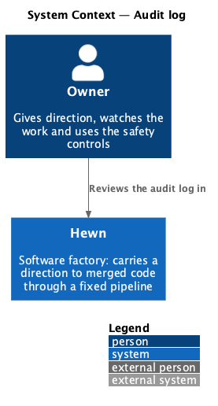
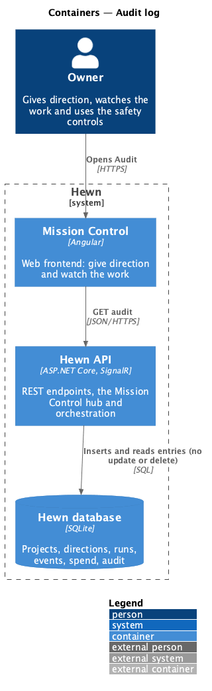
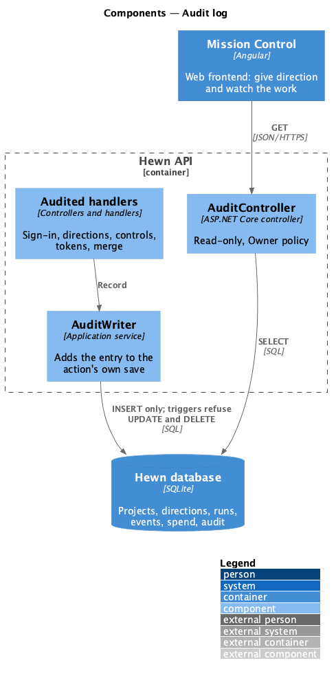
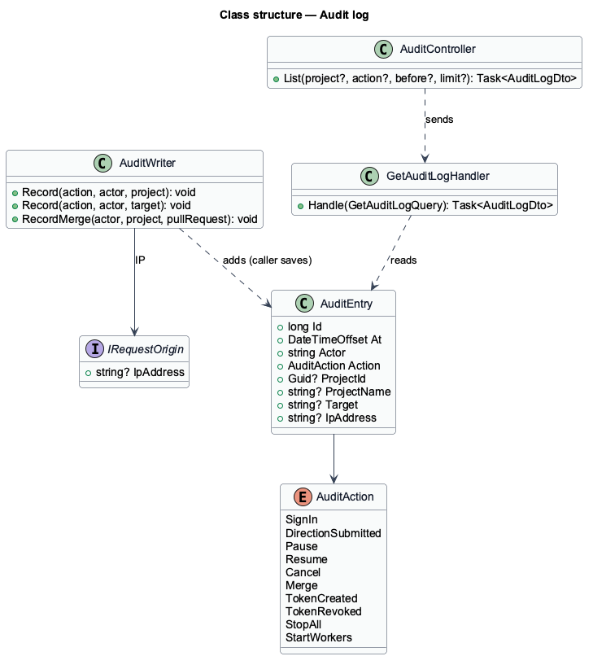
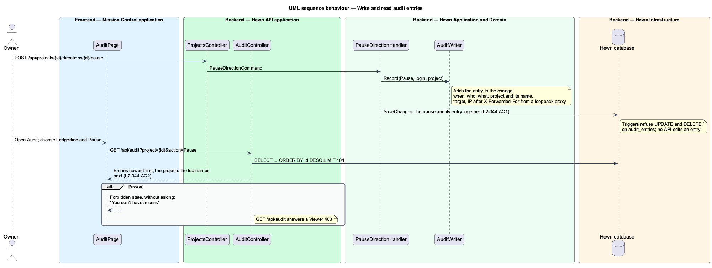

# Audit log

## Overview

Because Hewn acts without approvals, the record of what humans did to it matters. Every sign-in, direction submission, pause, resume, cancel, stop all, start workers, worker token creation or revocation, and merge writes an *audit entry* recording who did it, what, when and from which IP address. Merges are performed by Hewn itself, so their entry names whoever submitted the direction (or requested the skills update) and has no IP address.

Entries are append-only: no API edits or deletes them. Owners open the Audit page to list entries newest first and filter them by project and action.

Terms used in this design:

- **audit entry** — immutable record of one security-relevant action
- **actor** — GitHub login of the user; for a merge, of whoever submitted the direction or requested the skills update

## Description

The slice is an append-only table, a writer called from each audited handler, and a read-only page.

- **`AuditWriter`** — `Record(action, actor, project | target)` and `RecordMerge(actor, project, number)` add an entry to the audited handler's own change, so the action and its entry are saved together. The client IP comes from `IRequestOrigin`: `HttpContext.Connection.RemoteIpAddress` after `X-Forwarded-For` from a loopback proxy, IPv4 shown as IPv4.
- **`AuditAction`** — enumeration: SignIn, DirectionSubmitted, Pause, Resume, Cancel, Merge, TokenCreated, TokenRevoked, StopAll, StartWorkers.
- **`audit_entries` table** — append-only. SQLite has no database roles, so two triggers refuse every UPDATE and DELETE ("audit entries are append-only"); immutability holds even against a code defect.
- **`AuditController`** — `GET /api/audit?project=&action=&before=&limit=`, Owner policy, newest first with cursor paging; it also returns every project the log names. There is no write endpoint.
- **`AuditPage (Angular)`** — table of when, who, action, target and IP with project and action filters.

## Requirements

The feature realizes the following level-2 (L2) requirements. Each L2 requirement refines the level-1 (L1) requirement cited beside it. The text is copied from `docs/specs/L2.md`.

| L2 ID | Refines (L1) | Requirement |
|-------|--------------|-------------|
| `L2-044` | `L1-019` | **Audit log.** 1. Given a sign-in, direction submission, pause, resume, cancel, stop all, start workers, token creation or revocation, or merge, when it happens, then an audit entry records who did it, what, when and from which IP. A merge Hewn makes names whoever submitted the direction (or requested the skills update) and has no IP. Entries cannot be edited or deleted through any API, and deleting a project keeps its entries. 2. Given an Owner, when they open Audit, then entries are listed newest first and can be filtered by project and action. |

## Diagrams

### System context

Only Owners read the audit log.

### Containers

Entries live in the Hewn database under a role that can insert and read but not change them.

### Components

Each audited handler calls one writer inside its own transaction, so an action and its audit entry commit together.

### Class structure

`AuditEntry` has no mutators, and `AuditController` exposes reads only.

### Behaviour — write and read entries

Audited actions record who, what, when and IP, and cannot be edited (L2-044 AC1). Owners list them newest first with filters (AC2).

## Decisions made while building the audit log (journey 32)

- **Triggers instead of a database role** ([ADR 0033](../../../adr/0033-audit-entries-are-append-only-in-the-database.md)).
  Hewn runs on SQLite, which has no roles or grants, so the migration adds `BEFORE UPDATE` and `BEFORE DELETE`
  triggers on `audit_entries` that abort with "audit entries are append-only". Deleting a project leaves its entries,
  with the project's name kept in `ProjectName`.
- **What each action records.** The target is what the row shows: the project's name; "Ledgerline #27" for a merge;
  the worker's name for a token created or revoked; "All projects" for stop all and start workers; nothing for a
  sign-in. Only project actions carry a `ProjectId`, so filtering by a project leaves out sign-ins, tokens and
  stop all, as `no-results.html` explains.
- **Merges** are recorded when Hewn merges an increment's or the scaffold's pull request (for whoever submitted the
  direction) or a skills update (for whoever requested it), with no IP. A retried merge with the same idempotency
  key is recorded once, because the entry is saved with the ledger row.
- **Resume after raising a budget** is recorded as Resume, since it resumes the direction.
- **IP addresses.** `X-Forwarded-For` is honoured only from a proxy on the same machine (ASP.NET Core's default
  known proxies), so a client can't name its own address.
- **Ordering and paging.** Entries are ordered by `Id`, which increases with each entry; `before` is the last `Id`
  of a page. The page shows 100 at a time and "Show older entries" below the table when there are more (the mocks
  show 10 entries and no paging).
- **Viewers** don't see Audit in the sidebar; opening `/audit` shows the forbidden state without a request.

