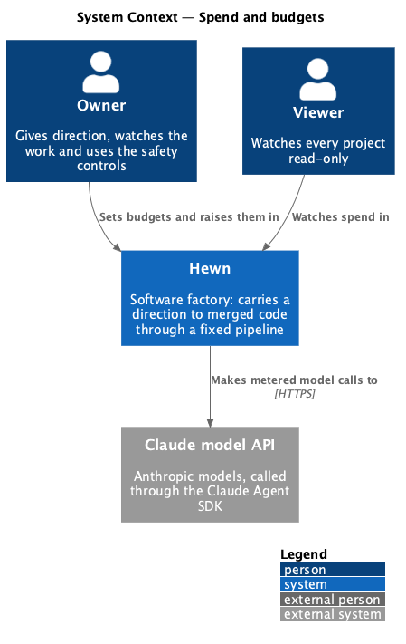
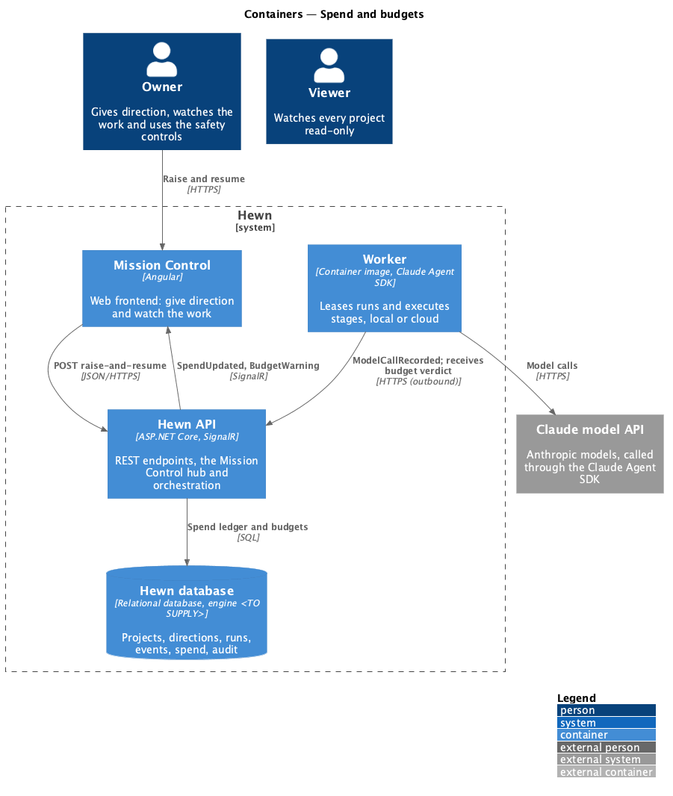
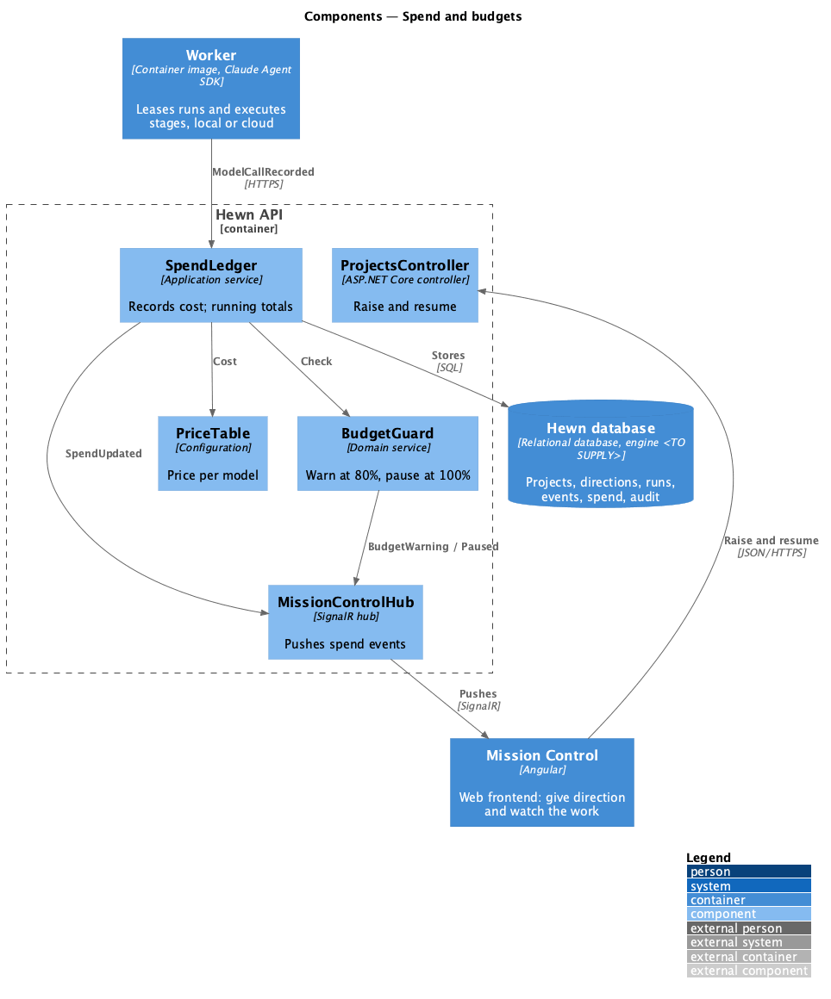
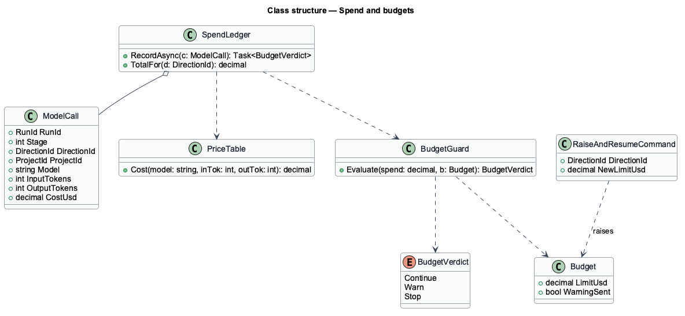
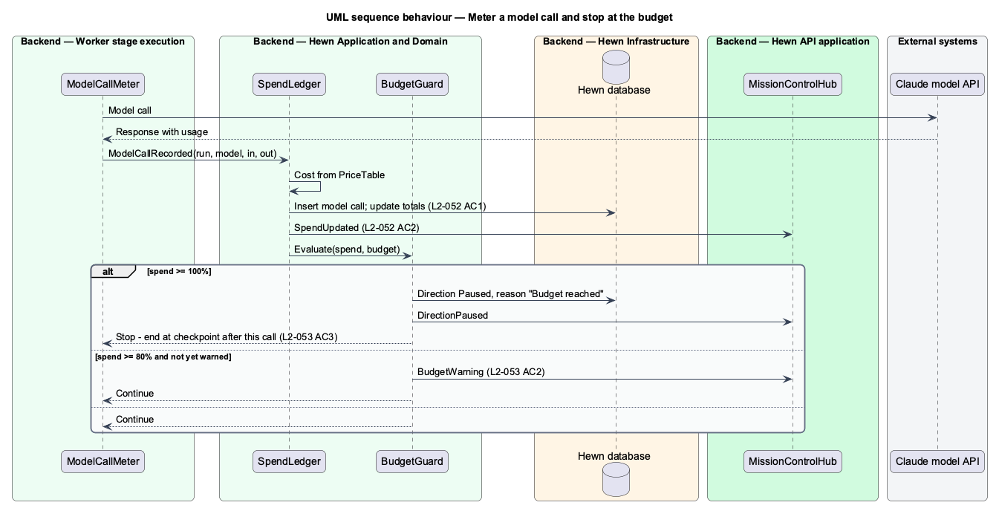
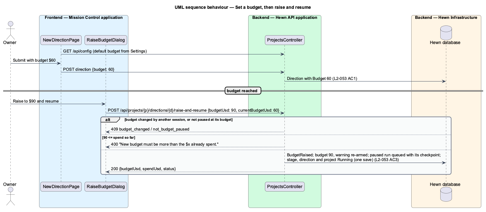

# Spend and budgets

## Overview

Every model call costs money, and Hewn runs without anyone approving each call, so it tracks spend precisely and stops itself at a limit. Each model call's input and output tokens, model and cost are recorded against its run, stage, direction and project. Spend to date is shown on the project and the direction and updates live.

Every direction has a *budget*. It starts at the default an Owner sets in Settings, and the Owner can change it when submitting. At 80% of the budget a warning appears on the project. At 100% the direction pauses with the reason "Budget reached" after the current model call, and resumes only when an Owner raises the budget above the spend so far and resumes in one action, Raise and resume. This is a safety stop, not an approval step (L2-028).

Terms used in this design:

- **spend** — sum of model call costs for a direction or project
- **budget** — spend limit for one direction, in US dollars
- **price table** — per-model price per million input and output tokens used to compute cost

## Description

The slice spans the worker's model-call meter, the spend ledger and budget guard in the API, and the spend UI.

- **`ModelCallMeter (worker)`** — wraps the Claude Agent SDK's model client; after each call it reports `ModelCallRecorded(run, model, inputTokens, outputTokens)` and, before the next call, checks the budget verdict the API returned.
- **`PriceTable`** — per-model prices in USD per million input and output tokens, from configuration (`Hewn:Prices:{model}`), defaulting to Anthropic's published prices. A price changes by configuration and restart; recorded calls keep their cost. An unknown model is priced at the table's highest rates (ADR 0010).
- **`SpendLedger`** — table of model calls with cost, keyed by run, stage, direction and project; maintains running totals per direction and project and emits `SpendUpdated` (L2-031).
- **`BudgetGuard`** — on each recorded call compares direction spend with its budget. Crossing 80% emits `BudgetWarning`; reaching 100% sets the direction Paused with reason "Budget reached" and returns `Stop` to the meter, which ends the run at a checkpoint after the current call.
- **`RaiseAndResumeCommand`** — `POST /api/directions/{id}/raise-and-resume {budget}`, Owner policy. Rejects a budget at or below spend with 400; otherwise updates the budget and resumes in one transaction.
- **`SpendBadge / BudgetBanner / RaiseBudgetDialog (Angular)`** — live spend on the project and direction, the 80% warning, and the "Budget reached" callout with Raise and resume.
- **`DefaultBudgetSetting`** — Settings field for the default budget; the new-direction form pre-fills it and lets the Owner change it.

## Requirements

The feature realizes the following level-2 (L2) requirements. Each L2 requirement refines the level-1 (L1) requirement cited beside it. The text is copied from `docs/specs/L2.md`.

| L2 ID | Refines (L1) | Requirement |
|-------|--------------|-------------|
| `L2-052` | `L1-023` | **Track usage and spend.** 1. Given any model call, when it returns, then its input and output tokens, model and cost are recorded against its run, stage, direction and project. 2. Given a project or direction, when a user views it, then the spend to date is shown and updates live (L2-031). |
| `L2-053` | `L1-023` | **Budgets.** 1. Given a direction, when it is submitted, then it has a budget (the default budget an Owner sets in Settings, which the Owner can change when submitting). 2. Given spend reaches 80% of the budget, when it crosses the threshold, then a warning event is pushed and shown on the project. 3. Given spend reaches 100%, when it crosses the threshold, then the direction is Paused with the reason "Budget reached" after the current model call. It resumes only when the Owner raises the budget above the spend so far and resumes it, in one action (Raise and resume). This is a safety stop, not an approval step (L2-028). |

## Diagrams

### System context

Every call to Claude is metered; Owners set and raise budgets, Viewers watch spend.

### Containers

The worker reports each call and obeys the verdict; the Hewn API owns the ledger and the budget rule.

### Components

The ledger and the guard run in one handler, so the verdict for a call always reflects that call's cost.

### Class structure

`BudgetVerdict` has three values; `Stop` pauses the direction and is cleared only by `RaiseAndResumeCommand`.

### Behaviour — meter a call and stop at budget

Each call is recorded with tokens, model and cost (L2-052 AC1) and spend updates live (AC2). 80% warns (L2-053 AC2); 100% pauses after the current call (AC3).

### Behaviour — set and raise a budget

A direction gets the Settings default, changeable at submission (L2-053 AC1). Raise and resume needs a budget above spend and resumes in one action (AC3).

## Decisions made while building the slice

Journey 4 built L2-052 and L2-053 AC1-AC3 up to the pause. Raise and resume is journey 5. These choices refine the
design above; ADR 0010 records them.

- **The meter.** The worker's `RunContext.recordModelCall({model, inputTokens, outputTokens})` posts
  `POST /api/worker/runs/{id}/model-calls` with a random `callId`; the API dedupes on (run, call id) and answers
  `{verdict, directionSpendUsd, budgetUsd}`. Only the scripted executor makes calls until the Agent SDK agent lands.
- **Events.** `SpendUpdated {directionId, stage, runId, model, inputTokens, outputTokens, costUsd,
  directionSpendUsd, projectSpendUsd, budgetUsd}`, `BudgetWarning {directionId, spendUsd, budgetUsd}` once per
  direction, and `DirectionChanged` now carries `pauseReason`.
- **Stop.** The run, its stage, the direction ("Budget reached") and the project turn Paused; the lease is released
  and the run keeps its checkpoint for Raise and resume. The worker ends the run with no further call, checkpoint or
  result.
- **Rounding.** Costs and spend are rounded to 6 decimal places, since SQLite stores decimals as doubles.
- **Defaults.** A one-row `direction_defaults` table holds the Owner's default budget ($10 to $10,000), read through
  `GET /api/settings/direction-defaults` and `GET /api/config`; `HEWN_DEFAULT_BUDGET_USD` applies until it is saved.
- **The UI.** The project header shows the direction's spend of budget as a `role="meter"` with the amounts in text,
  turning to warning at 80% (so status never rests on colour). The 80% `BudgetWarning` also raises a warning toast
  (10 s, pauses on hover or focus). A budget-reached direction shows the "Paused · Budget reached" callout; its
  raise controls arrive with Raise and resume. Settings builds only the Direction defaults section's budget; the
  descope threshold, appearance, access and integrations arrive with their own journeys.

