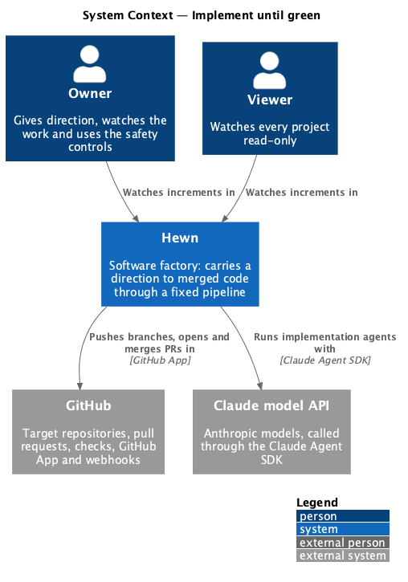
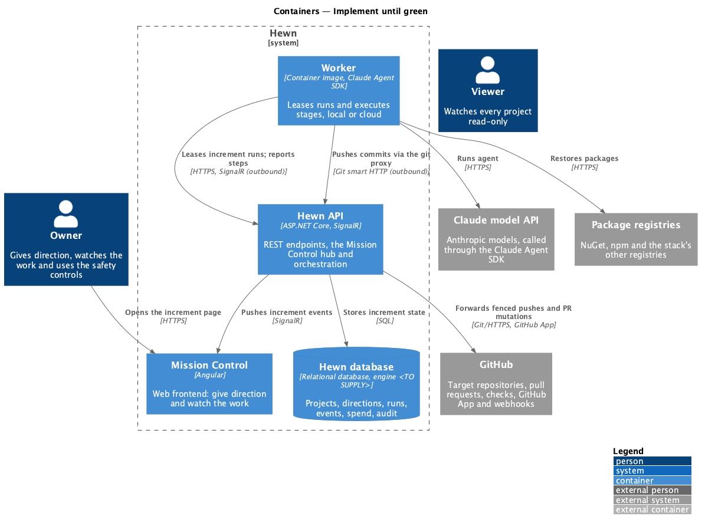
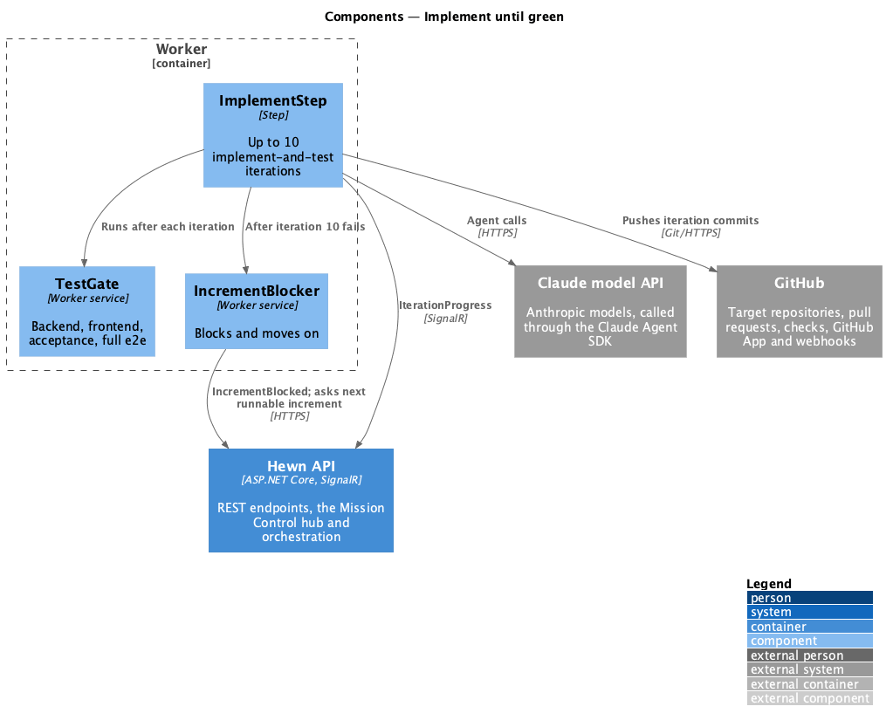
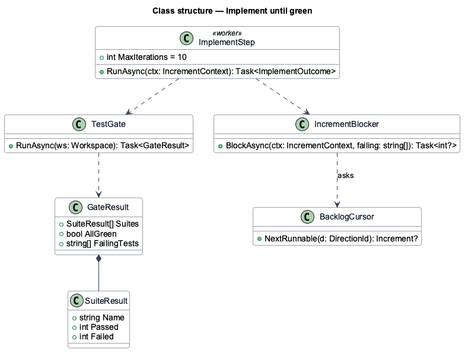
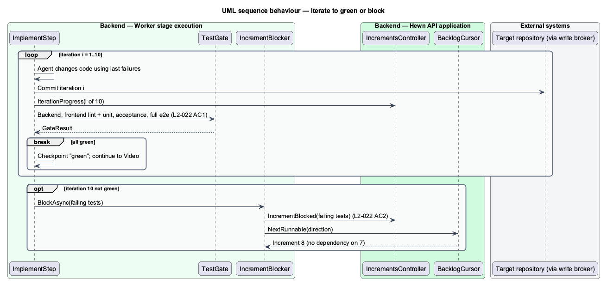

# Implement until green

## Overview

After the red test commit, the agent implements in iterations. Each iteration changes code and then runs the full gate locally in the worker: backend tests, frontend lint and unit tests, the increment's acceptance tests and the full end-to-end suite. The increment is done only when the whole gate passes.

Iterations are capped at 10 (configurable). If the 10th iteration ends with tests still failing, the increment becomes Blocked with its failing tests listed, and the agent moves to the next increment that does not depend on it. The Backlog page and the increment page show the block and the failing test output.

Terms used in this design:

- **iteration** — one implement-then-test cycle
- **gate** — the full local test set an increment shall pass: backend, frontend lint and unit, acceptance, full e2e

## Description

The slice is the Implement step of the increment run.

- **`ImplementStep (worker)`** — loops up to `MaxIterations` (default 10). Each iteration runs `StageAgent` with the failing results as input, commits, then runs `TestGate`.
- **`TestGate`** — runs the stack's commands in order (for the default stack: `dotnet test`, `npm run lint`, `npm test`, `npx playwright test`) and returns a `GateResult` with per-suite counts and failing test names.
- **`IncrementBlocker`** — on exhausting iterations, reports `IncrementBlocked(failingTests)` and asks `BacklogCursor` for the next increment with no dependency on the blocked one.
- **`BacklogCursor`** — API service that returns the next runnable increment, skipping those that depend on a Blocked increment.
- **`IterationProgress (Angular)`** — "Implement iteration n of 10" on the project page and dashboard, updated live.

Where the iteration cap is configured is <TO SUPPLY>; the Settings page does not expose it.

## Requirements

The feature realizes the following level-2 (L2) requirements. Each L2 requirement refines the level-1 (L1) requirement cited beside it. The text is copied from `docs/specs/L2.md`.

| L2 ID | Refines (L1) | Requirement |
|-------|--------------|-------------|
| `L2-022` | `L1-013` | **Implement until green.** 1. Given failing acceptance tests, when the agent implements, then the increment is done only when backend tests, frontend lint and unit tests, the increment's acceptance tests and the full e2e suite pass locally in the worker. 2. Given 10 implement-and-test iterations pass without all tests green (configurable), when the 10th ends, then the increment is Blocked with its failing tests listed, and the agent moves to the next increment that does not depend on it. |

## Diagrams

### System context

Humans watch progress; the agent implements with Claude and pushes to GitHub.

### Containers

All iterations and test runs happen inside the worker; the Hewn API records progress and picks the next runnable increment.

### Components

The gate is fixed code, so "done" never depends on the model's own judgment.

### Class structure

`GateResult` aggregates one `SuiteResult` per suite; `IncrementBlocker` hands control back to `BacklogCursor`.

### Behaviour — iterate to green or block

Done means the whole gate passes (L2-022 AC1). After 10 failing iterations the increment is Blocked with failing tests listed, and work moves to an independent increment (AC2).

