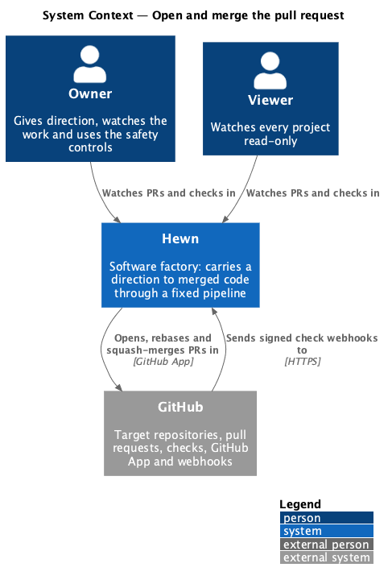
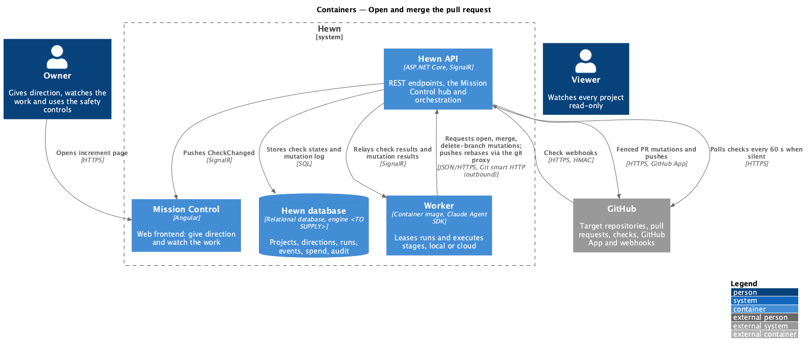
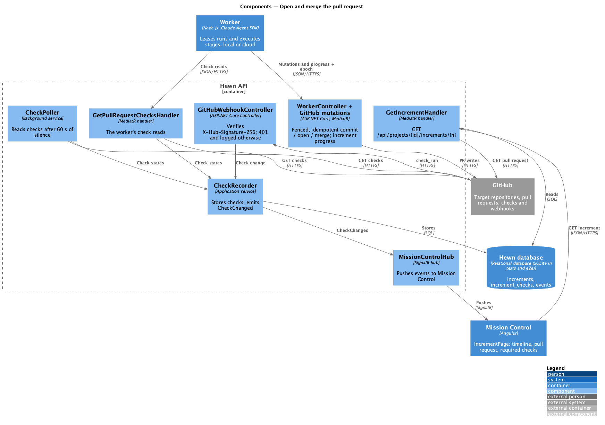
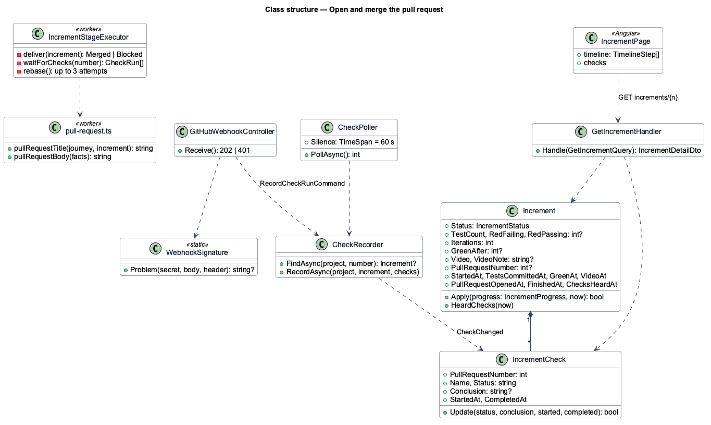
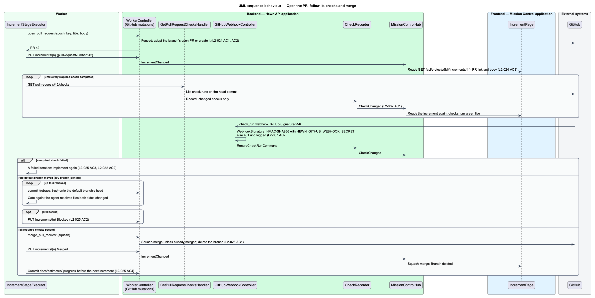
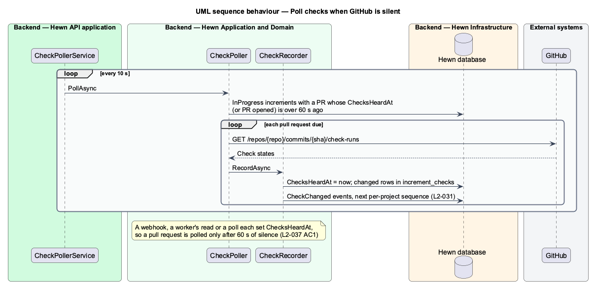

# Open and merge the pull request

## Overview

A green increment ends in a pull request and an automatic merge. The PR title is "{journey title} (journey {n}, L2-xxx[, L2-yyy])". The body has the sections What, Design and decisions, API, Tests, Deferred and Notes, lists the test commands with pass counts, and ends with the Hewn attribution line.

Hewn learns of check results through a signed GitHub webhook, or by polling every 60 seconds if no webhook arrives, and pushes each change to Mission Control within 1 second. When every required check passes, the PR is squash-merged with no human approval and its branch deleted. If the default branch moved, the agent rebases, re-runs checks and resolves conflicts itself, up to 3 attempts, after which the increment is Blocked. A failed required check counts as a failed implementation iteration. After each merge, the project's percent complete and `docs/estimates/` are updated before the next increment.

Terms used in this design:

- **required check** — CI job that branch protection requires before merging
- **squash-merge** — merge that collapses the branch into one commit on the default branch

## Description

The slice spans the PR step in the worker, check intake in the API, and the increment page.

- **`PullRequestStep (worker)`** — renders the title and body from `PullRequestTemplate` and asks the API's `GitHubWriteBroker` to open the PR (`OpenPullRequest`, idempotency key `{run}/pull-request/open`). The worker never calls GitHub; the broker fences the lease epoch, adopts an existing open PR on the branch, and stores the result so a resumed run gets the same PR number ([Connect to GitHub](../../source-control/connect-to-github/README.md), [Worker loop](../../agent-runtime/worker-loop/README.md)). The body carries `Hewn-Run: {run}/pull-request`.
- **`PullRequestTemplate`** — builds the title and the six body sections, the test commands with pass counts from `GateResult`, the video link or failure note, the early-green flag, and the attribution line.
- **`GitHubWebhookController`** — `POST /api/github/webhook`, anonymous but signature-verified with `HEWN_GITHUB_WEBHOOK_SECRET`. Unsigned or invalid requests return 401 and are logged.
- **`CheckPoller`** — background service (`CheckPollerService`, every 10 s) that reads the checks of each in-progress increment's PR once 60 seconds pass with no check news from a webhook or the worker.
- **`CheckRecorder`** — stores each increment's checks in `increment_checks` and appends `CheckChanged` for each one that changed, on the project's stream (L2-031).
- **`MergeStep (worker)`** — waits for all required checks, then requests `MergePullRequest` and `DeleteBranch` from the broker (keys `{run}/merge/merge` and `{run}/merge/delete-branch`). On a moved default branch it rebases locally and pushes through the git proxy, re-running checks, up to 3 attempts; on a failed check it returns to `ImplementStep` as a failed iteration. The broker re-reads the PR before merging: one already merged by an earlier attempt counts as success, so a resumed run never merges twice.
- **`ProgressUpdater`** — after merge, recomputes percent complete and commits the updated `docs/estimates/` before the next increment starts.
- **`IncrementPage (Angular)`** — the increment page's pull request rail: PR link and size, live required checks and the body, read from `GET /api/projects/{id}/increments/{n}` (`GetIncrementHandler`).

## Requirements

The feature realizes the following level-2 (L2) requirements. Each L2 requirement refines the level-1 (L1) requirement cited beside it. The text is copied from `docs/specs/L2.md`.

| L2 ID | Refines (L1) | Requirement |
|-------|--------------|-------------|
| `L2-024` | `L1-013` | **Open the pull request.** 1. Given an increment ready for PR, when it is opened, then the title is "{journey title} (journey {n}, L2-xxx[, L2-yyy])". 2. Given the PR body, when it is opened, then it has the sections What, Design and decisions, API, Tests, Deferred and Notes, lists the test commands with pass counts, and ends with the Hewn attribution line. 3. Given a PR is opened, when Mission Control is open, then the increment shows the PR link and live check status within 1 second of the event (L2-031). |
| `L2-025` | `L1-013` | **Merge automatically.** 1. Given all required checks pass on the PR, when the last check succeeds, then the PR is squash-merged with no human approval and the branch is deleted. 2. Given the default branch moved since the branch was made, when the agent prepares to merge, then it rebases, re-runs checks, and resolves conflicts itself for up to 3 attempts. After that, the increment is Blocked. 3. Given a required check fails, when the agent sees the failure, then it treats it as a failed iteration under L2-022 AC2. 4. Given a merge, when it completes, then the project's percent complete and `docs/estimates/` are updated before the next increment starts. |
| `L2-037` | `L1-018` | **Check status.** 1. Given an open PR, when a check changes state, then Hewn learns of it through a GitHub webhook, or through polling every 60 seconds if no webhook arrives, and emits an event (L2-031). 2. Given a webhook request, when it arrives, then its signature is verified, and unsigned or invalid requests return 401 and are logged. |

## Diagrams

### System context

GitHub is both a target (PRs and merges) and a source (check webhooks). Humans only watch.

### Containers

The worker opens and merges the PR; the Hewn API takes in check results by webhook or polling and fans them out to Mission Control and the worker.

### Components

Webhook and poller feed one projector, so Mission Control sees the same `CheckChanged` event whichever path delivered it.

### Class structure

`MergeStep` returns one of three outcomes. `FailedCheck` sends control back to the implement loop under L2-022 AC2.

### Behaviour — open, watch checks, merge

Title and body follow the template (L2-024 AC1, AC2); check changes reach Mission Control within 1 second (AC3, L2-037 AC1). The PR squash-merges on green (L2-025 AC1), rebasing up to 3 times (AC2); a failed check is a failed iteration (AC3); progress updates follow (AC4).

### Behaviour — poll when no webhook arrives

If no webhook arrives for an open PR within 60 seconds, the poller reads the checks and emits the same event (L2-037 AC1).

## Decisions made while building the slice

- **Rebase without git.** The worker holds no Git credential, so a rebase is a commit with `rebase: true`: the API
  commits every file the branch changes on top of the default branch's head and force-moves the branch. The
  worker replays its changes onto a fresh checkout; files both sides changed go to the agent to resolve.
- **Behind.** A merge refused because the branch is behind (GitHub's 405 "out of date" under strict protection)
  is `400 branch_behind`, with nothing recorded, so the worker rebases and merges again under a new key.
- **Merging deletes the branch** for every stage that merges, and the merge title is the pull request's title.
- **Stage 10's writes.** `feature/{slug}` branches take any path except `.github/`, `.claude/`, `.agents/`,
  `.hewn/` and `docs/specs/`; the default branch only `docs/estimates/` (progress) and the decision log.
- **Attribution** is "Built by Hewn · direction {id8} · run-{id8}", the last line of the body.
- **Checks are stored per increment** (journey 13) in `increment_checks`, keyed by increment, pull request and
  check name. Three paths record them through `CheckRecorder`: the worker's own reads, a signed `check_run`
  webhook, and `CheckPoller`. Each stored change appends `CheckChanged {number, pullRequestNumber, name, status,
  conclusion}` under the project's next sequence and is then broadcast (L2-037 AC1, L2-031). See ADR 0017.
- **The webhook** is `POST /api/github/webhook`, anonymous and without antiforgery, at most 1 MB. It checks
  `X-Hub-Signature-256` as HMAC-SHA256 of the raw body with `HEWN_GITHUB_WEBHOOK_SECRET`, compared in constant
  time; a missing, malformed or wrong signature, or no secret configured, is `401 webhook_signature_invalid`,
  logged with the delivery id, event, caller IP and reason, never the body (L2-037 AC2). A valid request is 202
  whether or not it matched an increment.
- **The poller** runs every 10 s and reads the checks of each in-progress increment with a pull request whose last
  check news (`ChecksHeardAt`, or the PR's opening) is over 60 s old, so a PR is polled after 60 s of silence.
  `Hewn:Checks:PollerEnabled=false` turns it off; the API tests do.
- **The increment page** reads `GET /api/projects/{id}/increments/{n}`, which takes the pull request's title, body
  and size from GitHub on each read; when GitHub can't be read it is `502 github_failed` and the page says so
  with Try again. The page reads again after each `IncrementChanged` or `CheckChanged` for its increment, so the
  checks and the squash-merge show without a reload (L2-024 AC3). The body is split on its `## ` headings, with
  the "Built by Hewn" line as the attribution. The mock's percent complete after merge is not shown; the
  Backlog tab carries it.
- **Paced fake CI.** The fake GitHub can take `Hewn:Fakes:GitHub:CheckSeconds` per check, set at run time in the
  e2e stack with `PUT /api/fakes/github/check-seconds`, so a test or a video can watch checks turn green.
