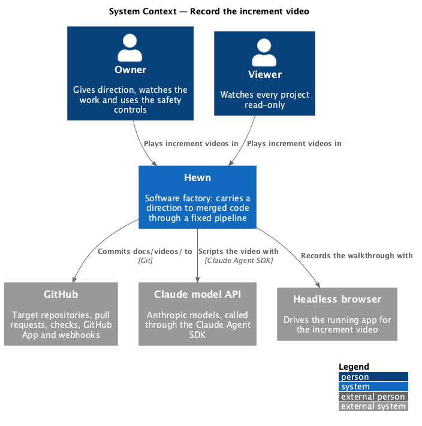
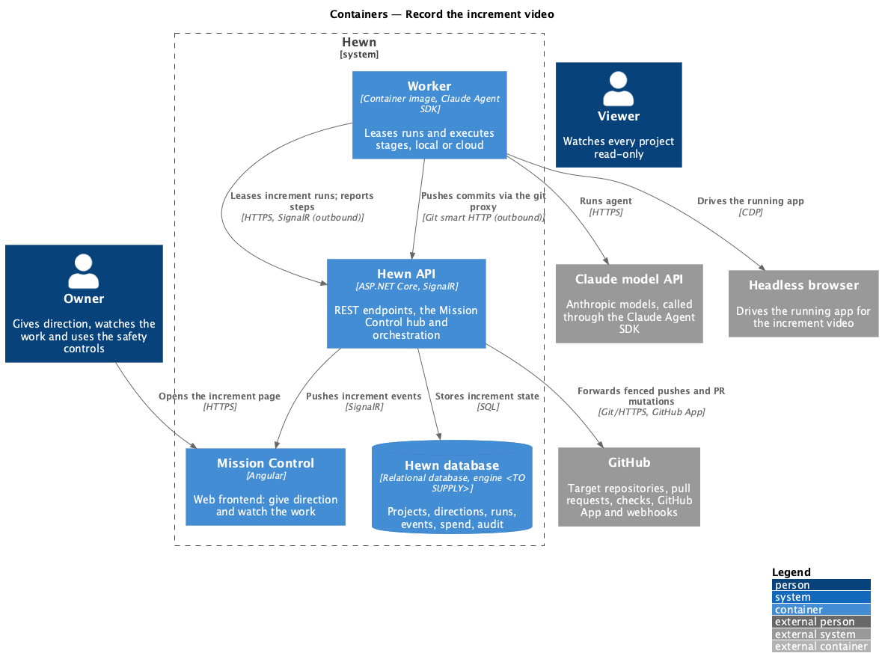
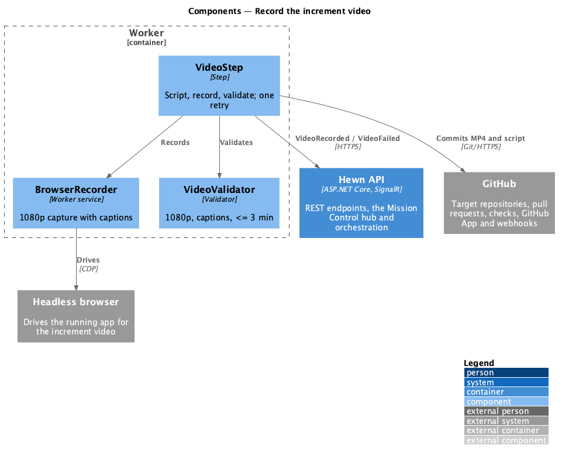
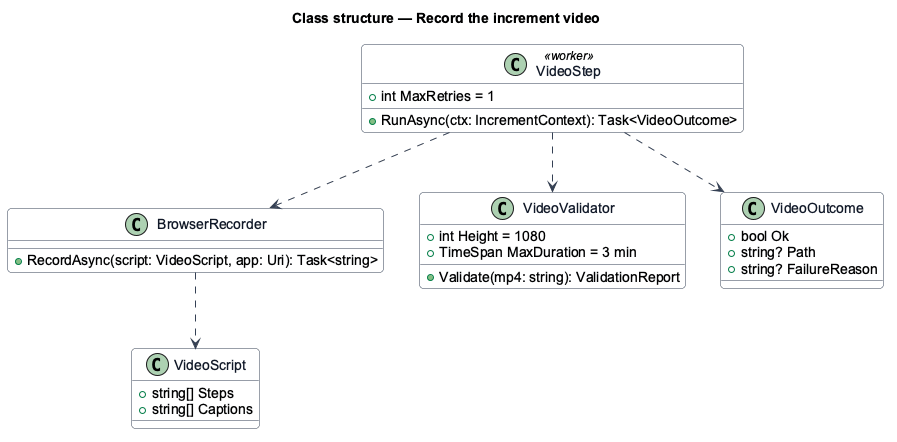
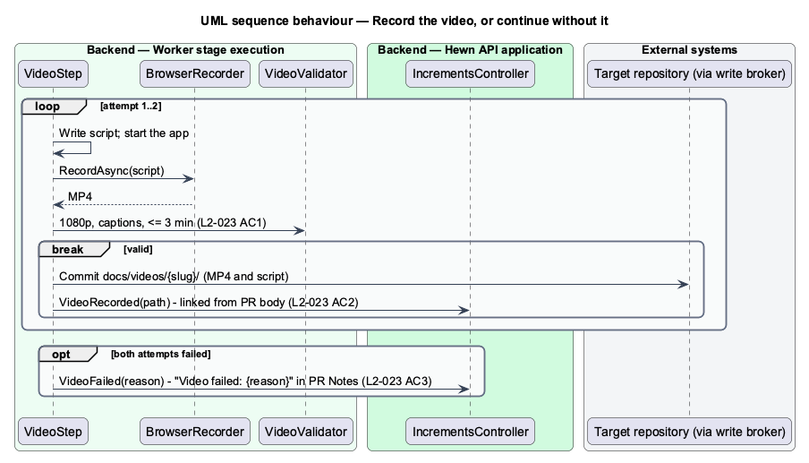

# Record the increment video

## Overview

Every green increment ends in a short video that shows it working. The video step uses the `creating-videos` skill to write a script, start the app, walk through the increment's journey in a headless browser, narrate it, and produce a captioned 1080p MP4 of 3 minutes or less. The MP4 and its script are saved under `docs/videos/{increment-slug}/`.

The pull request body links to the video, and Mission Control plays it on the increment page. A video failure does not stop the increment: the step is retried at most once, and if it still fails the increment goes on to its pull request with "Video failed: {reason}" in the PR Notes.

Terms used in this design:

- **walkthrough** — scripted path through the increment's journey in the running app

## Description

The slice is the Video step and the increment page's player.

- **`VideoStep (worker)`** — runs `StageAgent` with `creating-videos`, starts the app in the workspace, records with `BrowserRecorder`, and runs `VideoValidator`. It allows one retry.
- **`BrowserRecorder`** — headless browser plus ffmpeg capture at 1920×1080, with captions burned from the script.
- **`VideoValidator`** — checks resolution 1080p, captions present and duration of 3 minutes or less.
- **`IncrementVideoPlayer (Angular)`** — plays `docs/videos/{slug}/*.mp4` from the repository at the merge or branch SHA, with captions and full screen; shows the failure message when the step failed.

How the player serves an MP4 from a private repository (signed raw URL or proxied through the Hewn API) is <TO SUPPLY>.

## Requirements

The feature realizes the following level-2 (L2) requirements. Each L2 requirement refines the level-1 (L1) requirement cited beside it. The text is copied from `docs/specs/L2.md`.

| L2 ID | Refines (L1) | Requirement |
|-------|--------------|-------------|
| `L2-023` | `L1-013` | **Record the increment video.** 1. Given an increment passes its tests, when the video step runs with `creating-videos`, then a captioned 1080p MP4 of 3 minutes or less, walking through the increment's journey in the running app, is saved under `docs/videos/{increment-slug}/` along with its script. 2. Given the video, when the PR is opened, then the PR body links to it, and Mission Control plays it on the increment page. 3. Given video generation fails, when the step ends, then the increment continues to PR with "Video failed: {reason}" in the PR Notes, and the video step is not retried more than once. |

## Diagrams

### System context

Hewn records the walkthrough with a headless browser and stores the result in the project's repository.

### Containers

The worker records; Mission Control plays the stored file on the increment page.

### Components

Recording and validation are separate, so a too-long or caption-less video counts as a failure and uses the single retry.

### Class structure

`VideoOutcome` carries either the saved path or the failure reason that the PR step copies into Notes.

### Behaviour — record or fail the video

A valid video is saved with its script (L2-023 AC1) and linked from the PR (AC2). After one failed retry the increment continues with the failure in Notes (AC3).

