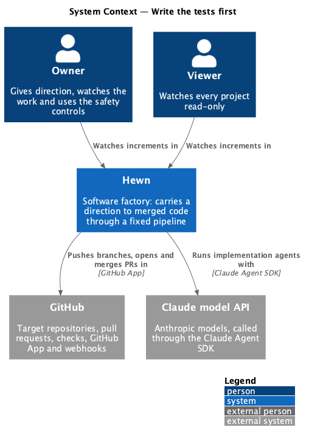
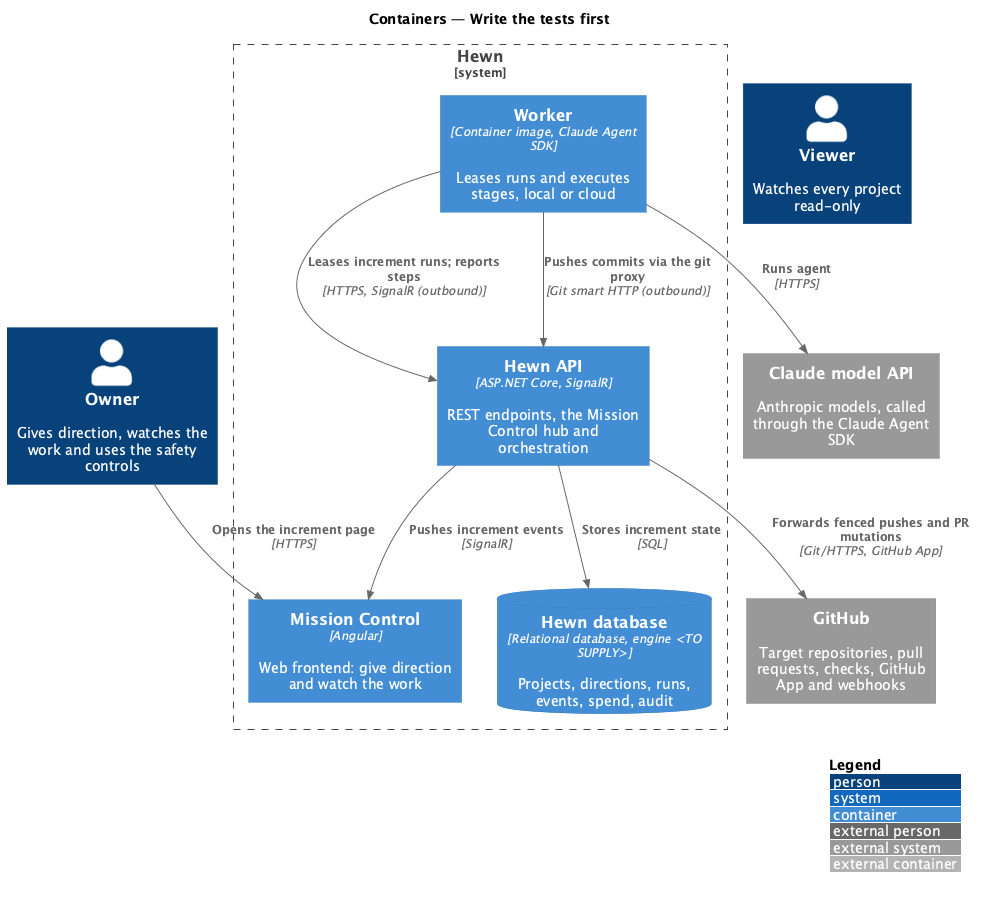
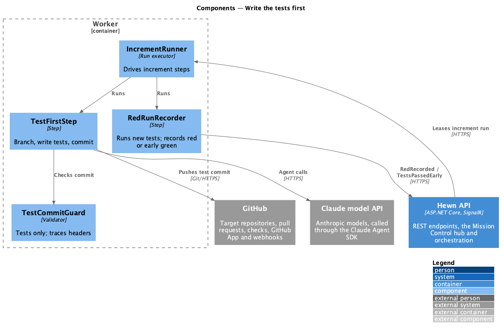
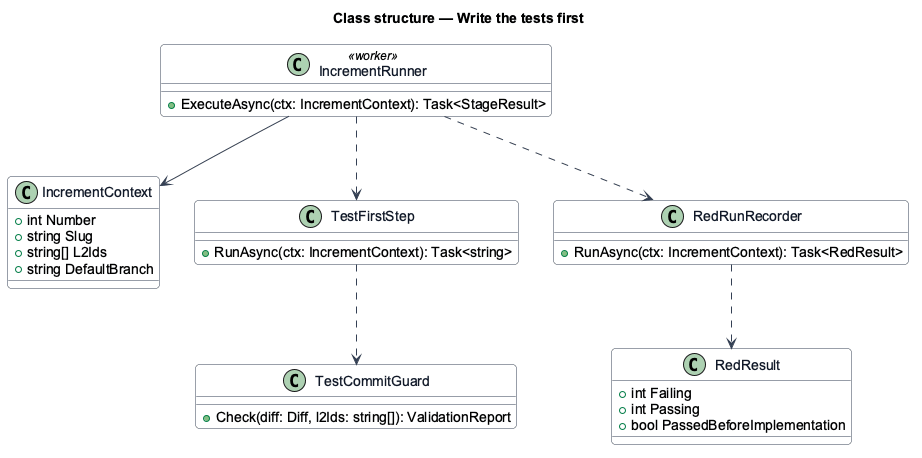
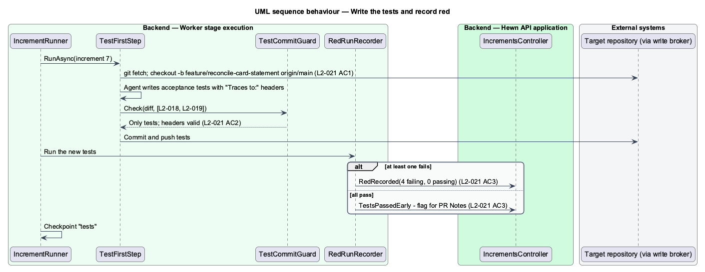

# Write the tests first

## Overview

Stage 10 delivers the backlog one increment at a time, and every increment starts with tests. The agent creates the branch `feature/{increment-slug}` from the latest default branch, writes acceptance tests for the increment's L2s, and commits them alone as the first commit. Each test file starts with a `Traces to: L2-xxx` header naming L2s in the increment.

The new tests then run once. At least one is expected to fail; the failing result is recorded on the increment as "red recorded". If every new test passes before any implementation, the increment is flagged "tests passed before implementation" and the flag appears in the pull request's Notes. The increment page shows this as the first two steps of its Test first timeline.

Terms used in this design:

- **increment slug** — kebab-case form of the increment title, such as `reconcile-card-statement`
- **red recorded** — increment state stating that at least one new acceptance test failed on the test commit
- **traces header** — first-line comment `Traces to: L2-xxx[, L2-yyy]` in a test file

## Description

The slice covers the first two steps of the increment run.

- **`IncrementRunner (worker)`** — stage-10 run executor. It drives the steps Test first, Implement, Video, Pull request and Merge, committing a checkpoint after each (L2-050).
- **`TestFirstStep`** — creates `feature/{increment-slug}` from `origin/{default}`, runs `StageAgent` with the `implementing-incrementally` skill restricted to test paths, and commits only test files.
- **`TestCommitGuard`** — rejects the commit if it contains any non-test file or any test file whose first line lacks a `Traces to:` header naming L2s in the increment.
- **`RedRunRecorder`** — runs the new tests, records `RedRecorded(failing, passing)` or `TestsPassedEarly`, and stores the result on the increment.
- **`IncrementTimeline (Angular)`** — Test first timeline on the increment page; shows "Red recorded" or "Tests passed before implementation".

## Requirements

The feature realizes the following level-2 (L2) requirements. Each L2 requirement refines the level-1 (L1) requirement cited beside it. The text is copied from `docs/specs/L2.md`.

| L2 ID | Refines (L1) | Requirement |
|-------|--------------|-------------|
| `L2-021` | `L1-013` | **Write the tests first.** 1. Given an increment starts, when the agent begins, then it creates the branch `feature/{increment-slug}` from the latest default branch. 2. Given the branch, when the first commit is made, then it contains only acceptance tests, each test file starting with a `Traces to: L2-xxx` header comment naming L2s in the increment. 3. Given the test commit, when the new tests run, then at least one fails. The failing result is recorded on the increment ("red recorded"). If all pass, the increment is flagged "tests passed before implementation" in the PR Notes. |

## Diagrams

### System context

Humans only watch; the agent works in GitHub with Claude.

### Containers

The worker creates the branch and the test commit and reports the red result to the Hewn API.

### Components

The guard runs before the push, so a commit that mixes tests and code never reaches the branch.

### Class structure

`RedResult` records counts and the early-green flag that the PR step copies into Notes.

### Behaviour — write tests and record red

The branch comes from the latest default branch (L2-021 AC1). The first commit holds only traced acceptance tests (AC2). The red run is recorded, or the early-green flag set (AC3).

## Decisions made while building the slice

- **`IncrementStageExecutor`** (`worker/src/executors/increment-executor.ts`) has one step, "Deliver increments",
  that asks the API for the next runnable increment until none is left; progress lives on the increment, so a
  resumed run picks up where the backlog stands.
- **Test files** are `*.spec.ts`, `*.test.ts`, `*Tests.cs` and scripts under `e2e/**/tests/`; the `Traces to:`
  header may sit anywhere in the first five lines, so the house header `// Acceptance Test` can come first.
- **A failed guard blocks the increment** (failing tests "Test commit: …") rather than failing the run, so the
  rest of the backlog still ships. Nothing is committed.
- **Red** is the stack's acceptance suite run on the new test files alone; counts are parsed from dotnet, vitest
  and Playwright output and stored as `RedFailing`/`RedPassing` on the increment with `TestsPassedEarly`.
- **Keys.** Commit keys carry the lease epoch (`{run}/e{epoch}/i{n}/tests`), so a resumed run commits its own work;
  pull request and merge keys do not, so a resume finds the same pull request.
- **Deferred:** the increment page timeline (journey 13).
