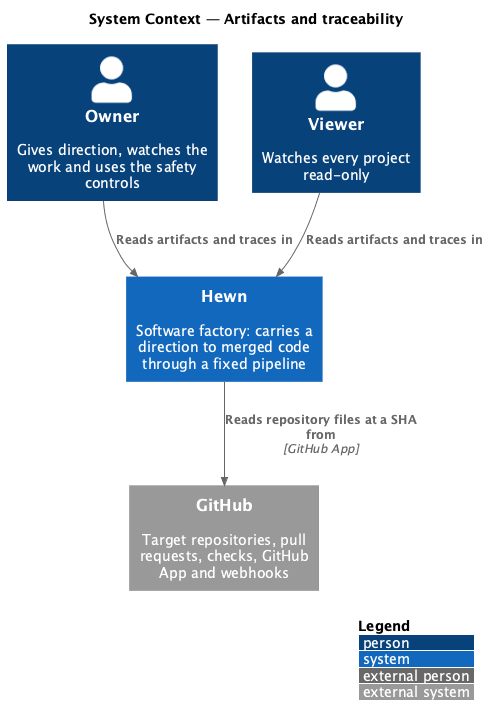
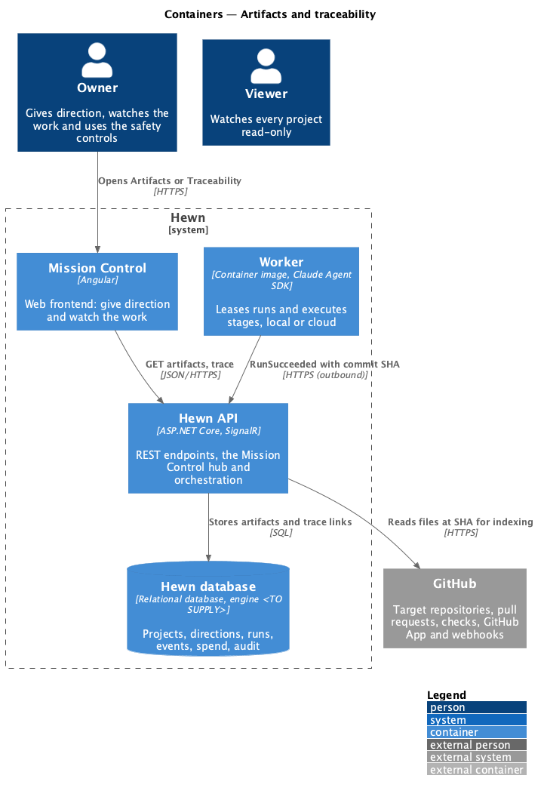
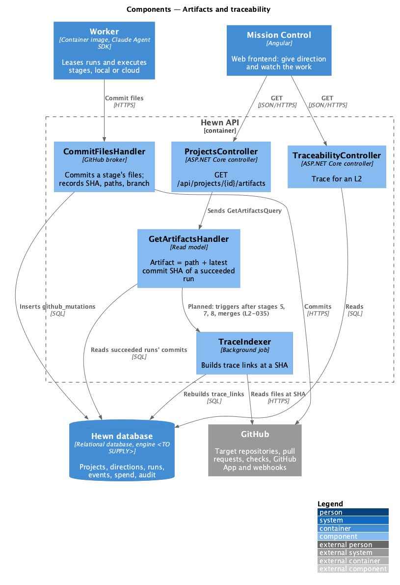
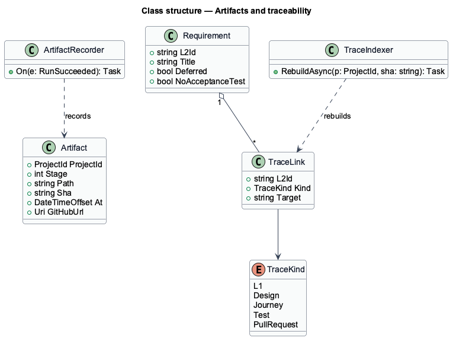
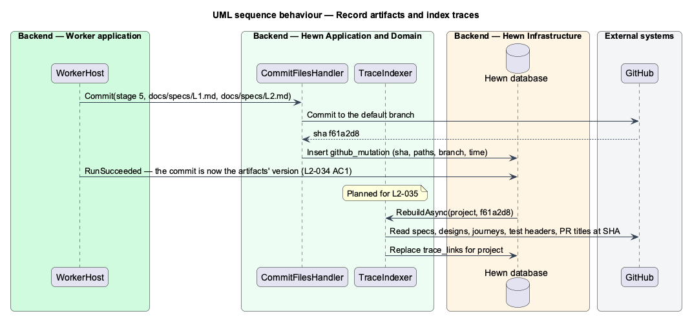
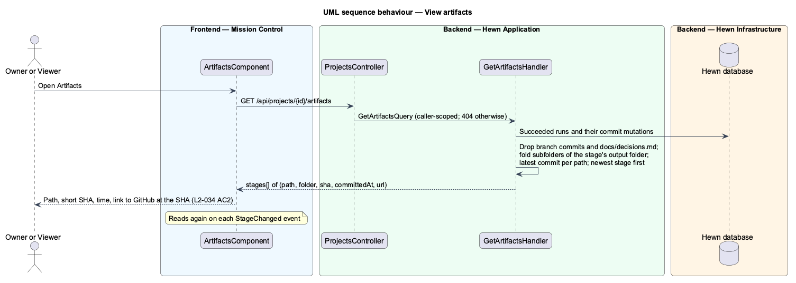
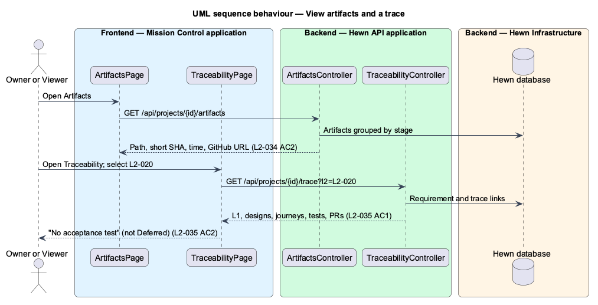

# Artifacts and traceability

## Overview

Every stage output is an *artifact*, and its version is the commit SHA in the target repository that holds it. The Artifacts tab lists each stage's artifacts with path, short SHA, time and a link to the file on GitHub at that SHA.

The Traceability tab answers "where does this requirement stand?" for any L2 ID. It shows the L2's parent L1, the designs that cover it, the journeys it appears in, the test files whose `Traces to:` header names it, and the pull requests whose titles name it. An L2 with no acceptance test is marked "No acceptance test", unless it is Deferred.

Terms used in this design:

- **artifact** — file or folder a stage writes to the target repository
- **artifact version** — commit SHA that holds the artifact
- **trace** — set of links from one L2 to its L1, designs, journeys, tests and pull requests

## Description

The slice is two read models fed by stage events and repository indexing.

- **`CommitFilesHandler`** — the GitHub broker that commits a stage's files. It records each commit's SHA, paths and branch in `github_mutations` against the run. No separate artifacts table is kept: once the run succeeds, that commit is the version of the files it holds (L2-034 AC1).
- **`GetArtifactsHandler`** — `GET /api/projects/{id}/artifacts` reads the commits that succeeded runs made to the default branch and returns each stage's artifacts, newest stage first. Each path's version is the latest such commit. A failed run's commits are ignored, so a retry's commit becomes the version. Commits to `hewn/scaffold` or `feature/*` branches are not listed. The decision log every stage appends to (`docs/decisions.md`) has its own tab, so it is left out. Files in a subfolder of the stage's output folder (`CommitPolicy`) fold into that subfolder, such as `docs/mocks/statements/`, and link as a tree.
- **`ArtifactsComponent (Angular)`** — `hw-artifacts` on the Artifacts tab (`/projects/{id}/artifacts`). It groups artifacts by stage, newest stage first, and each row shows the path, short SHA and time, and links to `https://github.com/{repo}/blob/{sha}/{path}` (`tree` for a folder). It reads the artifacts again on each `StageChanged` event and has loading, empty and error states.
- **`TraceIndexer`** — after stages 5, 7, 8 and each increment merge, parses `docs/specs/`, `docs/detailed-designs/*/README.md`, `docs/journeys.md`, test file headers and merged PR titles at the new SHA, and rebuilds the `trace_links` table for the project.
- **`TraceabilityController`** — `GET /api/projects/{id}/trace?l2=` returns the L2 list and the trace for one ID, including `Deferred` and `NoAcceptanceTest` flags.
- **`TraceabilityPage (Angular)`** — searchable L2 list with markers for no test and Deferred, and the trace panel with five groups.

## Requirements

The feature realizes the following level-2 (L2) requirements. Each L2 requirement refines the level-1 (L1) requirement cited beside it. The text is copied from `docs/specs/L2.md`.

| L2 ID | Refines (L1) | Requirement |
|-------|--------------|-------------|
| `L2-034` | `L1-017` | **Versioned artifacts.** 1. Given a stage writes files, when it succeeds, then the artifact version is the commit SHA in the target repository that holds them. 2. Given a project, when a user opens Artifacts, then each stage lists its artifacts with path, version (short SHA), time and a link to the file on GitHub at that SHA. |
| `L2-035` | `L1-017` | **Traceability view.** 1. Given an L2 ID, when a user opens it in Mission Control, then they see its L1, the designs that cover it, the journeys it appears in, the test files whose `Traces to:` header names it, and the PRs whose titles name it. 2. Given an L2 with no test, when it is shown, then it is marked "No acceptance test", unless it is Deferred. |

## Diagrams

### System context

Users read artifacts and traces in Hewn; Hewn reads the underlying files from GitHub.

### Containers

Workers commit through the Hewn API's GitHub broker, which records each commit's SHA. The Hewn API derives artifacts from those records and will index traces at that SHA.

### Components

Indexing runs after the stages that change traced files, so the trace always reflects a real commit.

### Class structure

A `Requirement` has `TraceLink`s of five kinds. `NoAcceptanceTest` is true when there is no `Test` link and the requirement is not `Deferred`.

### Behaviour — record artifacts and index traces

The artifact version is the commit SHA the broker recorded for a run that succeeded (L2-034 AC1). Traces will be rebuilt at that SHA (L2-035).

### Behaviour — view artifacts

The handler keeps only succeeded runs' commits to the default branch, folds subfolders and takes the latest commit per path (L2-034 AC2).

### Behaviour — view artifacts and a trace

Artifacts list path, short SHA, time and GitHub link per stage (L2-034 AC2). An L2's trace shows L1, designs, journeys, tests and PRs (L2-035 AC1), marked "No acceptance test" unless Deferred (AC2).

