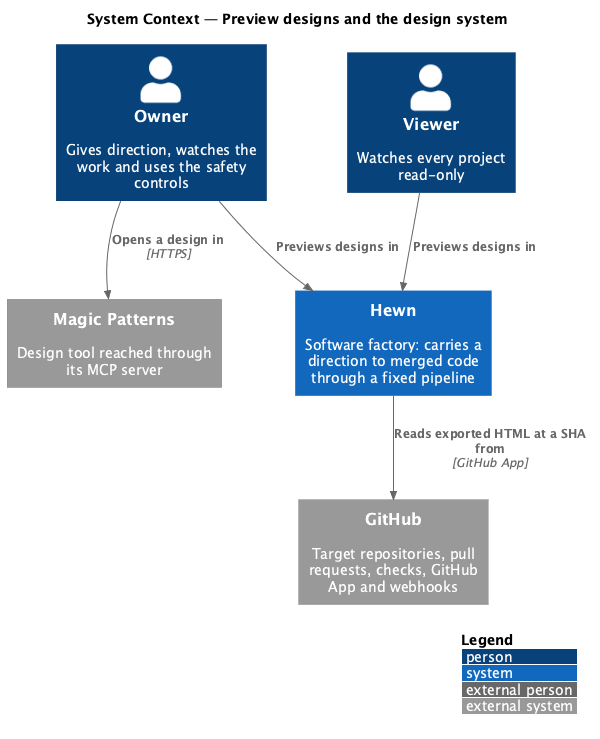
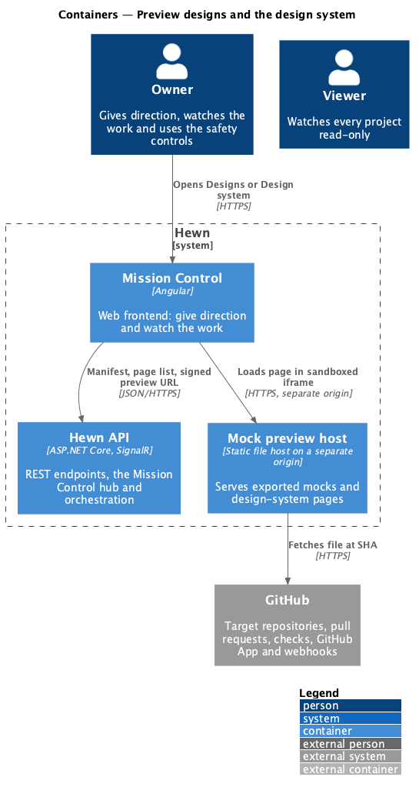
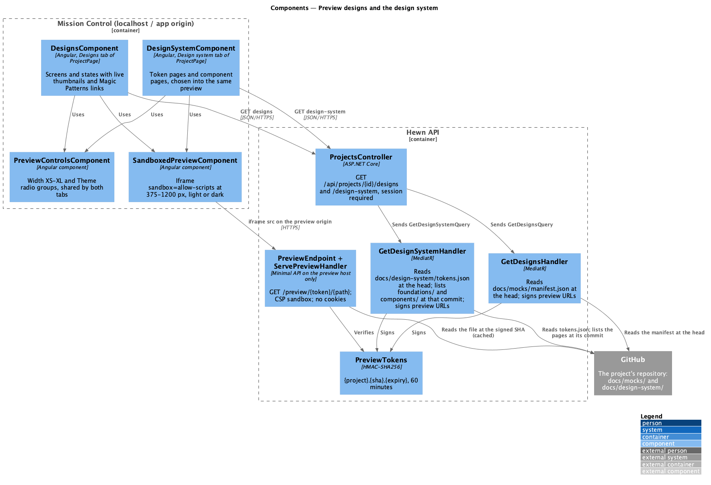
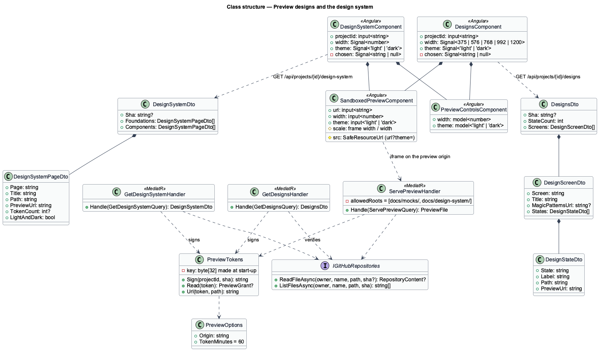
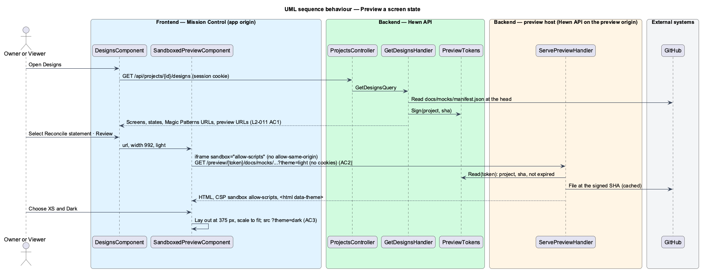
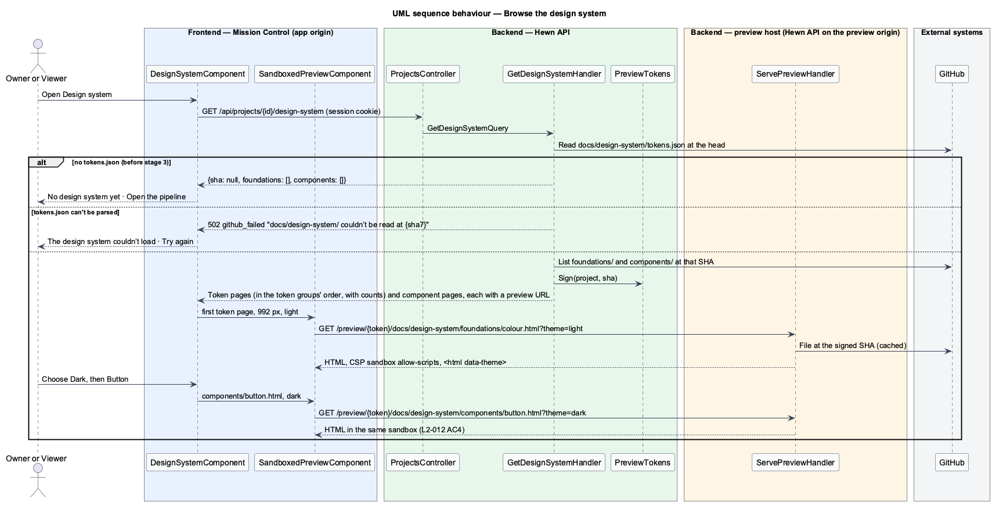

# Preview designs and the design system

## Overview

Stages 2 and 3 produce HTML: exported mocks in `docs/mocks/` and design-system pages in `docs/design-system/`. Mission Control lets users look at them without leaving the project. The Designs tab lists every screen and state with a thumbnail and an "Open in Magic Patterns" link; the Design system tab lists the token and component pages.

Both tabs show the selected page in the same preview. Because the HTML came from a generated design, the preview treats it as untrusted: it is served from a separate origin inside a sandboxed iframe that cannot read Mission Control's cookies or storage. The user can switch the preview between XS (375), S (576), M (768), L (992) and XL (1200) widths and between Light and Dark, and the iframe resizes and switches theme to match.

Terms used in this design:

- **preview origin** — separate host, such as `mocks.hewn.dev`, that serves project HTML for previews
- **sandboxed iframe** — iframe with `sandbox="allow-scripts"` and no `allow-same-origin`

## Description

The slice spans the project page's Designs tab, a shared preview component, the designs endpoint and the preview
host. Journey 14 built the Designs tab (L2-011); journey 15 built the Design system tab (L2-012 AC4) on the same
preview and host.

- **`DesignsComponent`**: the Designs tab of `ProjectPage`, route `/projects/:projectId/designs`. It reads
  `GET /api/projects/{id}/designs` and lists screens and states, each with a thumbnail and an Open in Magic Patterns
  link to the screen's `magicPatternsUrl`. It holds the chosen state, width and theme.
- **`DesignSystemComponent`**: the Design system tab of `ProjectPage`, route `/projects/:projectId/design-system`.
  It reads `GET /api/projects/{id}/design-system` and lists the token pages under Foundations and the component
  pages under Components, with a caption such as "6 foundations · 7 components · docs/design-system/ at 8e2290a".
  The chosen page opens in the same preview, titled with its token count ("Colour · 38 tokens, light and dark").
- **`PreviewControlsComponent`**: the Width and Theme radio groups, shared by both tabs.
- **`SandboxedPreviewComponent`**: the iframe on the preview origin, `sandbox="allow-scripts"` with no
  `allow-same-origin`. It is laid out at exactly the chosen width and scaled to fit the frame. The theme is passed
  as `?theme=light|dark`.
- **`GetDesignsHandler`**: reads `docs/mocks/manifest.json` at the default branch's head (stage 2's
  `{screens: [{screen, feature, magicPatternsUrl, states}]}`). It returns each state's label, path and a preview
  URL signed by `PreviewTokens` for that commit.
- **`GetDesignSystemHandler`**: reads `docs/design-system/tokens.json` at the default branch's head, then lists the
  `.html` files directly under `foundations/` and `components/` at that commit (`IGitHubRepositories.ListFilesAsync`).
  Token pages come in the order of L2-012 AC1's groups (colour, typography, spacing, radius, elevation, motion), each
  with its group's token count; components come by name. Every page gets a URL signed for that commit.
- **`PreviewTokens`**: signs `{project}.{sha}.{expiry}` with HMAC-SHA256 under a key made at start-up, and checks
  it. Links last 60 minutes.
- **`PreviewEndpoint` and `ServePreviewHandler`**: the preview host. `GET /preview/{token}/{path}` exists only on
  the host of `Hewn:Preview:Origin`. It serves paths under `docs/mocks/` and `docs/design-system/` at the signed
  SHA, read from GitHub and cached, with `Content-Security-Policy: sandbox allow-scripts`, no cookies, and the
  theme set on `<html data-theme>`.
- **Thumbnails**: each state's own page, small, in the same sandboxed frame. It loads lazily and replaces the
  design's `ThumbnailRenderer` (ADR 0018).

## Requirements

The feature realizes the following level-2 (L2) requirements. Each L2 requirement refines the level-1 (L1) requirement cited beside it. The text is copied from `docs/specs/L2.md`.

| L2 ID | Refines (L1) | Requirement |
|-------|--------------|-------------|
| `L2-011` | `L1-005` | **Preview designs in Mission Control.** 1. Given a project with designs, when a user opens Designs, then a gallery lists each screen and state with a thumbnail and an "Open in Magic Patterns" link. 2. Given an exported mock is opened, when it renders, then it is served from a separate origin inside a sandboxed iframe that cannot read Mission Control's cookies or storage. 3. Given the preview, when the user picks XS (375), S (576), M (768), L (992) or XL (1200) and Light or Dark, then the iframe resizes and switches theme to match. |
| `L2-012` | `L1-006` | **Extract the design system.** 1. Given stage 3 runs with `extracting-design-systems` on the exported Magic Patterns mocks, when it completes, then `docs/design-system/` contains tokens for colour (light and dark), typography, spacing, radius, elevation and motion, plus one page per component. 2. Given the mocks, when stage 3 validates, then every colour value used in `docs/mocks/` matches a token, and any that doesn't is listed and fails the run. 3. Given Magic Patterns holds design-system settings for the project (such as theme or tokens), when stage 3 runs, then the extracted tokens match them, and any mismatch is listed in the run log. 4. Given a project with a design system, when a user opens Design system in Mission Control, then the token and component pages can be browsed in the same sandboxed preview as L2-011. |

L2-012 AC1 to AC3 are realized by [Extract the design system](../../stages/extract-design-system/README.md); this design realizes AC4.

## Diagrams

### System context

Users preview designs inside Hewn and jump to Magic Patterns to edit them; Hewn reads the exported HTML from GitHub.

### Containers

The preview host is a separate container on a separate origin, so project HTML never runs on Mission Control's origin.

### Components

Both pages reuse one `SandboxedPreview`, which gives the design system the same isolation as the mocks (L2-012 AC4).

### Class structure

`SandboxedPreview` holds width and theme as signals; its `src` comes from a signed URL that the preview host accepts only for the two allowed roots. A preview link lasts 60 minutes (`Hewn:Preview:TokenMinutes`; ADR 0018).

### Behaviour — preview a screen state

The gallery lists screens and states with thumbnails and Magic Patterns links (L2-011 AC1); the page loads from a separate origin in a sandbox (AC2); width and theme controls resize and re-theme it (AC3).

### Behaviour — browse the design system

The tab reads the token and component pages at the head and opens them in the same sandboxed preview, in light or dark (L2-012 AC4).

## Decisions made while building the slice

- **The preview host is the API on another host name** (ADR 0018). The route is mapped with `RequireHost` for
  `Hewn:Preview:Origin`, so on Mission Control's host it doesn't exist. Locally and in e2e the origin is
  `127.0.0.1:{port}` while Mission Control is on `localhost`. Cookies are kept per host, so none reach the preview.
- **A token covers a commit, not a file.** One token per designs read signs the project and the manifest's SHA, so
  a mock's relative links to its CSS or another state still work. Paths with empty, `.` or `..` segments, or
  outside the two roots, are 404, and so are tampered or expired tokens.
- **Pinned to the commit.** A preview shows the files as they were when the designs were read, even after a newer
  commit; reading the designs again moves to the head.
- **Theme by `data-theme`.** The exported mocks theme by `<html data-theme>`, as Hewn's own do. The host adds it
  for `?theme=light|dark`, so a mock needs no script to follow the control.
- **The states.**
  - Loading is the mock's skeleton.
  - A project without a repository or manifest gets "No designs yet", with Open the pipeline.
  - An unreadable manifest is `502 github_failed` titled "docs/mocks/manifest.json couldn’t be read at
    {sha7}". The page shows it with Try again. The error mock's Open in Magic Patterns becomes Open the pipeline,
    because no Magic Patterns link can be read without the manifest.
- **Controls are radio groups.** Width and theme are `role="radio"` buttons, with arrow keys moving within each
  group. The selection lives in the page, not the URL.
- **Read on open.** The tab reads the designs when it opens and on Try again. It doesn't follow events, because
  every read signs new links and would reload the frames.
- **The design system has no manifest; its folders are the list.** Stage 3 always writes `tokens.json` (its
  validator requires it), so a project has a design system when that file exists at the head. Token pages are the
  files under `foundations/` and component pages the files under `components/`, read at the commit `tokens.json` was
  read at, so one signed token covers them and their relative links. Other folders, such as `patterns/`, are not
  listed.
- **Token counts come from `tokens.json`.** A token page whose name is a DTCG group (or a common alias, such as
  `colour` or `shape`) shows how many tokens the group holds; a group with `light` and `dark` counts one theme and
  says "light and dark".
- **Design system states.** "No design system yet", with Open the pipeline, before stage 3; an unparseable
  `tokens.json`, or GitHub failing to list the folders, is `502 github_failed` titled "docs/design-system/ couldn’t
  be read at {sha7}", shown with Try again and Open the pipeline.
