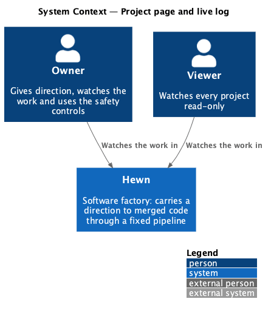
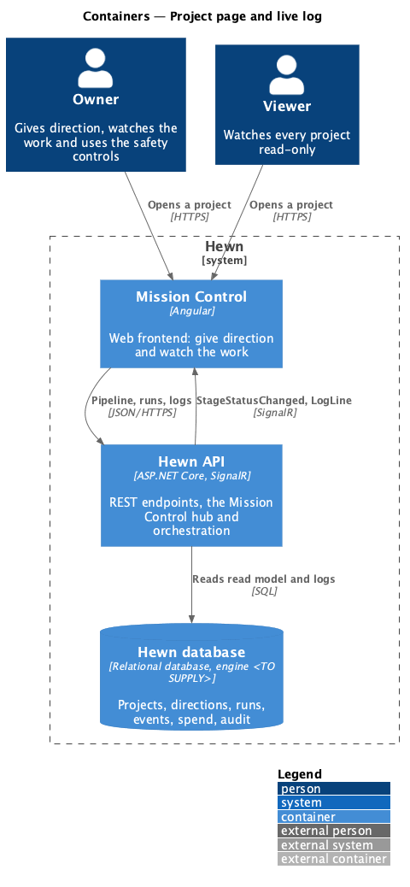
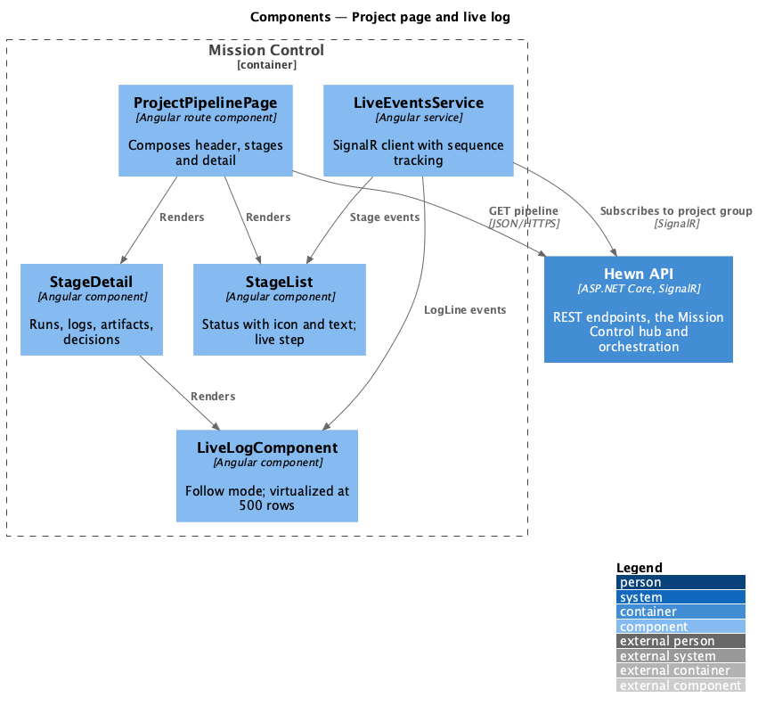
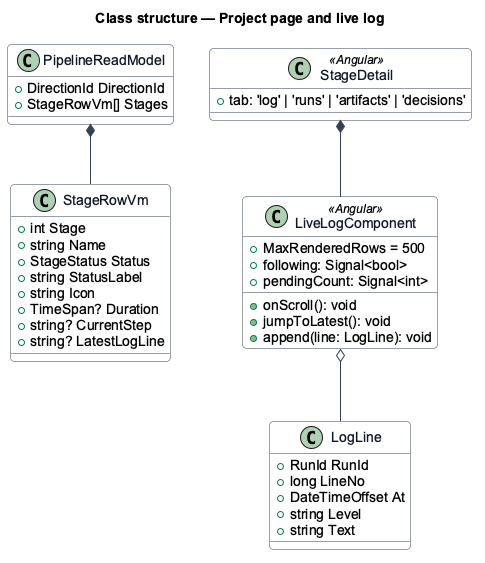
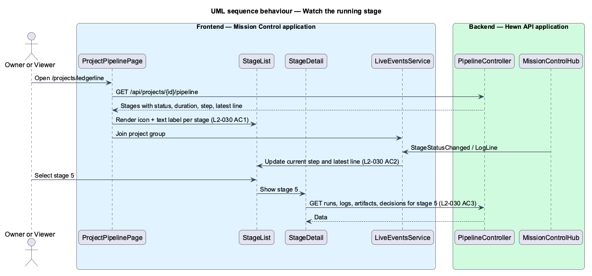
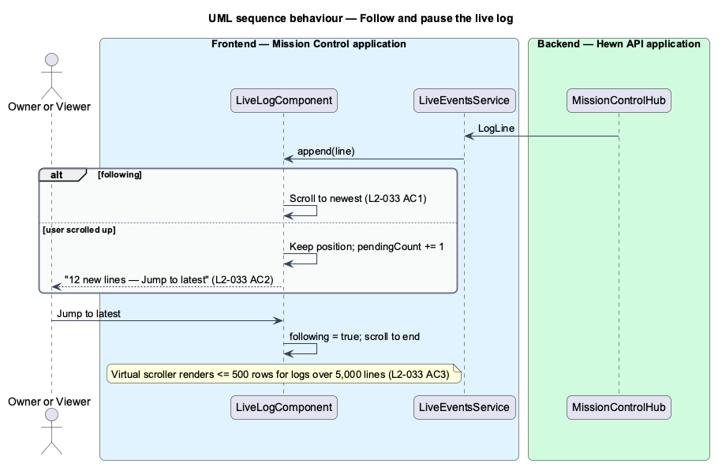

# Project page and live log

## Overview

The project page is where a user watches one direction move through the pipeline. It lists every stage with its status, duration, and an icon plus a text label for the status, never colour alone. The running stage shows its current step and latest log line, both updating live. Selecting a stage shows its runs, logs, artifacts and decisions.

The log view streams new lines as they arrive and follows the newest one. If the user scrolls up, the view stays put and offers "{n} new lines — Jump to latest". Logs longer than 5,000 lines are virtualized so no more than 500 line elements are in the DOM at once.

Terms used in this design:

- **stage detail** — right-hand (or lower, on small screens) panel for the selected stage: meta, increment card, and the Log, Runs, Artifacts and Decisions tabs
- **follow mode** — log state in which the view scrolls with each new line

## Description

The slice is a set of Angular components over a pipeline read model and the log stream.

- **`ProjectPipelinePage`** — route `/projects/:id`. Composes `ProjectHeader`, `StageList` and `StageDetail`, and subscribes to the project's hub group.
- **`StageList`** — eleven stage rows with status icon, number, name, duration and a visually hidden status label; the running row adds the live step and latest log line. Vertical list below 576 px, horizontal scrollable stepper at 576–991 px, side by side with the detail at 992 px and up (L2-046).
- **`StageDetail`** — meta (skill, output, duration, worker), the increment card for stage 10, and tabs Log, Runs, Artifacts and Decisions loaded on demand.
- **`LiveLogComponent`** — virtualized log viewer using a fixed-height row virtual scroller that renders at most 500 rows. It tracks follow mode and counts lines that arrive while the user is scrolled up.
- **`RunLogsController`** — `GET /api/runs/{id}/logs?after={line}` pages lines for catch-up; new lines arrive as `LogLine` events.
- **`PipelineReadModel`** — API projection of stage states, durations, current step and latest log line per direction.

## Requirements

The feature realizes the following level-2 (L2) requirements. Each L2 requirement refines the level-1 (L1) requirement cited beside it. The text is copied from `docs/specs/L2.md`.

| L2 ID | Refines (L1) | Requirement |
|-------|--------------|-------------|
| `L2-030` | `L1-016` | **Project page.** 1. Given a project, when a user opens it, then a pipeline shows every stage with its status, duration and an icon plus a text label for each status (never colour alone). 2. Given a stage is Running, when its status is shown, then the current step and the latest log line are visible and update live. 3. Given a stage, when the user selects it, then its runs, logs, artifacts and decisions (L2-054) are shown. |
| `L2-033` | `L1-016` | **Live log stream.** 1. Given a running run, when a user opens its log, then new lines appear as they arrive, and the view follows the newest line. 2. Given the user scrolls up, when new lines arrive, then the view stays where it is and shows "{n} new lines — Jump to latest". 3. Given a log of more than 5,000 lines, when it is displayed, then it is virtualized, so no more than 500 line elements are in the DOM at once. |

## Diagrams

### System context

Owners and Viewers both watch the project page; nothing outside Hewn is involved.

### Containers

Mission Control loads the pipeline once and then receives stage and log events over SignalR.

### Components

The live service feeds both the stage list and the log, so the latest log line in the list and the log view never disagree.

### Class structure

`StageRowVm` always carries a text `StatusLabel` and an `Icon`; `LiveLogComponent` caps rendered rows at 500.

### Behaviour — watch the running stage

Each stage shows status, duration, icon and text (L2-030 AC1); the running stage's step and latest line update live (AC2); selecting a stage loads its runs, logs, artifacts and decisions (AC3).

### Behaviour — follow and pause the log

New lines follow the newest (L2-033 AC1). Scrolled up, the view stays and counts new lines (AC2). Long logs keep at most 500 rows in the DOM (AC3).

## Decisions made while building the slice

Journey 3 built L2-030, L2-033 and L2-047 AC3. See [ADR 0009](../../../adr/0009-live-progress-from-the-worker.md).

- **One page component.** `ProjectPage` holds the stage list and the stage detail; `StageList` and `StageDetail`
  stayed template sections rather than components. `LiveLogComponent` (`hw-live-log`) is its own component.
- **Selection.** A stage row is a link to `?stage={n}` (replacing the history entry). With no `?stage=`, the detail
  follows the running stage, else the first pending one, else the last. The selected row carries
  `aria-current="step"`, as in the mocks.
- **Live step and line.** `StepStarted` and `LogLines` set the stage's `step` and `latestLine`; `StageChanged`
  clears them. The running row shows them in `.stage__live`.
- **Detail.** `GET /api/projects/{id}/directions/{d}/stages/{n}` loads the runs, artifacts and decisions, and is
  reloaded (at most every 250 ms) when an event touches the stage. Meta shows the stage's skill and output, its
  duration and the newest run's worker, or "Not leased yet". The tabs follow the WAI-ARIA tabs pattern (arrow keys,
  Home, End). Artifacts use the `files` list and decisions the `decision` list from the Artifacts and Decisions
  page mocks.
- **The log.** `RunLogsController` became `GET /api/projects/{id}/runs/{r}/logs?after=&limit=`, scoped to the
  project. The page loads every stored line in pages of 5,000 and merges `LogLines` events by line number, so a
  live line that arrives before its page is neither lost nor repeated. Above 500 lines the log renders a window of
  at most 500 rows; windowed lines keep to one row so the row height is exact. Following, the window ends at the
  newest line; scrolled up, new lines add to "{n} new lines — Jump to latest".
- **Notices.** A pending stage with no started run says "Waiting for a worker" (the direction's first stage) or
  "Not started"; a skipped stage says so.
- **States.** Loading shows the mock's skeleton; a failed load other than 404 shows "The pipeline couldn’t load"
  with Try again; 404 keeps "Project not found".
- **Announcements (L2-047 AC3).** Stage changes go to a polite live region, throttled to one every 5 seconds per
  page (leading and trailing; the latest change wins).
- **Not built yet:** the increment card on stage 10 (with journey 13, Follow an increment to merge) and the stepper layout
  at 576–991 px (L2-046).

