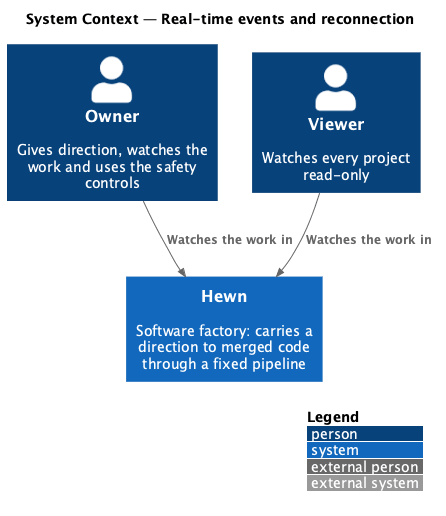
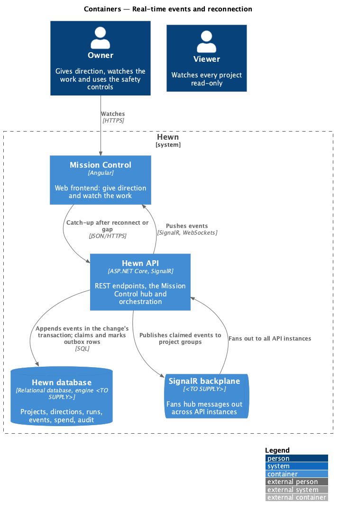
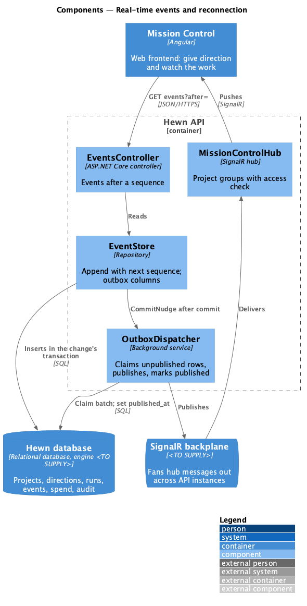
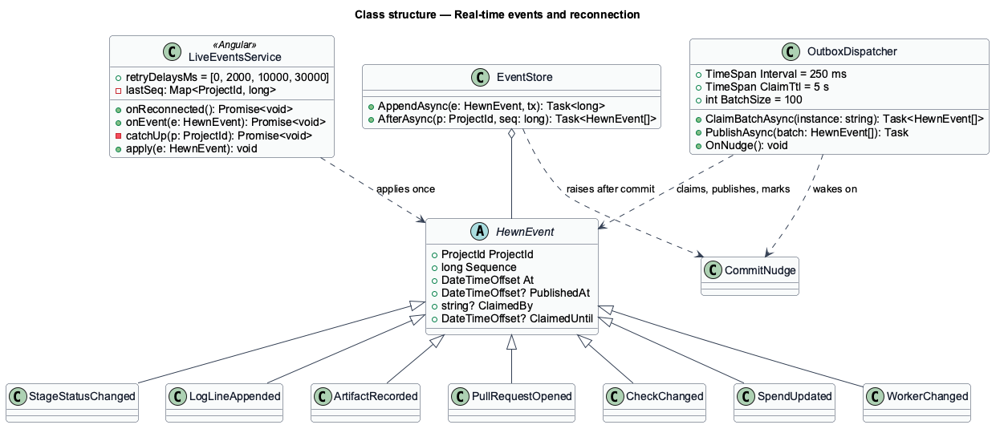
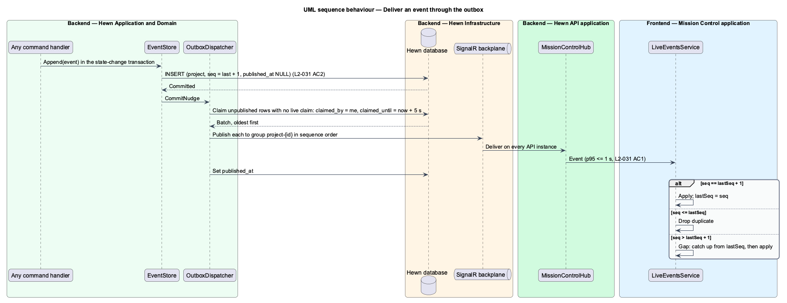
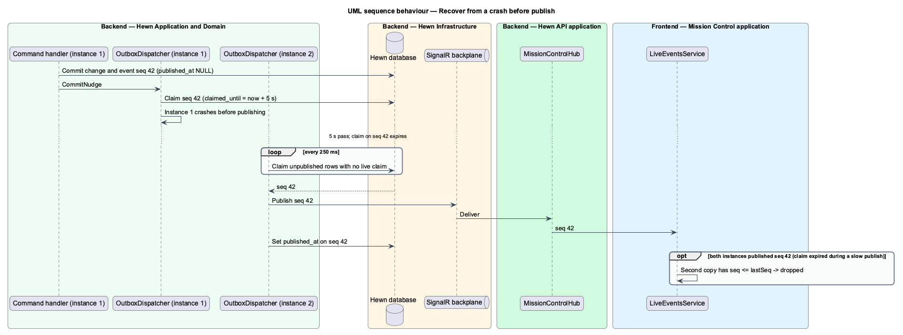
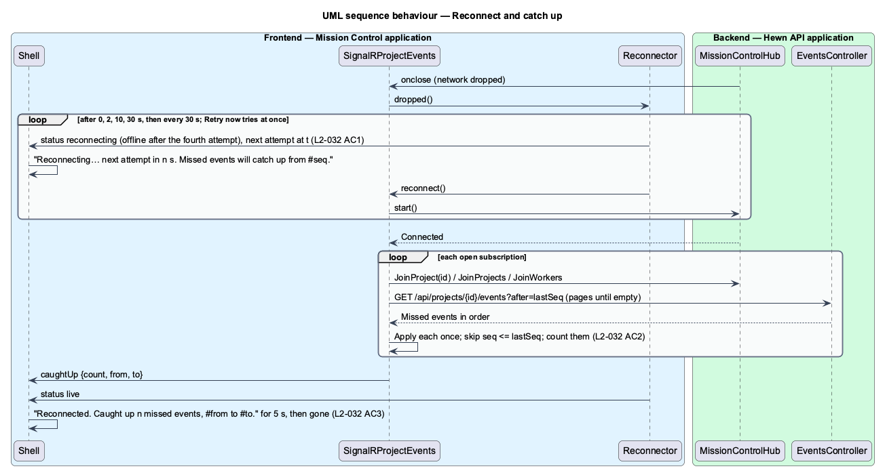

# Real-time events and reconnection

## Overview

Mission Control never needs a manual refresh. Every stage status change, log line, artifact, pull request, check status, spend update and worker status change is sent as a SignalR event to subscribed clients with a p95 latency of 1 second or less. Each event carries a per-project sequence number that increases by one.

An event is written in the same database transaction as the change it describes, and a dispatcher publishes it afterwards from that table: the events table is an *outbox*. A crash between the commit and the publish therefore loses nothing; the next dispatcher on any API instance picks the row up. Delivery is at least once, and clients drop duplicates by sequence number.

Connections drop. When the client notices, it shows a "Reconnecting…" banner and retries after 0, 2, 10 and 30 seconds, then every 30 seconds. On reconnect it resubscribes, fetches every event after its last sequence number, applies each once, and the screen then matches a fresh page load. The banner disappears when catch-up finishes.

Terms used in this design:

- **event** — persisted, typed record of one change, delivered to clients over SignalR
- **sequence number** — per-project counter stamped on each event, increasing by one
- **catch-up** — fetching and applying the events a client missed while disconnected or after a gap
- **outbox** — the events table as read by the dispatcher; a row stays unpublished until a dispatcher has sent it and marked it

## Description

The slice spans the event store, the outbox dispatcher, the hub, the backplane and the client service.

- **`EventStore`** — append-only `events` table keyed by `(project_id, sequence)` with the outbox columns `published_at`, `claimed_by` and `claimed_until`. `Append` assigns the next sequence inside the same transaction as the state change, so sequence order equals commit order, and raises `CommitNudge` once the transaction commits.
- **`OutboxDispatcher`** — background service on every API instance. It wakes every 250 ms, or at once on a `CommitNudge`, and claims a batch of unpublished rows whose claim is absent or expired by setting `claimed_by` and `claimed_until = now + 5 s` in one conditional update. It publishes each claimed event to its project's hub group through the backplane in sequence order, then sets `published_at`. A dispatcher that crashes mid-batch leaves claims that expire within 5 seconds and are taken by any other instance. The batch size and the claim TTL are tuning values; 100 rows and 5 seconds are the starting points.
- **`CommitNudge`** — in-process signal raised after each commit that wakes the local dispatcher, so the common path adds no polling delay toward the 1-second target; the 250 ms poll is the fallback that catches nudges lost to a crash.
- **`MissionControlHub`** — SignalR hub. `JoinProject(id)` checks access (L2-039) before adding the connection to the group.
- **`EventsController`** — `GET /api/projects/{id}/events?after={seq}` returns missed events in order for catch-up.
- **`LiveEventsService (Angular)`** — single SignalR connection with the retry schedule `[0, 2000, 10000, 30000]` then 30 s. It keeps `lastSeq` per project: an event with `seq <= lastSeq` is dropped as a duplicate, `seq == lastSeq + 1` is applied, and `seq > lastSeq + 1` means a gap, so the service fetches `after=lastSeq` from `EventsController` and applies the result in order before continuing.
- **`ConnectionBanner (Angular)`** — shows "Reconnecting… next attempt in {n} s" while disconnected and "Reconnected. Caught up {n} missed events" briefly after catch-up.

The 1-second p95 target holds at 200 events per second across all projects (L2-045 AC3); the load test for it is described in [Responsive, accessible and themed UI](../responsive-accessible-ui/README.md). The dispatcher exports `hewn_outbox_unpublished` and `hewn_outbox_lag_seconds` so a stuck outbox is visible (L2-049 AC3).

Ordering holds per project: a dispatcher publishes one project's rows in sequence order, and a client applies them only in order. Two instances may publish the same row when a claim expires during a slow publish; the client's duplicate rule makes that harmless. Rows older than 7 days with `published_at` set are purged by a nightly job; the retention period is a tuning value.

## Requirements

The feature realizes the following level-2 (L2) requirements. Each L2 requirement refines the level-1 (L1) requirement cited beside it. The text is copied from `docs/specs/L2.md`.

| L2 ID | Refines (L1) | Requirement |
|-------|--------------|-------------|
| `L2-031` | `L1-016` | **Real-time events.** 1. Given a stage status change, log line, artifact, PR, check status, spend update or worker status change, when it happens, then a SignalR event reaches subscribed clients with a p95 latency of 1 second or less. 2. Given each event, when it is sent, then it carries a per-project sequence number that increases by one. |
| `L2-032` | `L1-016` | **Reconnect without losing events.** 1. Given the SignalR connection drops, when the client notices, then it shows a "Reconnecting…" banner and retries after 0, 2, 10 and 30 seconds, then every 30 seconds. 2. Given the client reconnects, when it resubscribes, then it fetches every event after its last sequence number, applies each once, and the screen matches a fresh page load. 3. Given the connection comes back, when catch-up finishes, then the banner disappears. |

## Diagrams

### System context

Every user of Mission Control receives events; no external system is involved.

### Containers

Events are committed with the change, then a dispatcher reads them back from the database and publishes through the backplane so every API instance can push them to its connected clients.

### Components

The store's `CommitNudge` wakes the local dispatcher for low latency; the dispatcher's claim-and-mark cycle on the database is what makes delivery survive a crash. The hub refuses a group join for a project the user cannot access, and the catch-up endpoint reads the same store the dispatcher publishes from.

### Class structure

Seven event types share `HewnEvent`'s `ProjectId`, `Sequence` and outbox columns. `OutboxDispatcher` claims, publishes and marks rows; the client applies each sequence once and fills gaps.

### Behaviour — deliver an event

Each change becomes a sequenced event in the change's own transaction (L2-031 AC2). The nudged dispatcher publishes it within 1 second p95 (AC1) and marks it published only after the backplane has accepted it.

### Behaviour — recover from a crash before publish

An API instance commits an event and crashes before publishing it. The row stays unpublished, its claim expires within 5 seconds, and another instance's dispatcher publishes it on its next poll, so connected clients cannot stay stale beyond a few seconds.

### Behaviour — reconnect and catch up

The banner appears and retries follow 0, 2, 10, 30 s then every 30 s (L2-032 AC1). After reconnecting, missed events are applied once (AC2) and the banner clears (AC3).

## Decisions made while building the slice

Journey 3 built L2-031 for stage, step, log and decision events. See
[ADR 0009](../../../adr/0009-live-progress-from-the-worker.md).

- **Event types so far:** `DirectionQueued`, `DirectionChanged`, `DirectionScoped`, `StageChanged`,
  `StepStarted`, `LogLines` (one per batch of up to 500 lines), `DecisionRecorded`, `ProjectChanged` and
  `IncrementChanged`. Each carries `directionId` and `stage` where it concerns one, so a page can route it.
- **Sequence.** `EventAppender` gives each event the next per-project sequence inside the same unit of work as the
  change, and the unique `(project, sequence)` index rejects a concurrent writer. A pipeline e2e test checks that a
  project's events number 1, 2, 3, … with no gap.
- **Publishing.** Events are broadcast to the project's hub group right after the commit. The outbox dispatcher,
  claim columns and `CommitNudge` are not built yet: a crash between commit and broadcast is covered by the client,
  which catches up from `GET /api/projects/{id}/events?after=` whenever it joins or reconnects.
- **Not built yet:** the reconnect banner, the retry schedule and the catch-up count (journey 27), the outbox
  dispatcher and its metrics, and the p95 latency load test (L2-045).

