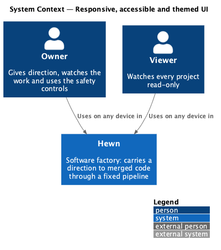
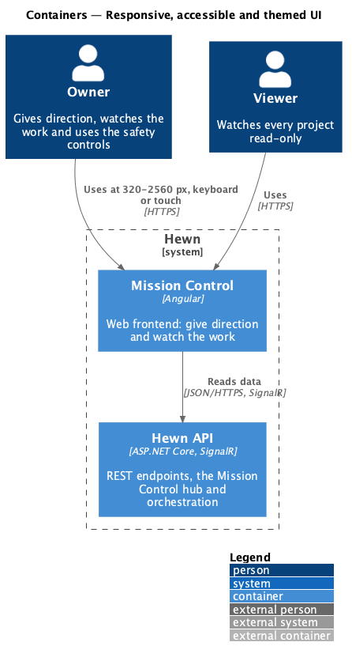
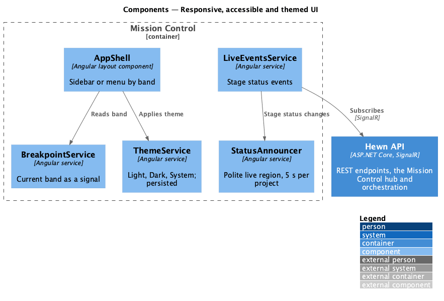
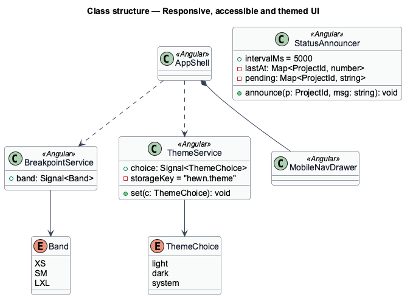
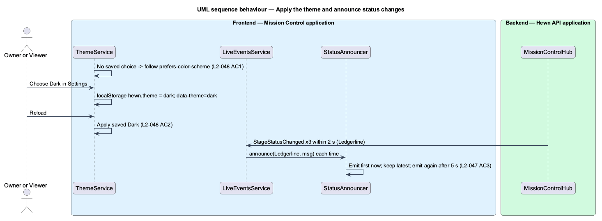

# Responsive, accessible and themed UI

## Overview

Every Mission Control page shares one shell and one set of rules for layout, accessibility, theme and performance. This design describes that baseline rather than one screen.

Layout follows three bands. Below 576 px (XS) content is one column, navigation collapses into a menu, and the pipeline is a vertical list. From 576 px (S) to 991 px (M) the project page shows the pipeline as a horizontal, scrollable stepper above the stage detail. From 992 px (L and XL) navigation is a fixed sidebar and the pipeline sits beside the stage detail. From 320 to 2560 px there is no horizontal page scroll, and touch targets are at least 44×44 px.

Every page in every state passes axe-core with no serious or critical violations, works by keyboard alone with a visible focus indicator and no traps, announces stage status changes through a polite live region at most once every 5 seconds per project, and disables animation when the user prefers reduced motion. With no saved choice the theme follows the operating system; a choice of Light, Dark or System is kept across reloads, and text contrast is at least 4.5:1 in both themes.

Terms used in this design:

- **breakpoint** — viewport width at which layout changes: 576, 768, 992 and 1200 px
- **live region** — element with `aria-live="polite"` whose text changes are read by screen readers
- **design tokens** — CSS custom properties from `docs/design-system/` for colour, type, spacing, radius, elevation and motion

## Description

The slice is a set of shared Angular building blocks plus the tests that hold every page to them.

- **`AppShell`** — layout component: fixed sidebar at 992 px and up, top bar with menu button below; the menu opens `MobileNavDrawer`, a focus-trapped dialog that releases focus on close.
- **`BreakpointService`** — exposes the current band (XS, S–M, L–XL) as a signal from `matchMedia` queries on the token breakpoints.
- **`StatusAnnouncer`** — single polite live region. It queues stage status messages per project and emits at most one per project every 5 seconds.
- **`ThemeService`** — reads `localStorage['hewn.theme']` (`light`, `dark` or `system`), applies `data-theme` on `<html>`, and follows `prefers-color-scheme` when the value is `system` or absent.
- **`Design tokens`** — `tokens.css` with light and dark values; motion tokens resolve to `0ms` under `prefers-reduced-motion: reduce`.
- **`AccessibilitySuite`** — Playwright e2e suite that visits every route in every mocked state and runs axe-core, and a keyboard walk that tabs through each page and checks for focus visibility and traps.
- **`PerformanceBudget`** — Angular build budget of 500 KB gzipped initial JavaScript with every route lazy-loaded, a Lighthouse mobile run on Projects in CI (LCP 2.5 s or less), a read-API load test at 50 projects and 20 workers (p95 300 ms or less), and an event load test at 200 events per second (p95 1 s or less).

## Requirements

The feature realizes the following level-2 (L2) requirements. Each L2 requirement refines the level-1 (L1) requirement cited beside it. The text is copied from `docs/specs/L2.md`.

| L2 ID | Refines (L1) | Requirement |
|-------|--------------|-------------|
| `L2-046` | `L1-021` | **Responsive layout.** 1. Given XS (<576 px), when any page renders, then content is one column, navigation collapses into a menu, and the pipeline is a vertical list. 2. Given S (≥576 px) and M (≥768 px), when the project page renders, then the pipeline is a horizontal, scrollable stepper above the stage detail. 3. Given L (≥992 px) and XL (≥1200 px), when any page renders, then navigation is a fixed sidebar, and the project page shows the pipeline and the stage detail side by side. 4. Given any width from 320 to 2560 px, when any page renders, then there is no horizontal page scroll, and touch targets are at least 44×44 px. |
| `L2-047` | `L1-021` | **Accessibility.** 1. Given every page in every state, when axe-core runs in the e2e suite, then there are no serious or critical violations. 2. Given a keyboard-only user, when they use any feature, then everything can be reached and used with a visible focus indicator and no keyboard traps. 3. Given stage status changes, when they occur, then they are announced through a polite live region, at most once every 5 seconds per project. 4. Given the user prefers reduced motion, when animations would play, then they are disabled. |
| `L2-048` | `L1-021` | **Light and dark themes.** 1. Given no saved choice, when Mission Control loads, then it follows the operating system's colour scheme. 2. Given the user picks Light, Dark or System, when they reload, then their choice is kept, and text contrast meets 4.5:1 in both themes. |
| `L2-045` | `L1-020` | **Performance targets.** 1. Given a mid-tier phone on a 4G profile (Lighthouse mobile), when Mission Control's Projects page loads, then Largest Contentful Paint is 2.5 s or less, and the initial JavaScript is 500 KB gzipped or less. 2. Given 50 projects and 20 connected workers, when the read APIs are load-tested, then p95 response time is 300 ms or less. 3. Given 200 events per second across all projects, when clients are subscribed, then the latency target in L2-031 AC1 still holds. |

## Diagrams

### System context

The baseline applies to every user and every page; no external system is involved.

### Containers

All of it runs in Mission Control; the Hewn API only feeds the status events that the announcer reads out.

### Components

Status announcements come from the same live events as the screen, throttled per project by `StatusAnnouncer`.

### Class structure

`BreakpointService` and `ThemeService` expose their state as signals that `AppShell` reads; `StatusAnnouncer` keeps one pending message per project.

### Behaviour — apply theme and announce status

The theme follows the OS until chosen, then persists (L2-048 AC1, AC2). Status changes are announced politely at most once per 5 seconds per project (L2-047 AC3).

