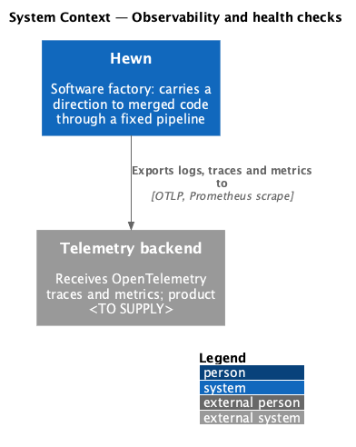
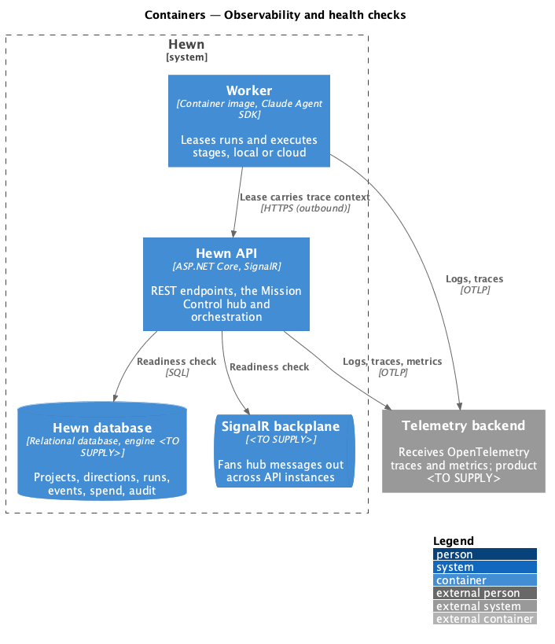
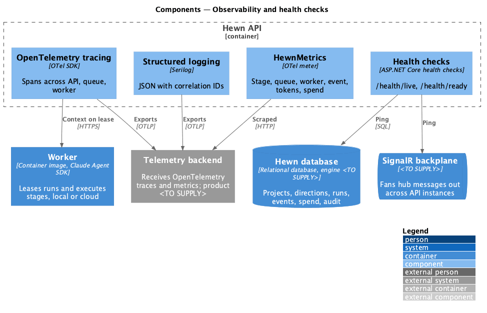
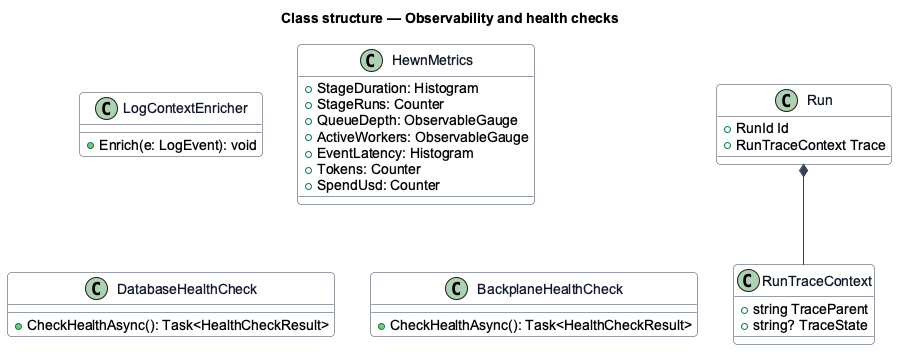
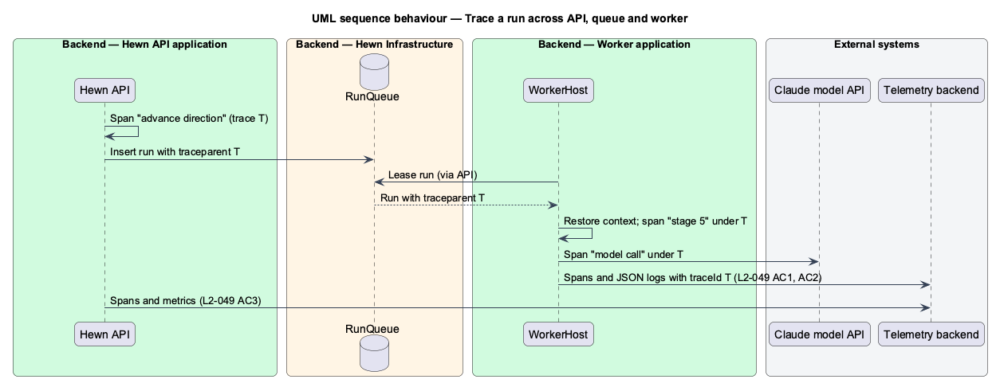
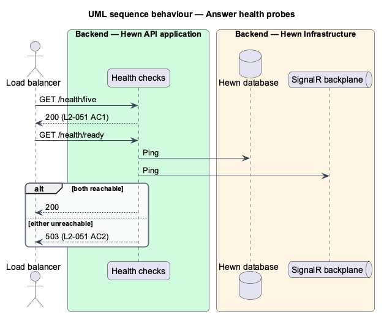

# Observability and health checks

## Overview

Operators need to see what Hewn is doing and whether it is healthy. Every server and worker log entry is structured JSON with timestamp, level and message, plus project, direction, stage, run and trace IDs where they apply. OpenTelemetry traces follow a run across the API, the queue, the worker and its model calls under one trace ID. Metrics cover stage duration, stage success rate, queue depth, active workers, event latency, tokens and spend.

Two health endpoints serve load balancers and orchestrators. `/health/live` returns 200 while the process runs. `/health/ready` returns 200 only when the database and the SignalR backplane are reachable, and 503 otherwise. Both are anonymous (L2-038 AC1).

Terms used in this design:

- **trace** — tree of timed spans sharing one trace ID
- **liveness** — whether the process is running
- **readiness** — whether the process can serve requests, meaning its dependencies are reachable

## Description

The slice is cross-cutting instrumentation plus two endpoints.

- **`Structured logging`** — Serilog with a compact JSON formatter in the API and the worker. An enricher adds `projectId`, `directionId`, `stage`, `runId` and `traceId` from the current scope. Log text passes `Redactor` first (L2-040).
- **`OpenTelemetry tracing`** — ASP.NET Core, HttpClient and SignalR instrumentation in the API. The trace context is stored on each `Run` when it is queued, returned with the lease, and restored by the worker, so worker and model-call spans join the run's trace. `ModelCallMeter` opens a span per model call.
- **`HewnMetrics`** — OpenTelemetry meter exporting `hewn_stage_duration_seconds` (histogram), `hewn_stage_runs_total{outcome}` (success rate), `hewn_queue_depth`, `hewn_workers_active`, `hewn_event_latency_seconds`, `hewn_tokens_total{direction=in|out}` and `hewn_spend_usd_total`, exposed for scraping at `/metrics`.
- **`Health checks`** — ASP.NET Core health checks: `/health/live` with no checks; `/health/ready` with a database check and a backplane check, returning 503 when either fails.
- **`Telemetry backend`** — receives traces and metrics through OTLP or scraping; the product is <TO SUPPLY>.

## Requirements

The feature realizes the following level-2 (L2) requirements. Each L2 requirement refines the level-1 (L1) requirement cited beside it. The text is copied from `docs/specs/L2.md`.

| L2 ID | Refines (L1) | Requirement |
|-------|--------------|-------------|
| `L2-049` | `L1-022` | **Logs, metrics and traces.** 1. Given any server or worker log entry, when it is written, then it is structured JSON with timestamp, level, message, and project, direction, stage, run and trace IDs where they apply. 2. Given a run, when it executes, then OpenTelemetry traces span the API, the queue, the worker and model calls under one trace ID. 3. Given the platform, when metrics are scraped, then stage duration, stage success rate, queue depth, active workers, event latency, tokens and spend are exported. |
| `L2-051` | `L1-022` | **Health checks.** 1. Given the server, when `/health/live` is requested, then it returns 200 while the process is running. 2. Given the server, when `/health/ready` is requested, then it returns 200 only when the database and SignalR backplane are reachable, and 503 otherwise. |

## Diagrams

### System context

Hewn sends all telemetry to one external backend.

### Containers

The API and worker both export; the run's trace context travels with the lease so their spans join.

### Components

Readiness depends on exactly the database and the backplane, as L2-051 AC2 requires.

### Class structure

`RunTraceContext` stored on `Run` is what links API, queue and worker spans under one trace ID.

### Behaviour — trace a run

One trace ID spans the API, the queue, the worker and model calls (L2-049 AC2); every log line carries it (AC1).

### Behaviour — answer health probes

Liveness is 200 while running (L2-051 AC1); readiness is 200 only with database and backplane reachable, else 503 (AC2).

