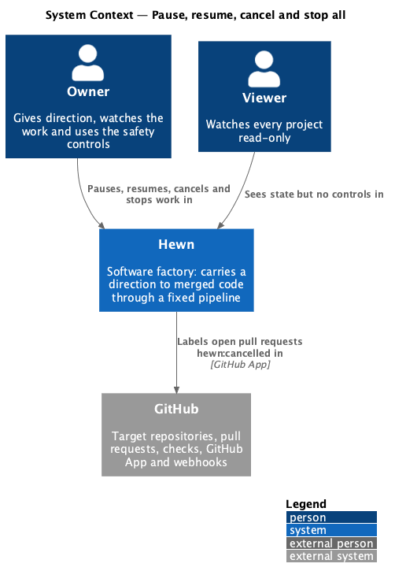
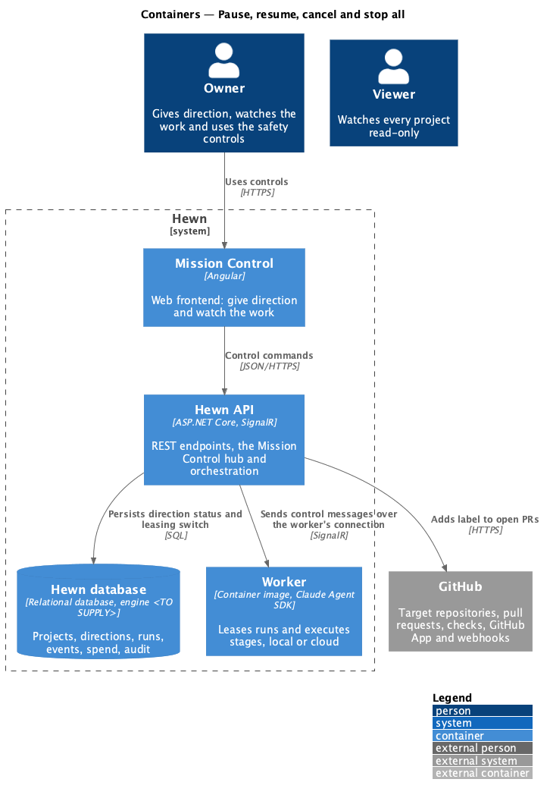
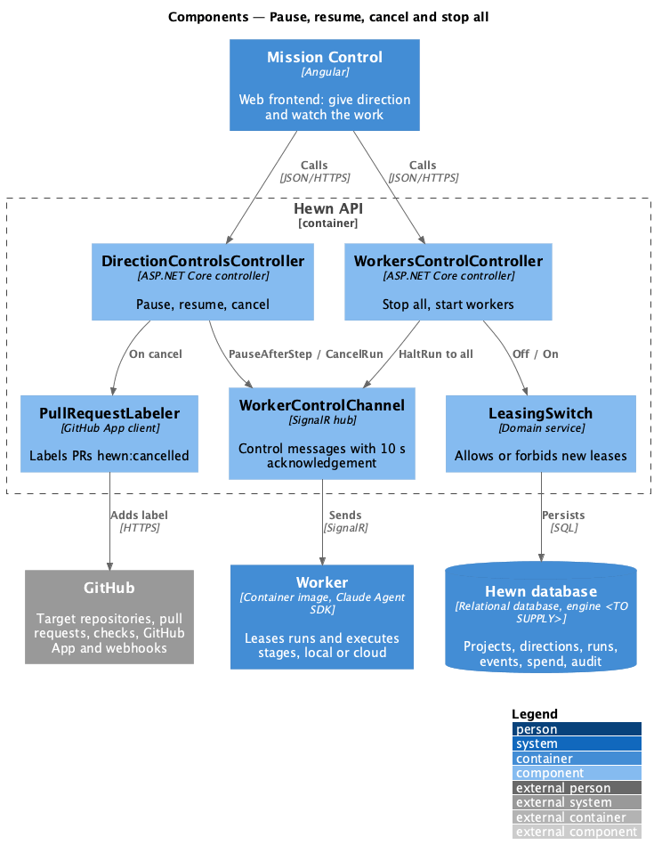
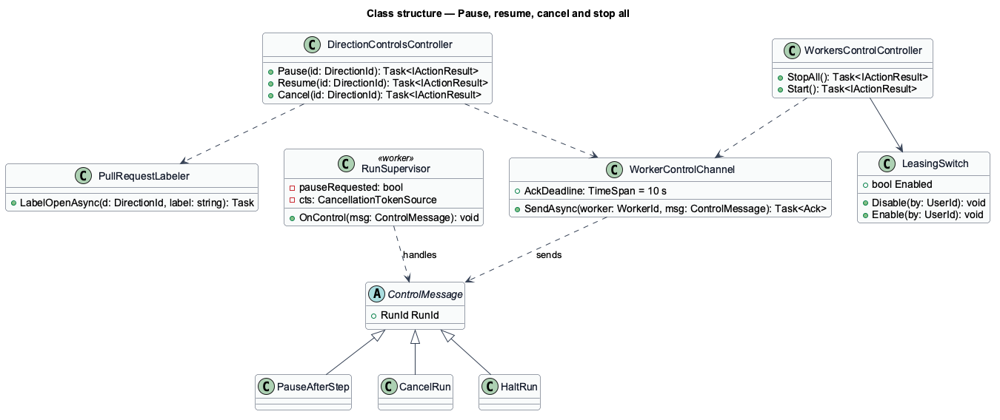
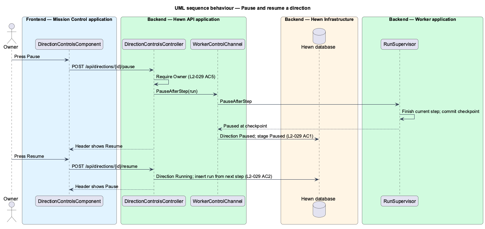
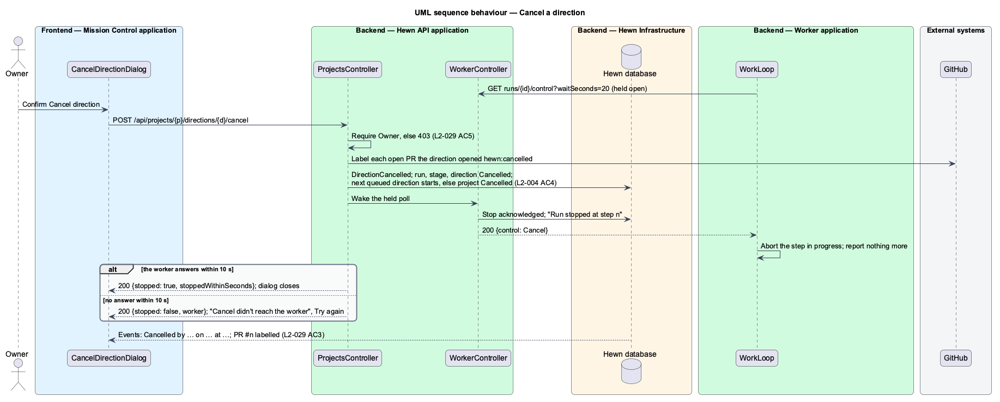
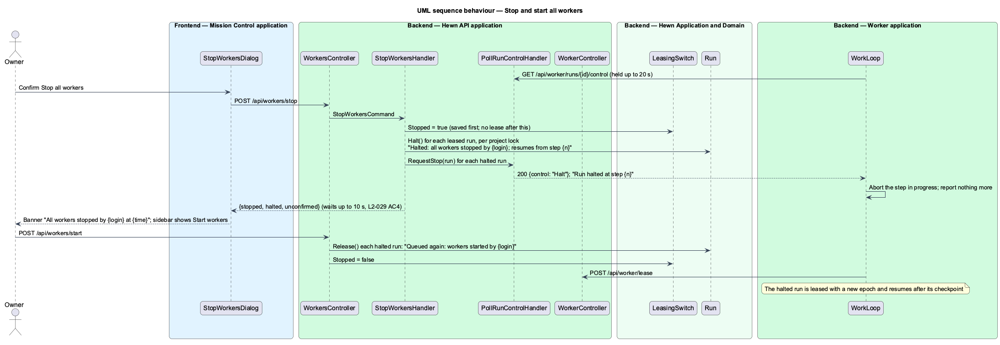

# Pause, resume, cancel and stop all

## Overview

Hewn runs without approval steps, so humans need safety controls. An Owner can pause a running direction, resume a paused one, cancel a running or paused one, and stop every worker at once. These are safety controls only; they never gate progress (L1-015).

*Pause* lets the current step finish, checkpoints it, and starts nothing new until Resume. *Resume* continues from the next step. *Cancel* stops the active run within 10 seconds, marks the direction Cancelled, and leaves open pull requests open with the label `hewn:cancelled`. *Stop all workers* makes every worker halt its active run within 10 seconds and lease nothing new until the Owner presses Start workers; each halted run resumes from its last checkpoint afterwards. Viewers never see these controls, and the API refuses them with 403.

Terms used in this design:

- **step** — smallest checkpointed unit of work inside a run
- **checkpoint** — end of the last completed step, committed to the branch (L2-050)
- **leasing switch** — global flag that allows or forbids workers to lease new runs

## Description

The slice adds control commands to the API and control messages to the worker connection.

- **`DirectionControlsComponent`** — Angular header controls on the project page: Pause or Resume, and Cancel (opens `CancelDirectionDialog`). Rendered only for Owners; a Blocked direction shows Retry stage instead of Resume.
- **`StopWorkersDialog`** — confirmation listing online workers and what each is running; offers Stop all workers, then the sidebar shows Start workers.
- **`DirectionControlsController`** — `POST /api/directions/{id}/pause|resume|cancel`, Owner policy.
- **`WorkersControlController`** — `POST /api/workers/stop-all` and `POST /api/workers/start`, Owner policy. Both write audit entries (L2-044).
- **`WorkerControlChannel`** — server side of the worker's outbound SignalR connection. It sends `PauseAfterStep`, `CancelRun` and `HaltRun` messages and tracks acknowledgements with a 10-second deadline.
- **`RunSupervisor (worker)`** — receives control messages. `PauseAfterStep` sets a flag checked between steps; `CancelRun` and `HaltRun` cancel the agent's cancellation token and kill the run container if it has not stopped within 10 seconds.
- **`PullRequestLabeler`** — on cancel, adds `hewn:cancelled` to each open pull request of the direction through the GitHub App.
- **`LeasingSwitch`** — persisted flag consulted by `RunQueue` before every lease.

## Requirements

The feature realizes the following level-2 (L2) requirements. Each L2 requirement refines the level-1 (L1) requirement cited beside it. The text is copied from `docs/specs/L2.md`.

| L2 ID | Refines (L1) | Requirement |
|-------|--------------|-------------|
| `L2-029` | `L1-015` | **Pause, resume, cancel and stop all.** 1. Given a running direction, when the Owner presses Pause, then the current step finishes, the direction becomes Paused, and nothing new starts until Resume. 2. Given a paused direction, when the Owner presses Resume, then work continues from the next step. 3. Given a running or paused direction, when the Owner presses Cancel and confirms, then the active run stops within 10 seconds, the direction is Cancelled, and open PRs are left open and labelled `hewn:cancelled`. 4. Given the Owner presses Stop all workers and confirms, when the command is sent, then every worker halts its active run within 10 seconds and leases no new work until the Owner presses Start workers. 5. Given a Viewer, when they try any of these actions, then the controls are hidden and the API returns 403. |

## Diagrams

### System context

Owners use the controls; Viewers see state only. Cancel touches GitHub only to label open pull requests.

### Containers

Control commands enter the Hewn API and travel to workers over the worker's existing outbound SignalR connection, so no inbound port is needed on a Local worker (L2-027 AC3).

### Components

Both controllers send typed control messages through one channel that enforces the 10-second acknowledgement deadline.

### Class structure

`ControlMessage` has three subtypes. The worker's `RunSupervisor` maps them to a between-steps flag or to cancellation of the running agent.

### Behaviour — pause and resume

Pause waits for the current step to finish and checkpoint (L2-029 AC1): the checkpoint's answer tells the worker to stop there. Resume queues the same run again, so it continues from the next step (AC2) and no completed step runs twice (L2-050 AC3).

### Behaviour — cancel a direction

The run stops within 10 seconds, the direction is Cancelled, and open pull requests stay open with `hewn:cancelled` (L2-029 AC3). The worker hears the cancel on its held control poll, and the next queued direction starts (L2-004 AC4).

### Behaviour — stop and start all workers

Every worker halts its active run within 10 seconds and leases nothing until Start workers (L2-029 AC4).

## Decisions made while building Pause and Resume

Journey 6 built Pause and Resume (L2-029 AC1, AC2, AC5). Cancel and Stop all come with journeys 7 and 8.

- **Pause is answered on the checkpoint call, not a control channel** ([ADR 0011](../../../adr/0011-pause-takes-effect-at-the-next-checkpoint.md)).
  `POST /api/projects/{projectId}/directions/{directionId}/pause` records the request (`PauseRequested`, "Pause
  requested by {login}" in the run log). The worker's next checkpoint, the end of the step in progress, answers
  `{verdict: "Pause"}`, and the run, stage, direction and project turn Paused with "Step {n} finished · checkpoint ·
  direction Paused" in the log. `WorkerControlChannel`, `RunSupervisor` and `PauseAfterStep` are not built; Cancel
  and Stop all need them to stop a run within 10 seconds.
- **Routes sit under the project**, like every other project-scoped endpoint, so another project's direction is
  404: `.../directions/{id}/pause` and `.../resume`, served by `ProjectsController` (no `DirectionControlsController`).
- **No step to wait for:** a run still waiting for a worker pauses at once, and a stage that ends while a pause is
  pending leaves the next stage's run paused, so it does not start.
- **Resume re-queues the paused run** (`DirectionResumed`, "Resumed by {login}"): the next lease bumps the epoch and
  starts after the checkpoint.
- **Refusals:** 403 for Viewers; 409 `not_running` (Pause with no queued or leased run), `not_paused` (Resume on a
  direction that is not paused) and `budget_reached` (a budget stop continues only through Raise and resume). Pause
  twice is harmless.
- **The header** follows the mocks: Pause on a running direction, Resume on a paused one, and the paused callout
  "Paused by {login} at {time}". Between the two, the Pause button shows the design system's busy state
  ("Pausing…", `aria-busy`), so no new mock was needed. `DirectionControlsComponent` is part of the project page's
  header rather than a component of its own. Cancel is not shown until journey 7 builds it.
- **Not built yet:** audit entries for Pause and Resume (the audit log is journey 32).

## Decisions made while building Cancel

Journey 7 built Cancel (L2-029 AC3, AC5, L2-004 AC4).

- **Cancel reaches the worker on a held control poll, not SignalR** ([ADR 0012](../../../adr/0012-cancel-reaches-the-worker-on-a-held-control-poll.md)).
  While a run executes the worker holds `GET /api/worker/runs/{id}/control` open for 20 seconds at a time; it
  answers `{control: "Cancel"}` the moment the run is cancelled, and the worker aborts the step in progress.
  `WorkerControlChannel` and `RunSupervisor` remain unbuilt; `WorkLoop` plays the supervisor's part.
- **Cancel commits first, then waits up to 10 seconds** for the worker to hear. In one save:
  - `DirectionCancelled` and "Cancel requested by {login}" in the run log;
  - the run, its running or paused stage, and the direction are Cancelled;
  - the next queued direction starts, or the project shows Cancelled.
  The run's lease stops fencing at once, so the worker's writes are refused even before it hears.
- **The answer reports the stop:** `{directionId, status, stopped, stoppedWithinSeconds, worker}`. When the worker
  does not answer in time, the dialog's failed state names it ("{worker} stopped answering…"), and Try again waits
  again. The direction records `cancelledBy`, `cancelledAt`, `stoppedWithinSeconds` and `labelledPullRequests` for
  the callout "Cancelled by {login} on {date} at {time}".
- **`PullRequestLabeler` is part of the cancel handler.** It reads the pull requests the direction's runs opened
  from the mutation ledger, labels each unmerged one through the new `IGitHubRepositories.AddLabelAsync`, and logs
  `gh pr edit {n} --add-label hewn:cancelled`. A label GitHub refuses is logged as a warning, and the cancel still
  completes.
- **Routes sit under the project:** `POST .../directions/{id}/cancel` on `ProjectsController`. Refusals: 403 for
  Viewers, 409 `not_active` for a Complete direction, 404 for another project's direction. Cancel on a direction
  already Cancelled answers 200 and only waits for the worker again.
- **The header** shows Cancel beside Pause or Resume on a queued, running or paused direction. The dialog follows
  the mocks' default, busy and failed states, except its text says "Merged work stays merged" because the read
  model does not count merged increments yet. A cancelled direction's stage stays selected, so its log shows how
  it ended.
- **Not built yet:** audit entries for Cancel (the audit log is journey 32).

