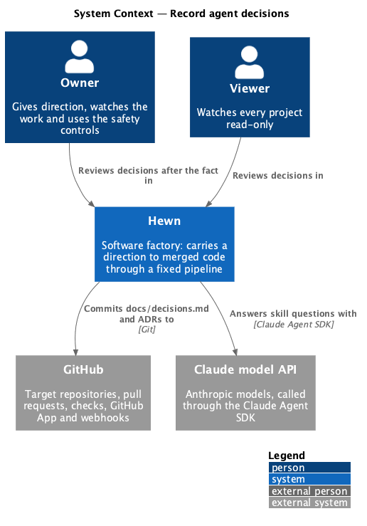
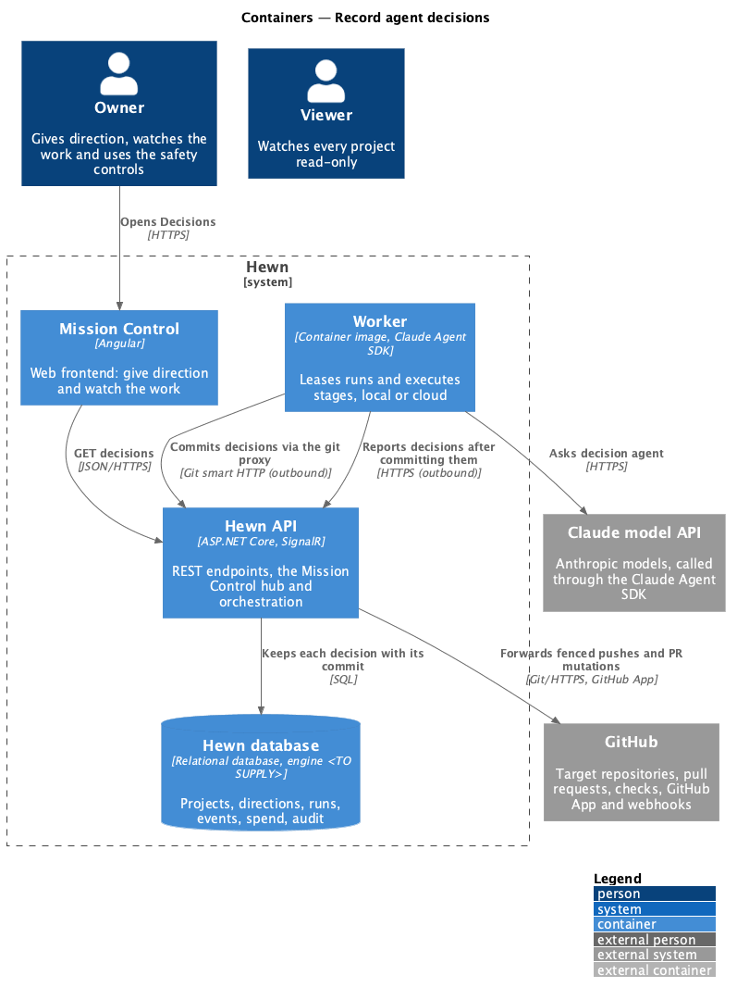
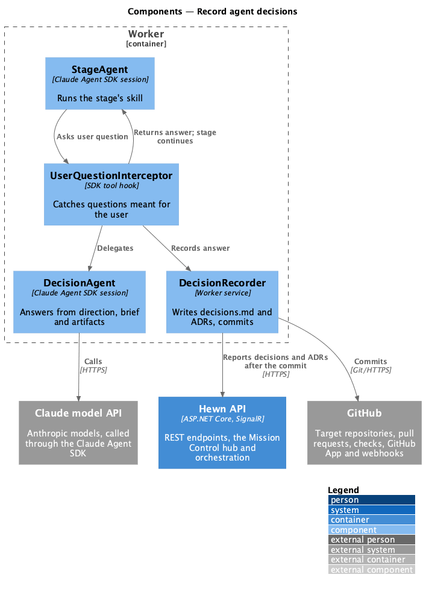
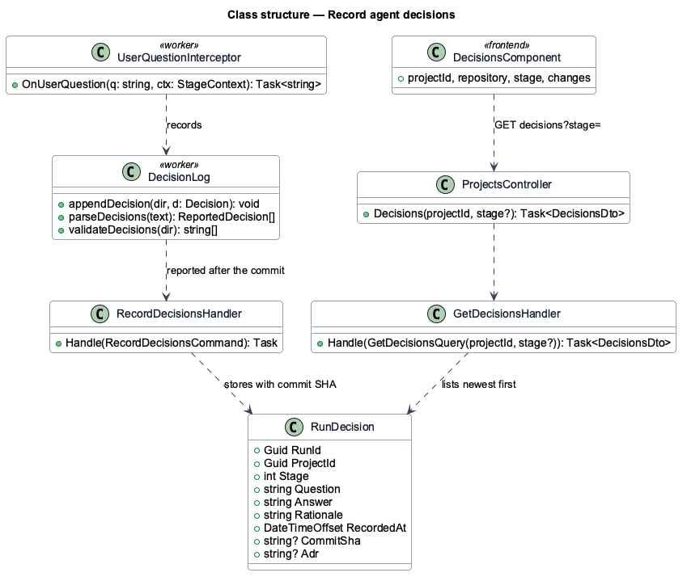
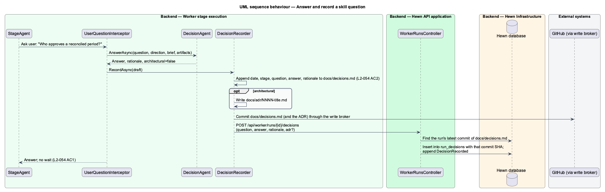
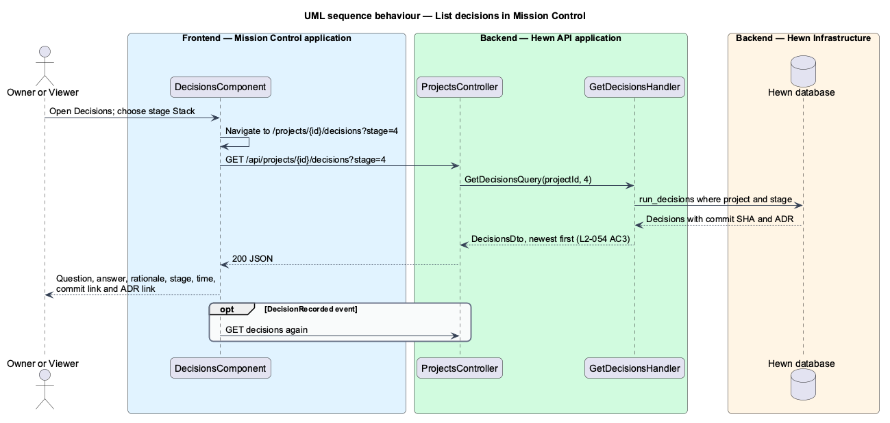

# Record agent decisions

## Overview

Several Greenlit skills were written for interactive use and ask the user questions; the `grilling` skill is the clearest case. Hewn has no approval steps, so when a skill or stage asks a question meant for the user, the agent answers it itself from the direction, the brief and the existing artifacts, and carries on without waiting.

Every such answer is a *decision*. It is appended to `docs/decisions.md` in the target repository with the date, stage, question, answer and rationale. A decision that changes architecture also gets an architecture decision record (ADR) in `docs/adr/`. The Decisions page in Mission Control lists decisions newest first, filters them by stage, and links each one to the commit that recorded it.

Terms used in this design:

- **decision** — question a skill would have asked the user, with the agent's answer and rationale
- **ADR** — architecture decision record: a numbered file in `docs/adr/` with Context, Decision, Alternatives and Consequences

## Description

The slice spans the worker's question interception, the repository file, an index in Hewn and the Decisions page.

- **`UserQuestionInterceptor (worker)`** — hooks the Claude Agent SDK's user-question tool. Instead of surfacing the question, it asks a decision agent to answer from the direction, `docs/brief.md` and the repository contents.
- **`DecisionLog (worker)`** — `worker/src/agents/decision-log.ts`. `appendDecision` appends the entry to `docs/decisions.md` and, for an architecture decision, writes `docs/adr/NNNN-*.md` and links it; `parseDecisions` reads each new entry, with its ADR path, so the executor can report it after the stage's commit. Document stages report once after their commit; stage 10 reports after each commit that writes the log, including a rebase.
- **`RecordDecisionsHandler`** — `POST /api/worker/runs/{id}/decisions` keeps each reported decision in `run_decisions` (redacted), with the run's latest commit that wrote `docs/decisions.md` as its commit SHA, and appends `DecisionRecorded`. `docs/decisions.md` remains the source of truth.
- **`GetDecisionsHandler`** — `GET /api/projects/{id}/decisions?stage=` on `ProjectsController` returns the project's decisions newest first, with the stage name, a GitHub link to the commit and the ADR link. A stage outside 0 to 10 is a 400.
- **`DecisionsComponent`** — the project's Decisions tab (`/projects/{id}/decisions?stage=`) with a stage filter, one entry per decision and links to the commit and ADR on GitHub. It reads the list again on each `DecisionRecorded` event.

The agent decides itself whether a decision is architectural, from the shared instruction in `AUTONOMY`: a decision that changes the architecture also gets an ADR. The starting rule is that any decision touching stack, deployment, data storage or a cross-cutting pattern is architectural.

## Requirements

The feature realizes the following level-2 (L2) requirements. Each L2 requirement refines the level-1 (L1) requirement cited beside it. The text is copied from `docs/specs/L2.md`.

| L2 ID | Refines (L1) | Requirement |
|-------|--------------|-------------|
| `L2-054` | `L1-024` | **Agents decide and record decisions.** 1. Given a skill or stage asks a question meant for the user, when the agent meets it, then it answers from the direction, the brief and the existing artifacts, and carries on without waiting. 2. Given each such decision, when it is made, then it is appended to `docs/decisions.md` with the date, stage, question, answer and rationale. A decision that changes architecture also gets an ADR in `docs/adr/`. 3. Given a project, when a user opens Decisions in Mission Control, then decisions are listed newest first, can be filtered by stage, and link to the commit that recorded them. |

## Diagrams

### System context

Humans read decisions after the fact. Hewn answers questions with Claude and stores the record in the project's GitHub repository.

### Containers

The worker answers and commits; the Hewn API indexes the result so Mission Control can list it.

### Components

Inside the worker the interceptor sits between the stage agent and the user-question tool, so the stage never blocks on a human (L2-054 AC1, L2-028 AC2).

### Class structure

A `Decision` carries the five required fields plus its commit and optional ADR path. The index mirrors the repository file for listing.

### Behaviour — answer and record a question

The agent answers and carries on (L2-054 AC1). The entry goes to `docs/decisions.md`, with an ADR for architectural decisions (AC2).

### Behaviour — list decisions

Decisions are listed newest first, filtered by stage, each linked to its commit (L2-054 AC3).

## Decisions made while building the slice

- **Instructions, not interception, for now.** Only the scripted agent exists, so every agent session (stages 1 to
  10) carries the shared `AUTONOMY` instruction from `worker/src/agents/decision-log.ts`, and no session is given
  a question tool. The `UserQuestionInterceptor` arrives with the Claude Agent SDK agent.
- **Format.** Each entry is `## {date} · Stage {n} {name}` with `**Question:**`, `**Answer:**` and
  `**Rationale:**`, plus `**ADR:** [NNNN-slug](adr/NNNN-slug.md)` for an architecture decision. `validateDecisions`
  fails a document stage before it commits, and keeps an increment from going green, when an entry lacks a field
  or links a missing ADR.
- **ADRs.** `appendDecision` with `architecture` writes the next numbered `docs/adr/NNNN-{slug}.md` (Context,
  Decision, Alternatives, Consequences), and the stage commits the files the log links. The API lets any stage
  that may write `docs/decisions.md` write numbered ADRs.
- **Commits.** Decisions are committed with the stage's own commit, so the commit link (AC3) is that commit.
- **Listed from Hewn's record, not the repository** ([ADR 0020](../../../adr/0020-decisions-are-listed-from-hewns-record.md)).
  The worker reports each decision after the commit that wrote it, so Hewn keeps the commit SHA with the decision
  in `run_decisions` and lists them without reading GitHub. This replaces the planned `DecisionIndex` table and
  `DecisionsController`.
- **The recording commit** is the run's latest commit mutation whose paths include `docs/decisions.md` when the
  decision is reported. A decision reported before any such commit has no commit link.
- **ADRs** are reported as `docs/adr/NNNN-slug.md` (validated) and linked at the recording commit as "ADR NNNN".
- **Stage filter** in the address (`?stage=4`), so a link opens filtered; "Show all stages" clears it. The filter
  offers stages 1 (Idea) to 10 (Increments).
