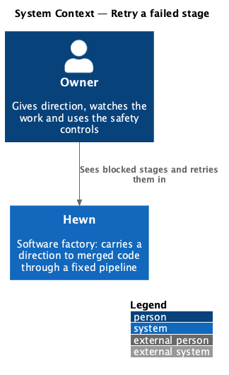
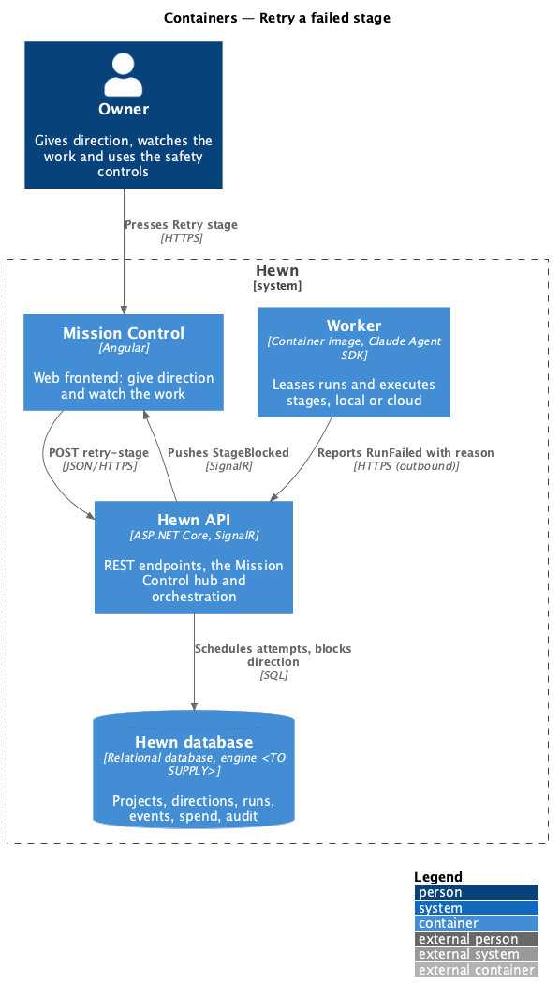
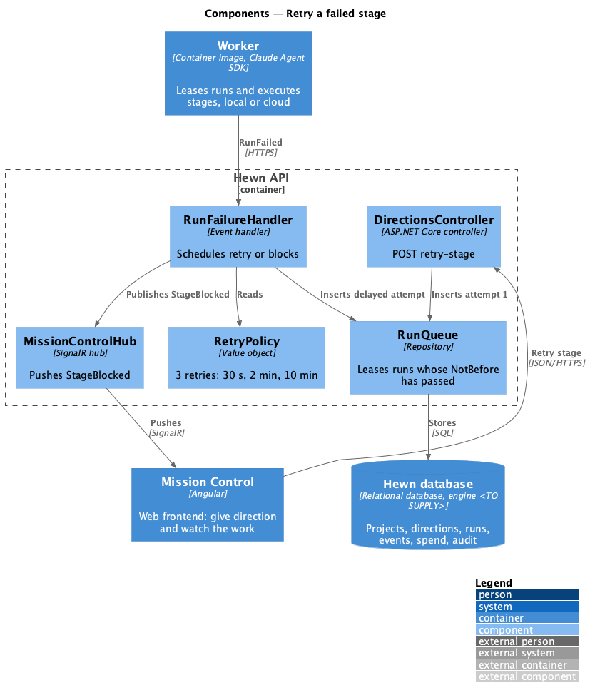
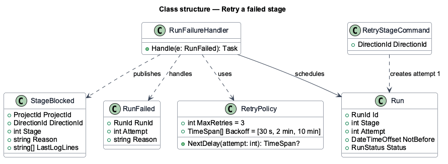
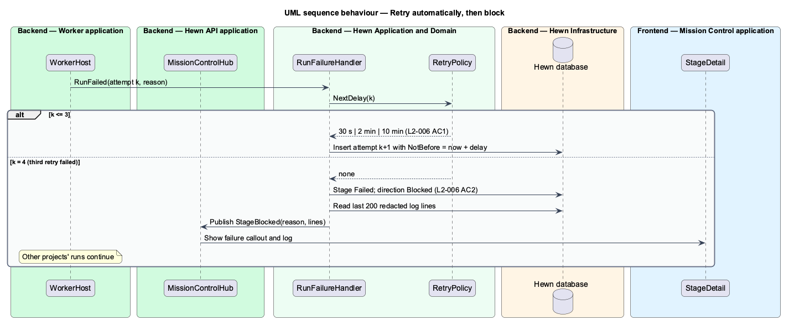
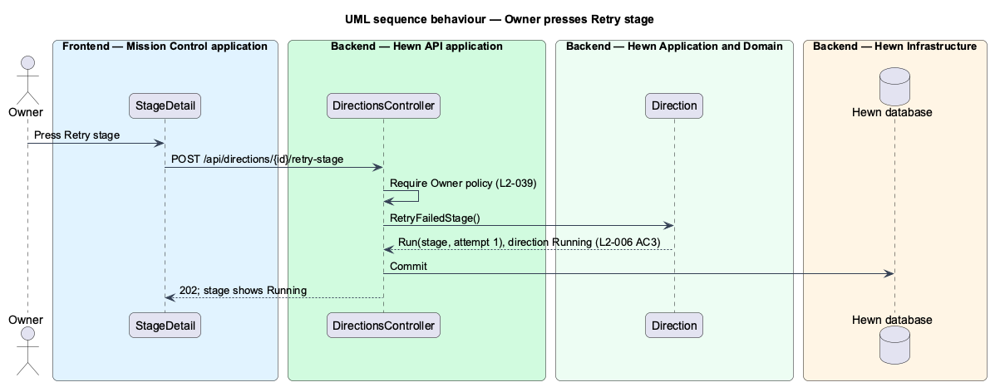

# Retry a failed stage

## Overview

A run can fail: a skill output may not validate, an external service may be down, or a check may fail. Hewn retries a failed run automatically up to 3 times, waiting 30 seconds, 2 minutes and 10 minutes before each retry. If the third retry also fails, the stage becomes Failed and the direction Blocked. Mission Control receives an event with the failure reason and the last 200 log lines, and every other project keeps running.

A Blocked direction stays put until an Owner presses Retry stage on the project page or the dashboard's Needs attention tile. Retry stage runs the failed stage again from its start with its retry counter reset. This is the only human step in failure handling, and it is a recovery action, not an approval (L2-028).

Terms used in this design:

- **attempt** — one numbered execution of a stage within a run sequence; attempt 1 is the first try, attempts 2–4 are retries
- **backoff** — delay before a retry: 30 s, then 2 min, then 10 min
- **Blocked** — direction status after a stage exhausts its retries

## Description

The slice spans the orchestrator, a delayed-run scheduler, the event stream and the Retry stage control.

- **`RetryPolicy`** — value object: `MaxRetries = 3`, `Backoff = [30 s, 2 min, 10 min]`.
- **`RunFailureHandler`** — handles `RunFailed`. Below the limit it schedules a new attempt with `NotBefore = now + backoff`; at the limit it marks the stage Failed and the direction Blocked and publishes `StageBlocked`.
- **`RunQueue`** — leases only runs whose `NotBefore` has passed, so backoff needs no timers in workers.
- **`StageBlocked`** — event carrying `Reason` and `LastLogLines` (the last 200 lines, already redacted per L2-040).
- **`DirectionsController.RetryStage`** — `POST /api/directions/{id}/retry-stage`, Owner policy. It resets the attempt counter and inserts attempt 1 of the failed stage.
- **`StageDetail (Angular)`** — on the project page, shows the failure callout, the 200 log lines and the Retry stage button. The dashboard's Needs attention tile offers the same action.

## Requirements

The feature realizes the following level-2 (L2) requirements. Each L2 requirement refines the level-1 (L1) requirement cited beside it. The text is copied from `docs/specs/L2.md`.

| L2 ID | Refines (L1) | Requirement |
|-------|--------------|-------------|
| `L2-006` | `L1-002` | **Stage failure and retry.** 1. Given a run fails, when it is retried automatically, then it is retried up to 3 times with backoff of 30 s, 2 min and 10 min. 2. Given the 3rd retry fails, when the stage ends, then the stage is Failed, the direction is Blocked, an event is pushed to Mission Control with the failure reason and the last 200 log lines, and other projects keep running. 3. Given a Blocked direction, when the Owner presses Retry stage, then the failed stage runs again from its start with its retry counter reset. |

## Diagrams

### System context

Only the Owner is involved, and only after retries are exhausted.

### Containers

Workers report failures to the Hewn API, which schedules the next attempt in the database or pushes `StageBlocked` to Mission Control.

### Components

Backoff is a `NotBefore` timestamp on the run, so the delay survives restarts and no worker holds a timer.

### Class structure

`RunFailureHandler` consults `RetryPolicy` to schedule the next `Run` attempt or to publish `StageBlocked` with the last 200 log lines.

### Behaviour — retry automatically, then block

Attempts 2–4 wait 30 s, 2 min and 10 min (L2-006 AC1). After the third retry fails, the stage is Failed, the direction Blocked, and Mission Control gets the reason and 200 log lines (AC2).

### Behaviour — Owner presses Retry stage

The failed stage restarts from its beginning with the counter reset (L2-006 AC3).

