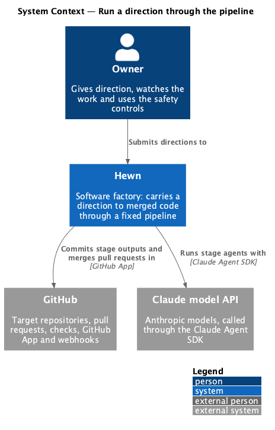
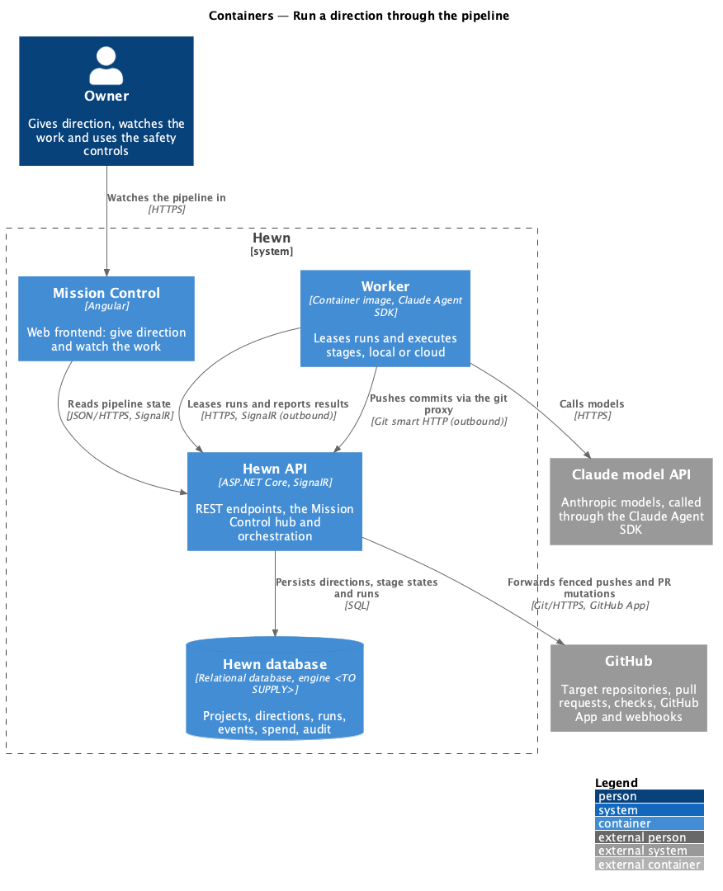
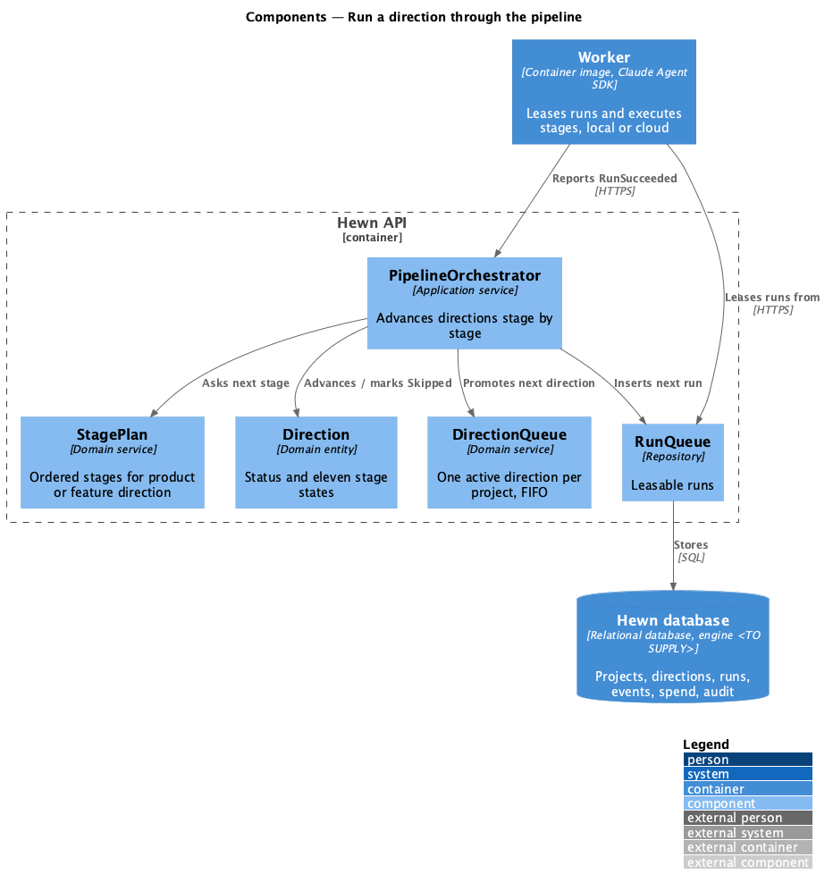
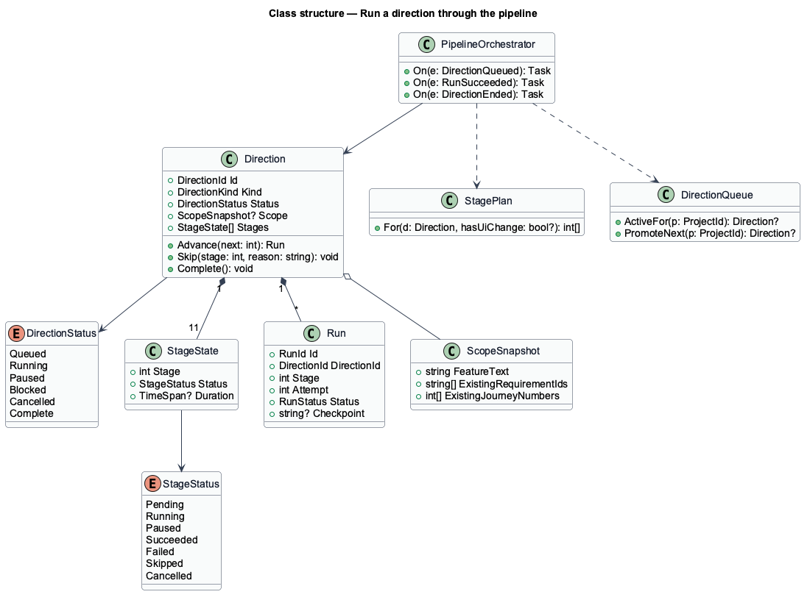
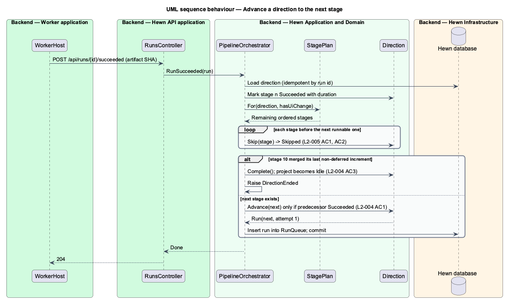
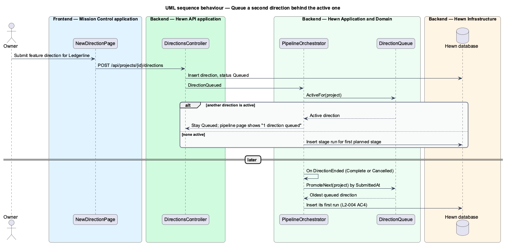

# Run a direction through the pipeline

## Overview

Every direction runs the same fixed pipeline. A product direction runs stages 0 to 10 in order: Bootstrap, Idea, Designs, Design system, Stack, Requirements, Scaffold, Detailed designs, User journeys, Estimates and Increments. A feature direction skips Bootstrap (0), Stack (4) and Scaffold (6), runs the other stages against the new or changed scope only, and also skips Designs (2) and Design system (3) when the agent decides the feature has no user interface change.

The orchestrator enforces order: a stage starts only after the previous non-skipped stage has Succeeded. A project runs one direction at a time; a second direction waits in a first-in, first-out queue until the active one is Complete or Cancelled. No stage, pull request or merge waits for a human (L2-028). Where a skill would ask a question, the agent answers it and records the decision ([Record agent decisions](../record-decisions/README.md)).

The orchestrator lives in the Hewn API. It does not execute stages itself; it creates *runs* and offers them to workers through the lease mechanism in [Worker loop](../../agent-runtime/worker-loop/README.md). Failure handling is in [Retry a failed stage](../retry-failed-stage/README.md) and the safety controls are in [Pause, resume, cancel and stop all](../pause-resume-cancel-stop/README.md).

Terms used in this design:

- **run** — one execution of one stage for one direction
- **stage status** — one of Pending, Running, Paused, Succeeded, Failed, Skipped or Cancelled
- **direction queue** — per-project first-in, first-out list of directions waiting behind the active one
- **scope** — set of new or changed requirements, designs and screens a feature direction works on

## Description

The slice is server-side orchestration plus the pipeline view's status rendering.

- **`PipelineOrchestrator`** — application service in the Hewn API. It reacts to `RunSucceeded`, `DirectionQueued` and `DirectionEnded` events, decides the next stage, marks skipped stages and creates the next `Run`.
- **`StagePlan`** — pure function that returns the ordered stage list for a direction: all of 0–10 for a product direction; 1, 2, 3, 5, 7, 8, 9, 10 for a feature direction, minus 2 and 3 when the recorded `HasUiChange` decision is false.
- **`Direction`** — entity with `Status` (Queued, Running, Paused, Blocked, Cancelled, Complete) and eleven `StageState` entries. `Advance()` refuses to start a stage whose predecessor has not Succeeded.
- **`DirectionQueue`** — per-project ordering by `SubmittedAt`. `PromoteNext()` starts the oldest queued direction when the active one ends.
- **`RunQueue`** — table of leasable runs; a run becomes visible to workers when the orchestrator inserts it (L2-026).
- **`ScopeSnapshot`** — for a feature direction, the feature text plus the IDs of existing L1/L2 requirements, journeys and designs, passed to every stage so stages 5 and 8 keep existing IDs and number new ones from the next free value.
- **`NoApprovalE2ETest`** — automated end-to-end test that submits a small direction and asserts it reaches Complete with no user interaction after submission (L2-028 AC1).

The orchestrator handles each event idempotently by run id, so a redelivered `RunSucceeded` cannot start a stage twice (L2-050 AC3). The feature-direction decision about user interface change is made in stage 1 and read by `StagePlan` before stage 2 is created.

## Requirements

The feature realizes the following level-2 (L2) requirements. Each L2 requirement refines the level-1 (L1) requirement cited beside it. The text is copied from `docs/specs/L2.md`.

| L2 ID | Refines (L1) | Requirement |
|-------|--------------|-------------|
| `L2-004` | `L1-002` | **Run a product direction through every stage.** 1. Given a queued product direction, when a worker picks it up, then stages 0 to 10 run in order, and each stage starts only after the previous stage has status Succeeded. 2. Given any stage, when its status is shown, then it is exactly one of Pending, Running, Paused, Succeeded, Failed, Skipped, Cancelled. Paused applies to the active stage of a Paused direction, and Cancelled to the active stage of a Cancelled direction. 3. Given every stage succeeds, when stage 10 merges its last non-deferred increment, then the direction is Complete and the project is Idle. 4. Given a project, when a second direction is submitted while one is active, then it queues and starts only when the active one is Complete or Cancelled (one active direction per project, first in, first out). |
| `L2-005` | `L1-002` | **Run a feature direction on an existing product.** An Owner submits a feature description (10–20,000 characters) on a project whose first product direction is Complete. 1. Given a feature direction, when it runs, then stages 0, 4 and 6 are marked Skipped, and stages 1, 2, 3, 5, 7, 8, 9 and 10 run in order, each limited to the new or changed scope. 2. Given the feature has no user interface change (decided and recorded per L2-054), when it runs, then stages 2 and 3 are Skipped. 3. Given a feature direction, when stage 5 runs, then existing L1/L2 IDs are kept, and new requirements take the next free numbers. 4. Given a project whose first product direction is not Complete, when the Owner submits a feature direction, then it is queued behind it (L2-004 AC4). |
| `L2-028` | `L1-015` | **No approval steps.** 1. Given a product direction is submitted, when it runs to Complete, then no stage, PR or merge waits for human input. An automated end-to-end test proves this by submitting a small direction and asserting it completes with no user interaction after submission. 2. Given any stage, when it would normally ask a human (a skill question, a review or a PR approval), then it proceeds under L2-054 instead. |

## Diagrams

### System context

The Owner submits a direction once. From there Hewn runs agents on Claude and works in GitHub with no further human step.

### Containers

The orchestrator in the Hewn API writes runs to the Hewn database; workers lease them over outbound connections and report back.

### Components

On each `RunSucceeded` the orchestrator asks `StagePlan` for the next stage, marks skipped stages, and inserts the next run, or completes the direction and promotes the next queued one.

### Class structure

A `Direction` owns eleven `StageState` entries and its `Run` history. `StagePlan` is a pure function of the direction kind and the recorded UI-change decision.

### Behaviour — advance to the next stage

A stage starts only after its predecessor Succeeded (L2-004 AC1). For a feature direction, stages 0, 4 and 6 are Skipped, and 2 and 3 too when there is no UI change (L2-005 AC1, AC2).

### Behaviour — queue a second direction

A second direction on a busy project queues and starts when the active one is Complete or Cancelled, first in, first out (L2-004 AC4, L2-005 AC4).

## Decisions made while building the slice

Journey 1, part 2 built L2-004 AC1-AC3. These choices refine the design above.

- **The first run is queued with the direction.** `SubmitProductDirection` adds the stage 0 `Run` in the
  same unit of work as the project, the direction and `DirectionQueued`, so a submitted direction is
  leasable the moment the API answers.
- **The stage starts on lease.** The orchestrator marks a stage Running when a worker first leases its run
  (`StageChanged`, plus `DirectionChanged` for stage 0). A resumed run changes nothing visible.
- **Events.** `StageChanged {directionId, stage, name, status, startedAt, endedAt}`,
  `DirectionChanged {directionId, status, completedAt}` and `ProjectChanged {status}`. A full product
  direction emits 22 `StageChanged`, then `DirectionChanged` Complete and `ProjectChanged` Idle.
- **Failure.** A failed run marks the stage Failed and the project Blocked; no further run is queued. Journey 9
  replaced this with automatic retries, a Blocked direction and Retry stage (L2-006; see
  [Retry a failed stage](../retry-failed-stage/README.md)).
- **Header pill.** The pill beside the project name follows the current direction, as the mocks do: Running
  while queued or running, Complete when done; a Blocked project always reads Blocked.
- **Not built yet then:** the direction queue and feature directions came with journey 2 (below); the
  no-approval end-to-end test with part 9.

## Feature directions (journey 2)

Journey 2 built L2-005 AC1-AC4. See [ADR 0008](../../adr/0008-feature-scope-is-a-recorded-decision.md).

- **Submitting.** `POST /api/projects/{id}/directions` `{idea, budgetUsd}` (Owner only; 404 for an unknown
  project; `idea` 10 to 20,000 characters). The feature direction is created with stages 0, 4 and 6 Skipped,
  and `DirectionQueued` carries the whole direction so an open project page can show it.
- **The queue.** A project's active direction is the one Running or Paused, else its oldest Queued one. A
  feature submitted to a project with an active direction stays Queued; otherwise its first run (stage 1) is
  queued at once and the project turns Running. When a direction completes, the orchestrator starts the oldest
  queued direction instead of setting the project Idle (L2-004 AC4).
- **`StagePlan`.** It is the stage list itself: the next stage is the next Pending one, so Skipped stages are
  never offered. Stage 1 reports the recorded UI-change decision through `PUT /api/worker/runs/{id}/scope`;
  without a change, stages 2 and 3 become Skipped before stage 2 would be queued (AC2, L2-054).
- **The lease** carries `direction: {kind, idea, hasUiChange}`, so every agent session names the feature and
  works on the new or changed scope.
- **`ScopeSnapshot`** is the set of numbered documents the worker copies before each document stage's agent runs;
  stages 2, 5 and 8 fail when one of their numbers or designs is dropped or reused (AC3, L2-014 AC4, L2-017 AC3,
  L2-010 AC6).
- **Mission Control.** New direction's Feature for a product lists products from `GET /api/projects`; one whose
  first direction isn't Complete reads "queues behind the running direction". The project page strikes through
  Skipped stages, shows "N direction(s) queued" naming the next one, and a "Feature direction complete" callout
  that says what was skipped and the recorded reason.
- **Not built yet:** cancelling a direction (journey 6) must also start the next queued direction.

## No approval steps (L2-028)

`e2e/tests/pipeline/no-approval.spec.ts` submits a small direction and then only watches. It passes when the
direction reaches Complete with all eleven stages Succeeded, no dialog or browser prompt ever appears, and every
increment stage 9 planned has an `IncrementChanged` Merged event with a pull request number, and none is Blocked.
