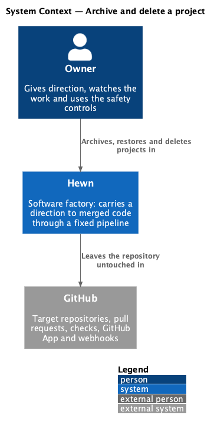
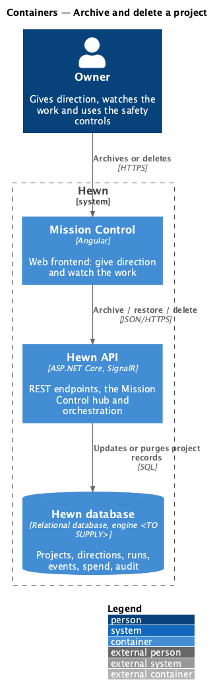
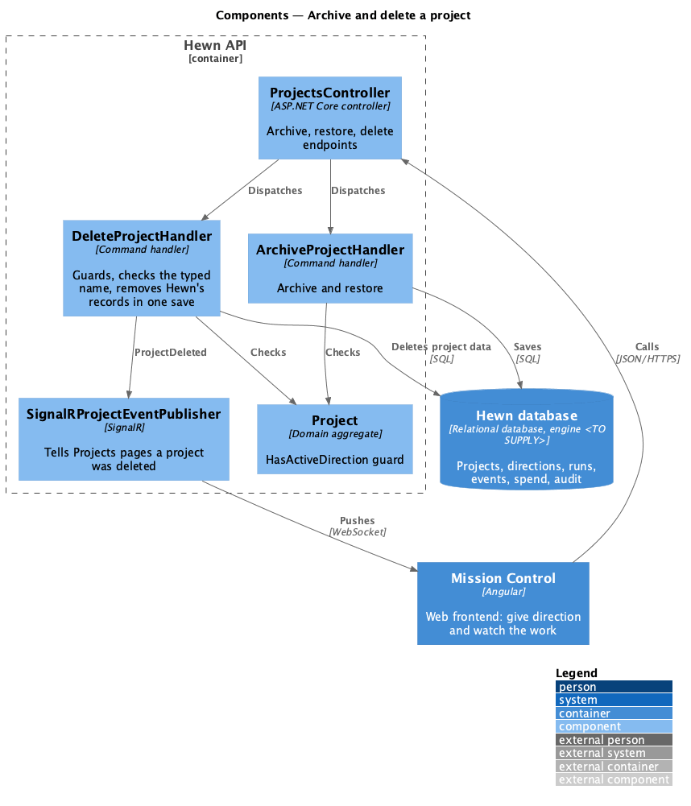
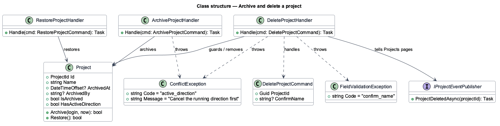
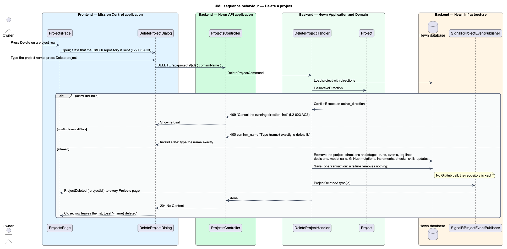
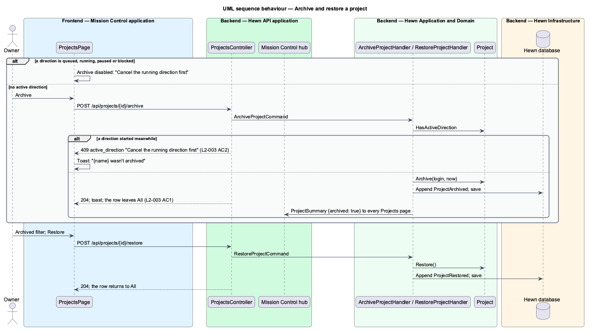

# Archive and delete a project

## Overview

A finished or abandoned project can leave the default Projects list in two ways. *Archive* is the soft path: the project moves under the Archived filter and can be restored. *Delete* is the hard path: Hewn removes its own records, logs and stored artifacts for the project, and leaves the GitHub repository untouched.

Both actions are refused while the project has an active direction (Queued, Running, Paused or Blocked). Mission Control shows the row actions disabled with the reason "Cancel the running direction first", and the API refuses the request with the same message. Delete asks the Owner to type the project name exactly before it proceeds.

Terms used in this design:

- **active direction** — direction whose status is Queued, Running, Paused or Blocked (`Direction.IsActive`)
- **archived project** — project hidden from the default list, shown under the Archived filter, restorable

## Description

The slice spans the Projects page, the delete dialog, three endpoints and a purge job.

- **`ProjectsPage`** — renders Archive and Delete per row for Owners. On projects with an active direction both render disabled, with the accessible name and tooltip "Cancel the running direction first". The Archived filter lists archived projects with Restore; Viewers see the filter without actions.
- **`DeleteProjectDialog`** — confirmation dialog. It states that the GitHub repository is kept, enables Delete only when the typed text equals the project name, and shows busy, invalid and failed states.
- **`ProjectsController`** — `POST /api/projects/{id}/archive`, `POST /api/projects/{id}/restore` and `DELETE /api/projects/{id}` with body `{ confirmName }`. All require the `Owner` policy.
- **`ArchiveProjectHandler / RestoreProjectHandler`** — refuse a project with `Project.HasActiveDirection` (409 `active_direction`), then set or clear `Project.ArchivedAt` and append `ProjectArchived` or `ProjectRestored`.
- **`DeleteProjectHandler`** — checks the guard and the typed name, then removes the project's directions and stages, runs, events, log lines, decisions, model calls (spend), GitHub mutations, increments and their checks, and skills updates in one save. It never calls GitHub.
- **`SignalRProjectEventPublisher`** — sends `ProjectDeleted { projectId }` to Projects pages and the project's own page.
- **`Project.HasActiveDirection`** — true while any direction is active; `Project.Archive` throws if called then, and the handlers answer 409 `active_direction` with the title "Cancel the running direction first".

Audit entries survive the purge, because L2-044 entries cannot be edited or removed through any API. Whether project deletion itself is an audited action is <TO SUPPLY>; L2-044 AC1 does not list it.

## Requirements

The feature realizes the following level-2 (L2) requirements. Each L2 requirement refines the level-1 (L1) requirement cited beside it. The text is copied from `docs/specs/L2.md`.

| L2 ID | Refines (L1) | Requirement |
|-------|--------------|-------------|
| `L2-003` | `L1-001` | **Archive and delete a project.** 1. Given a project with no active direction, when the Owner archives it, then it leaves the default list, appears under the Archived filter, and can be restored. Viewers see the Archived filter without Archive or Restore, and an archived project takes no new direction until it is restored ("Restore the project first"). 2. Given a project with an active direction (queued, running, paused or blocked), when the Owner tries to archive or delete it, then the action is refused with "Cancel the running direction first". 3. Given the Owner chooses Delete, when they type the project name exactly and confirm, then Hewn's records, logs and stored artifacts for the project are removed, and the GitHub repository is left untouched. The dialog states that the repository is kept. |

## Diagrams

### System context

The Owner archives, restores or deletes projects in Hewn. Hewn does not touch the GitHub repository on delete (L2-003 AC3).

### Containers

All three actions run in the Hewn API against the Hewn database; deletion finishes in a background job.

### Components

Both handlers call the same domain guard, so the API refuses the action even when a client shows it enabled.

### Class structure

`Project` owns the guard and the archive state; `DeleteProjectHandler` depends on the typed confirmation and removes the project's records itself.

### Behaviour — delete a project

The guard refuses projects with an active direction (L2-003 AC2). A mismatched name leaves the dialog in its invalid state. A match removes Hewn's data in one save and keeps the repository (AC3).

### Behaviour — archive and restore

Archive moves the project under the Archived filter; Restore returns it to the default list (L2-003 AC1).

## Decisions made while archiving and restoring (journey 30)

- **A flag beside the status** ([ADR 0031](../../../adr/0031-archiving-is-a-flag-beside-the-projects-status.md)). `projects.ArchivedAt`
  and `ArchivedBy` record the archive; the project keeps its status (Idle, Complete or Cancelled). Restore clears
  them, so the row shows the status it had.
- **The list filters on the client.** `GET /api/projects` returns every project with `archived`. All, each status
  tab and the counts leave archived projects out, and `?status=archived` lists only them, as the other filters do
  (ADR 0016). Archived has no count in the mock, so it shows none.
- **Queued counts as active.** A queued direction would start while the project was archived, so archiving is
  refused for it too.
- **An archived project takes no new direction.** `POST /api/projects/{id}/directions` answers 409
  `project_archived` ("Restore the project first").
- **Feedback.** Archive and Restore answer 204 and append `ProjectArchived` or `ProjectRestored`, so every open
  Projects page gets the changed row live. The Owner sees a success toast (with "Show archived" after archiving),
  or a danger toast with the API's reason. Both reuse the live-toast mocks, so no new mock was needed.
- **Activity older than a week** reads as a date ("12 Oct"), as `pages/projects/archived.html` shows.
- **Delete** (AC3) was journey 31; see below.

## Decisions made while deleting a project (journey 31)

- **Deleted in the request, in one save** ([ADR 0032](../../../adr/0032-a-project-is-deleted-in-one-save.md)). The
  design planned a `Deleting` mark and a `PurgeProjectJob`. A project's records are small rows in one database, so
  `DeleteProjectHandler` removes them all in one `SaveChanges`, and the API answers 204 once they are gone. A
  failure removes nothing, so the failed dialog can say "Nothing was removed; try again". No `Deleting` state, no
  job, no migration.
- **What "records, logs and stored artifacts" means here.** Directions and their stages, runs, events, run log
  lines, decisions, model calls (the spend history), GitHub mutations, increments and their checks, and skills
  updates. Workers, worker tokens, users and settings belong to no project and stay.
- **The name is checked on the server too.** `DELETE /api/projects/{id}` takes `{ confirmName }`; anything but the
  name exactly (case and spaces count) answers 400 `confirm_name` with the dialog's message, "Type {name} exactly
  to delete it." The active-direction guard is checked first, as for Archive (409 `active_direction`).
- **The dialog.** Delete project is enabled only when the name matches. The field error shows once the field is
  left with something else typed, as `invalid.html` shows. A failure keeps what was typed, so Try again works
  (`failed.html` shows the field empty; with it empty, Try again could not be enabled).
- **Live.** Every Projects page drops the row when `ProjectDeleted` arrives; the Owner gets a "{name} deleted"
  toast, "Its GitHub repository is kept.", reusing the live-toast mocks.
- **Archived projects** offer Restore only, as `archived.html` shows; restore one to delete it.
