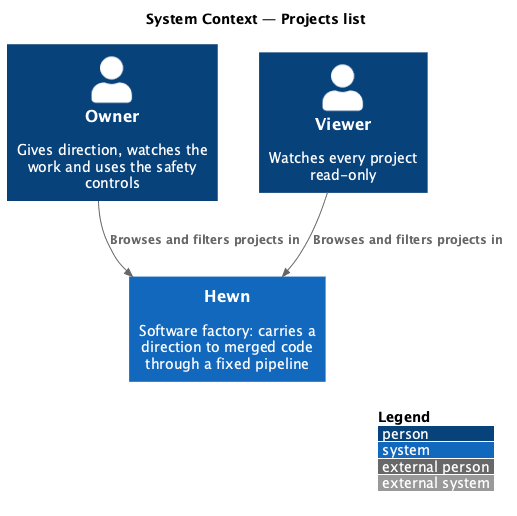
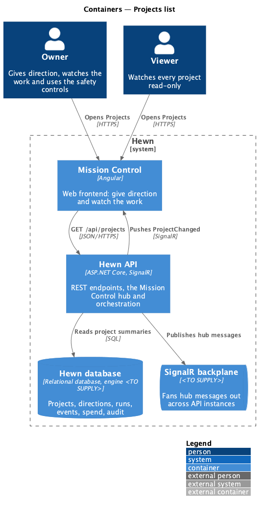
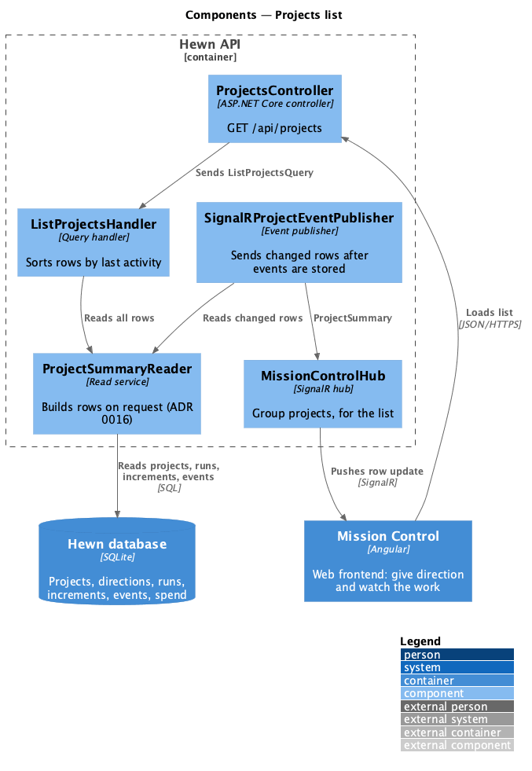
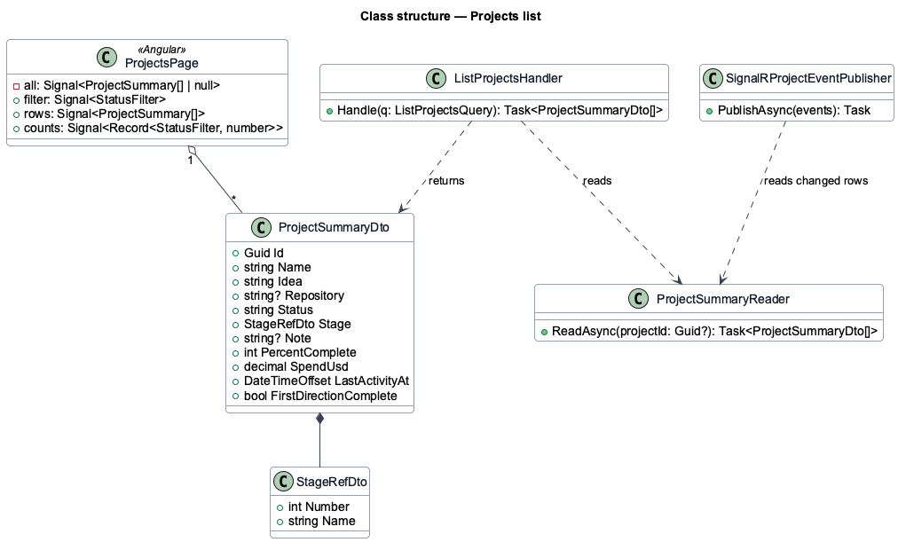
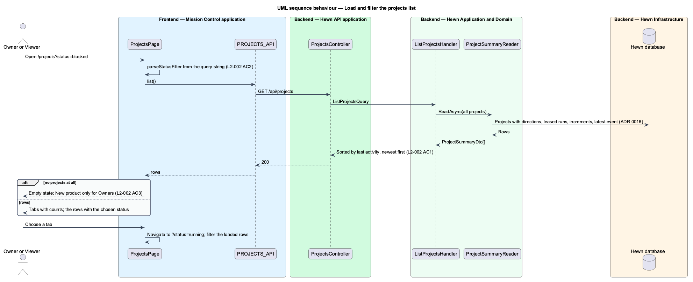
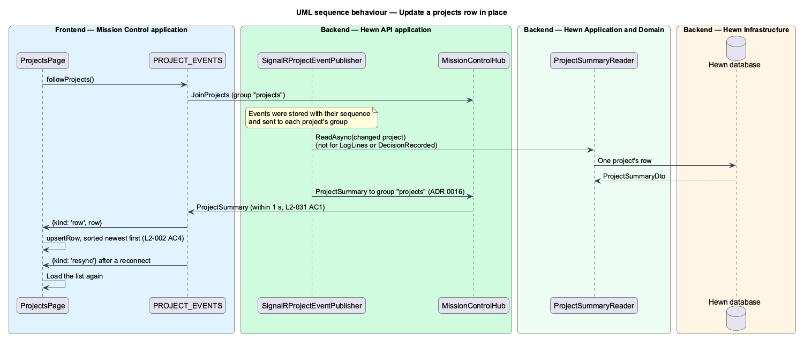

# Projects list

## Overview

The Projects page is the index of everything the factory is building. Each row is one project with its current stage, status, percent complete, spend to date and last activity, sorted newest activity first. A status filter narrows the list and survives a reload because it lives in the query string.

The list is live. When a project's status, stage, percent complete or spend changes, the row updates in place within 1 second through the real-time event stream designed in [Real-time events](../../mission-control/real-time-events/README.md). Owners also see the New product action and the per-row Archive and Delete actions designed in [Archive and delete a project](../archive-and-delete-project/README.md); Viewers see the same list without them.

Terms used in this design:

- **project status** — one of Running, Idle, Paused, Blocked, Cancelled or Complete, derived from the project's active direction
- **last activity** — time of the most recent event recorded for the project

## Description

The slice is a list read on request plus a live update path ([ADR 0016](../../../adr/0016-project-rows-are-read-on-request.md)).

- **`ProjectsPage`** — Angular page at `/projects?status={filter}`. It renders the filter tabs (All and each status, with a count), the rows, and the empty, loading, error and no-results states. The New product action renders only for Owners. It loads the list once through `PROJECTS_API`, then applies each `ProjectSummary` row from `PROJECT_EVENTS.followProjects()` without a reload.
- **`ProjectsController`** — `GET /api/projects` returns `ProjectSummaryDto[]` for every project, sorted by `LastActivityAt` descending, through `ListProjectsHandler`.
- **`ProjectSummaryReader`** — builds rows on request from projects, directions, leased runs, increments and each project's latest event.
- **`SignalRProjectEventPublisher`** — after events are stored and sent to each project's group, reads every changed project's row and sends it as `ProjectSummary` to the hub's `projects` group, which the page joins with `JoinProjects`.
- **`ProjectSummaryDto`** — row data: id, name, idea, repository, status, stage, note, percent complete, spend, last activity.

## Requirements

The feature realizes the following level-2 (L2) requirements. Each L2 requirement refines the level-1 (L1) requirement cited beside it. The text is copied from `docs/specs/L2.md`.

| L2 ID | Refines (L1) | Requirement |
|-------|--------------|-------------|
| `L2-002` | `L1-001` | **Projects list.** 1. Given projects exist, when a user opens Projects, then each project shows its name, current stage, status (Running, Idle, Paused, Blocked, Cancelled, Complete), percent complete, spend to date and last activity time, sorted by last activity, newest first. 2. Given the user selects a status filter, when the list refreshes, then only projects with that status are shown, and the filter survives a page reload (query string). 3. Given no projects exist, when an Owner opens Projects, then an empty state is shown with a "New product" action. A Viewer sees the empty state without the action. 4. Given a project's status changes, when the list is open, then the row updates in place within 1 second without a reload (L2-031). |
| `L2-045` | `L1-020` | **Performance targets.** 1. Given a mid-tier phone on a 4G profile (Lighthouse mobile), when Mission Control's Projects page loads, then Largest Contentful Paint is 2.5 s or less, and the initial JavaScript is 500 KB gzipped or less. 2. Given 50 projects and 20 connected workers, when the read APIs are load-tested, then p95 response time is 300 ms or less. 3. Given 200 events per second across all projects, when clients are subscribed, then the latency target in L2-031 AC1 still holds. |

L2-045 AC1 and AC2 are listed because the Projects page is the page they measure. The page keeps its initial JavaScript within the 500 KB gzipped budget by lazy-loading every other route.

## Diagrams

### System context

Owners and Viewers both read the projects list from Hewn; nothing outside Hewn is involved.

### Containers

Mission Control loads the list over HTTPS and then receives row updates over SignalR. The backplane carries hub messages between API instances.

### Components

The reader builds rows on request for both the list and the live updates, so they always agree; the publisher sends each changed row to the `projects` group.

### Class structure

`ProjectsPage` holds `ProjectSummaryDto` rows and replaces or adds a row by project id; the reader produces those rows for the handler and the publisher.

### Behaviour — load and filter the list

The filter lives in the query string and is applied to the loaded rows, so a reload restores it (L2-002 AC2). An Owner with no projects sees the empty state with New product; a Viewer sees it without (AC3).

### Behaviour — update a row in place

A persisted status change reaches the open list within 1 second and changes only the affected row (L2-002 AC4, L2-031).

## Decisions made while building the slice

Journey 11 built L2-002 AC1–AC4 and L2-045 AC1–AC2.

- **No read-model table** ([ADR 0016](../../../adr/0016-project-rows-are-read-on-request.md)). `ProjectSummaryReader`
  builds the rows on request; `ProjectSummaryProjector` and `project_summaries` are not built. After events are
  stored, the hub publisher reads each changed project's row and sends it as `ProjectSummary` to the hub's
  `projects` group, which the page joins with `JoinProjects`. After a reconnect the page loads the list again.
- **`ProjectSummaryDto`** is `{id, name, idea, repository, status, stage {number, name}, note, percentComplete,
  spendUsd, lastActivityAt, firstDirectionComplete}`. `idea` reads "Feature: …" while a feature direction is the
  current one. `note` is the running step (with "Increment n of m" in stage 10), the pause reason, or
  "{Stage} failed after 3 retries".
- **The filter is applied in the page.** `GET /api/projects` returns every project and has no `status` parameter,
  because the tabs show a count for every status. The filter is `?status=running` and so on, read on load.
- **Status is the project's own**: a finished project is Idle (L2-004 AC3); nothing sets Complete yet.
- **Not in this slice:** the Archived tab and the per-row Archive and Delete actions belong to
  [Archive and delete a project](../archive-and-delete-project/README.md) (L2-003), so every user gets the
  `rows--projects-viewer` layout for now. The error state has no "Go to dashboard" link until a dashboard exists.
  A filter with no projects shows "No {status} projects" with Show all projects, adapted from the Archived
  no-results mock.
- **Performance (L2-045).** `npm run test:perf` builds Mission Control for production, serves it gzipped with
  the e2e API behind it, and runs Lighthouse's mobile profile on `/projects`: LCP measured 1.44 s with 146
  projects and 125 KB of initial JavaScript, gzipped. The build merges chunks (`NG_BUILD_OPTIMIZE_CHUNKS=1`), so
  the initial JavaScript is one file; Angular preloads only ten, and the eleventh was found a round trip late.
  Start-up loads the user and the config together, Projects is the one eager route, and when the app opens on
  `/projects`, `ProjectsPrefetch` requests the list alongside the session instead of after routing. The load test ensures 50 projects
  and 20 workers, then sends 1,000 reads from 20 clients: p95 13 ms overall, 15 ms for the list.

