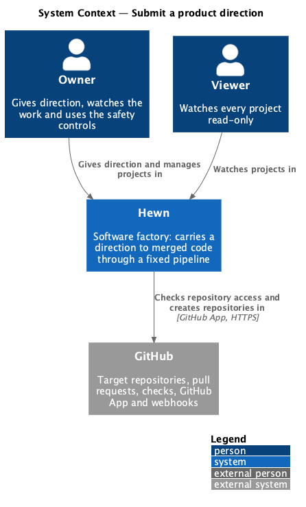
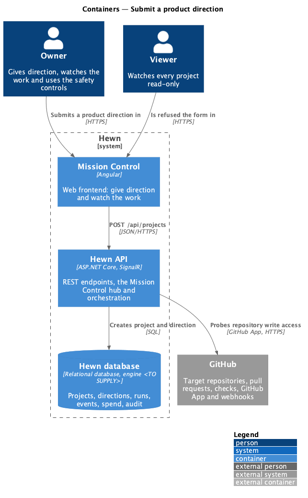
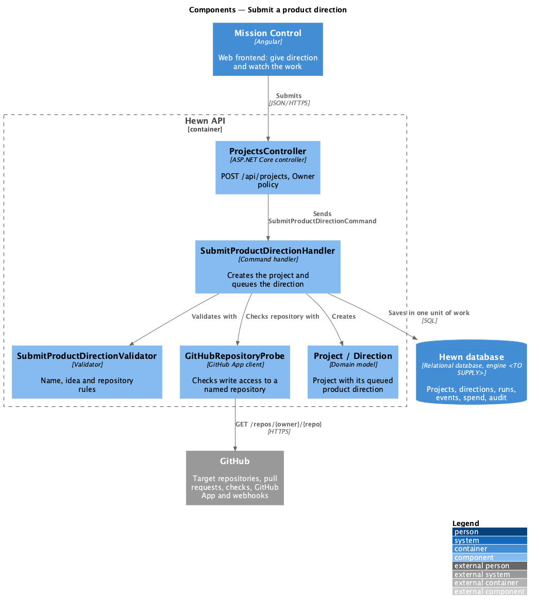
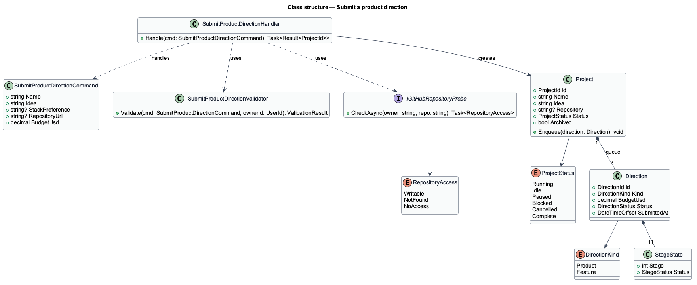
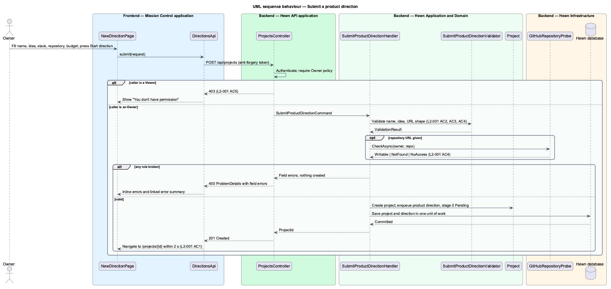

# Submit a product direction

## Overview

Hewn is a software factory. A human gives it a *direction* and autonomous agents carry that direction to merged code through a fixed, ordered pipeline of eleven stages (0 to 10). Mission Control is the Angular web frontend through which humans give direction and watch the work.

This feature covers the moment a project is born. An Owner opens the New direction page, keeps New product selected, and submits a project name, an idea, an optional stack preference, an optional existing GitHub repository and a budget. Hewn validates the submission, creates the project, queues a product direction with stage 0 Pending, and sends the browser to the new project page. After submission no step waits for human input (L2-028).

The same page also accepts a *feature direction* on an existing product; that path is designed in [Run a direction through the pipeline](../../pipeline/run-direction/README.md). The budget field is designed in [Spend and budgets](../../governance/spend-and-budgets/README.md), and the per-minute submission limit in [Web protections](../../security/web-protections/README.md).

Terms used in this design:

- **direction** — human instruction to build a new product or to add a feature to an existing product
- **product direction** — direction that creates a project and runs all eleven stages
- **project** — one product built by the factory, tracked independently through the pipeline
- **Owner** — role that gives direction and can stop work
- **Viewer** — read-only role

## Description

The slice runs from the New direction page to the Hewn database. All names are introduced by this design.

- **`NewDirectionPage`** — Angular page at `/projects/new`. It renders the form, the character counters and the "What runs next" stage plan, shows inline field errors and a linked error summary, and navigates to `/projects/{id}` on success. Viewers see "You don't have permission" instead of the form.
- **`DirectionsApi`** — typed Angular HTTP client. It posts `SubmitProductDirectionRequest` and maps `400 ProblemDetails` field errors back onto form controls.
- **`ProjectsController`** — ASP.NET Core controller. `POST /api/projects` requires the `Owner` policy, validates the anti-forgery token and dispatches the command. It returns `201 Created` with the project id, `400` with field errors, or `403`.
- **`SubmitProductDirectionCommand`** — request object: `Name`, `Idea`, `StackPreference?`, `RepositoryUrl?`, `BudgetUsd`.
- **`SubmitProductDirectionValidator`** — applies the field rules: name 1–100 characters and unique among the Owner's projects, idea 10–20,000 characters, repository URL in the form `https://github.com/{owner}/{repo}`.
- **`SubmitProductDirectionHandler`** — application logic. It runs the validator, asks `IGitHubRepositoryProbe` whether the GitHub App can write to a named repository, creates the `Project` and its first `Direction`, and saves both in one unit of work.
- **`Project`** — aggregate root holding the name, idea, repository, status and the ordered queue of directions.
- **`Direction`** — entity holding the kind (`Product` or `Feature`), budget, status and one `StageState` per stage; it starts `Queued` with stage 0 `Pending`.
- **`IGitHubRepositoryProbe`** — port implemented by the GitHub App client; it reports `Writable`, `NotFound` or `NoAccess` for a repository.
- **`HewnDbContext`** — persistence for projects and directions.

The handler acknowledges the request only after the commit, so an acknowledged direction is already durable (L2-050). Workers learn of the queued direction through the lease mechanism designed in [Worker loop](../../agent-runtime/worker-loop/README.md). The 2-second navigation target in L2-001 AC1 covers the round trip and the client-side route change; it does not wait for a worker to lease the run.

## Requirements

The feature realizes the following level-2 (L2) requirements. Each L2 requirement refines the level-1 (L1) requirement cited beside it. The text is copied from `docs/specs/L2.md`.

| L2 ID | Refines (L1) | Requirement |
|-------|--------------|-------------|
| `L2-001` | `L1-001` | **Submit a product direction.** An Owner creates a project by submitting a product direction: a project name, an idea, an optional stack preference and an optional existing GitHub repository. 1. Given an authenticated Owner on the New direction page with New product selected, when they submit a name of 1–100 characters that is unique among their projects and an idea of 10–20,000 characters, then a project is created, a direction is queued with stage 0 Pending, and the browser navigates to the project page within 2 seconds. 2. Given the name is empty, longer than 100 characters, or already used, when the Owner submits, then nothing is created and an inline error names the field and the rule broken. 3. Given the idea is shorter than 10 or longer than 20,000 characters, when the Owner submits, then nothing is created and an inline error states the allowed length. 4. Given an existing repository URL that is not a `https://github.com/{owner}/{repo}` URL, or a repository the GitHub credential cannot write to, when the Owner submits, then nothing is created and the error explains which. 5. Given a Viewer, when they open the New direction page or POST to the create endpoint, then the page shows "You don't have permission" and the API returns 403. |
| `L2-028` | `L1-015` | **No approval steps.** 1. Given a product direction is submitted, when it runs to Complete, then no stage, PR or merge waits for human input. An automated end-to-end test proves this by submitting a small direction and asserting it completes with no user interaction after submission. 2. Given any stage, when it would normally ask a human (a skill question, a review or a PR approval), then it proceeds under L2-054 instead. |

## Diagrams

### System context

An Owner submits the direction to Hewn; a Viewer is refused. Hewn checks write access to any named GitHub repository before it creates anything.

### Containers

Mission Control posts the form to the Hewn API, which probes GitHub and writes the project and direction to the Hewn database in one transaction.

### Components

Inside the Hewn API the controller dispatches a command; the handler validates, probes the repository, builds the domain objects and saves them.

### Class structure

A `Project` owns an ordered queue of `Direction` objects, and each direction owns eleven `StageState` entries. The handler depends on the validator and on the `IGitHubRepositoryProbe` port.

### Behaviour — submit a product direction

The happy path creates the project and direction in one commit and navigates within 2 seconds (L2-001 AC1). Validation failures return field errors and create nothing (AC2–AC4); a Viewer receives 403 (AC5).

