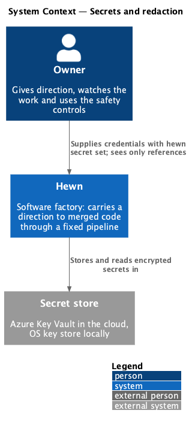
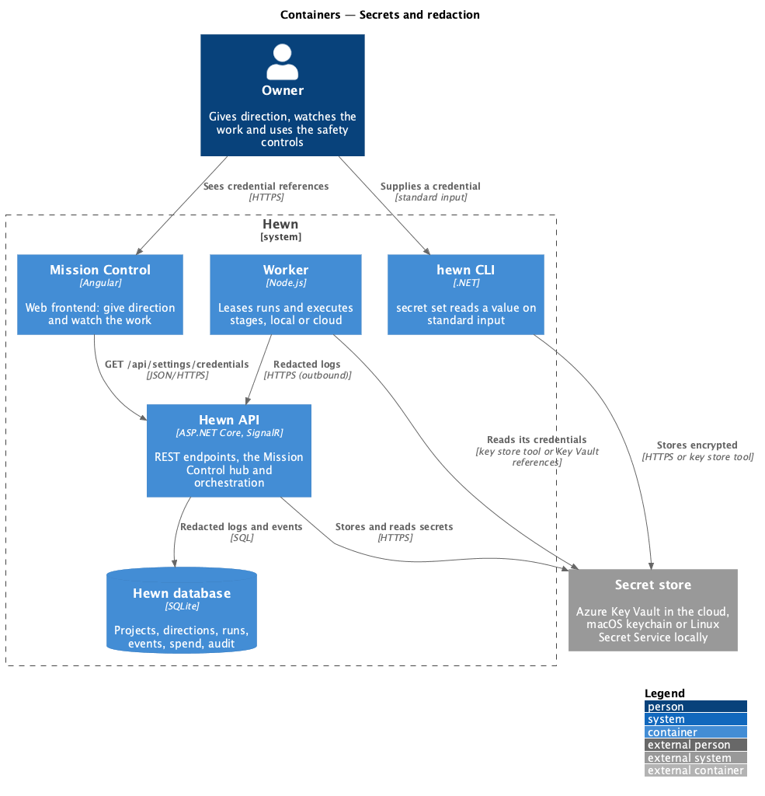
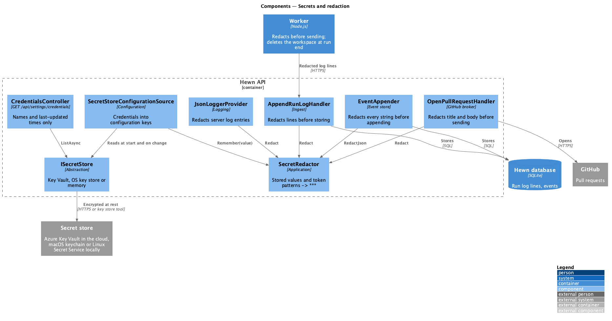
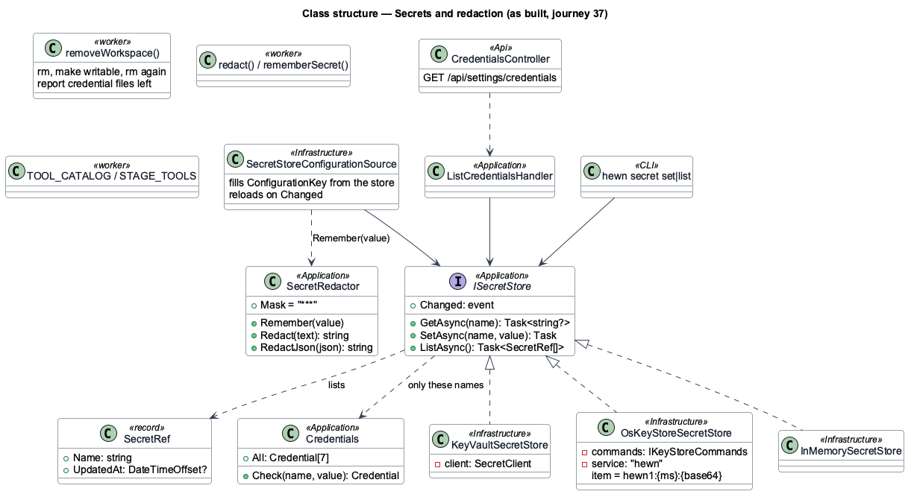
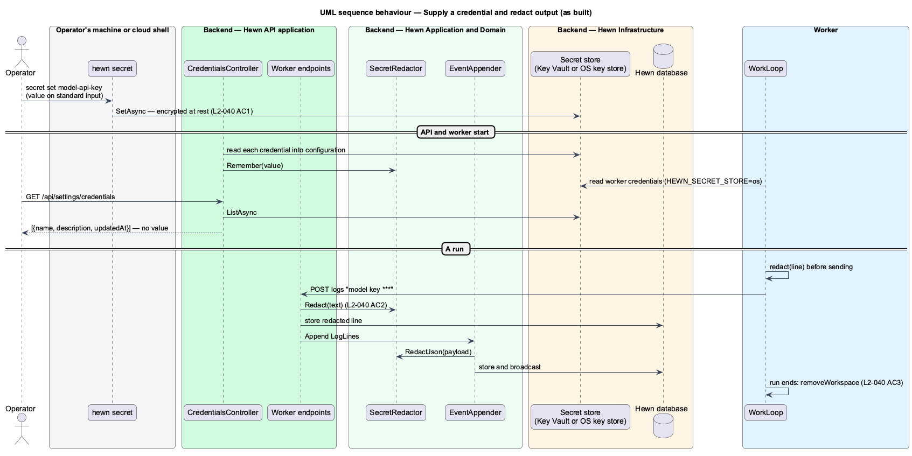
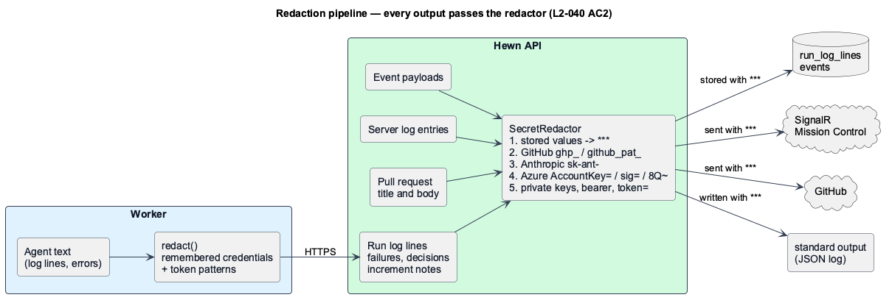

# Secrets and redaction

## Overview

Hewn holds four kinds of secret: model API keys, Magic Patterns credentials, the GitHub App private key and worker tokens. They are encrypted at rest, in a cloud key vault when Hewn runs in the cloud and in the operating system's key store when a worker runs locally, and no API response ever contains one.

Secrets can still leak into text an agent writes. Every log line, event and pull request body passes a *redactor* before it is stored or sent: any value equal to a stored secret, or matching a known token pattern for GitHub, Anthropic or Azure, is replaced with `***`. When a run ends, credentials written into its workspace are deleted.

Terms used in this design:

- **secret store** — cloud key vault (cloud) or OS key store (local) holding encrypted secrets
- **redactor** — filter that replaces secret values and token patterns with `***`

## Description

The slice is a secret store, a redaction filter applied at every output boundary, and workspace deletion at run end. As built in journey 37 (ADR 0037):

- **`ISecretStore`** (Application) — `GetAsync(name)`, `SetAsync(name, value)`, `ListAsync()` and a `Changed` event. Only the seven names in `Credentials` can be stored: `model-api-key`, `magic-patterns-token`, `github-app-private-key`, `github-client-secret`, `github-webhook-secret`, `worker-token` and `metrics-token`, each mapped to the configuration key it fills.
- **`KeyVaultSecretStore`** — Azure Key Vault, chosen as the cloud vault, with `HEWN_SECRET_STORE=keyvault` and `HEWN_KEY_VAULT_URI`; signs in with `DefaultAzureCredential`.
- **`OsKeyStoreSecretStore`** — with `HEWN_SECRET_STORE=os`: the macOS login keychain (`security`) or the Linux Secret Service (`secret-tool`). One item per credential under the service `hewn`, holding `hewn1:{unix ms}:{base64 value}`; a value only travels on standard input. Windows uses Key Vault.
- **`InMemorySecretStore`** — when `HEWN_SECRET_STORE` is unset: nothing persisted, for tests and environment-variable stacks.
- **`SecretStoreConfigurationSource`** — fills each credential's configuration key from the store, over environment variables, and reloads when the store changes one, so existing readers (`HEWN_GITHUB_APP_PRIVATE_KEY`, `HEWN_WORKER_TOKEN` and so on) need no change.
- **`hewn secret set <name>` / `hewn secret list`** — how an operator supplies a credential: the value on standard input, written straight to the store. The API and workers read it at start.
- **`SecretRef` and `GET /api/settings/credentials`** — the only form in which credentials appear: name, description and last-updated time, never the value. Anyone signed in can read it; a worker token can't.
- **`SecretRedactor`** — `Remember(value)` adds each credential's value (8 characters or more), from the store or the environment. `Redact(text)` replaces those values, then GitHub tokens (`gh[pousr]_…`, `github_pat_…`), Anthropic and other `sk-` keys, AWS keys, Azure storage and Service Bus keys (`AccountKey=`, `SharedAccessKey=`), SAS signatures (`sig=`), Entra ID client secrets (`…8Q~…`), private keys, bearer tokens and the value of `password=`, `token:` style assignments, with `***`. `RedactJson(json)` redacts every string in a document.
- **Redaction points** — run log lines, failures, decisions and increment notes at ingest; every event payload in `EventAppender.AppendAsync`; a pull request's title and body in `OpenPullRequestHandler` before they reach GitHub; every server log entry in the JSON logger. The worker applies the same patterns, and its own credentials' values, to a run's log lines and failure before sending them, and to its console log.
- **`removeWorkspace` (worker)** — when a run ends, however it ends, deletes its workspace and every credential the run wrote there. If a folder the run left read-only stops that, it makes the run's folders writable and tries again; the run's log reports any credential file it could not delete, and the worker goes on.
- **`TOOL_CATALOG` (worker)** — the tools any stage's agent can have; none exposes Hewn configuration, budgets, secrets or another project ([Agent isolation](../../agent-runtime/agent-isolation/README.md), L2-042 AC4).

## Requirements

The feature realizes the following level-2 (L2) requirements. Each L2 requirement refines the level-1 (L1) requirement cited beside it. The text is copied from `docs/specs/L2.md`.

| L2 ID | Refines (L1) | Requirement |
|-------|--------------|-------------|
| `L2-040` | `L1-019` | **Secrets.** 1. Given model API keys, Magic Patterns credentials, GitHub App keys and worker tokens, when they are stored, then they are encrypted at rest (a cloud key vault in the cloud, the OS key store locally) and no API response ever contains them. 2. Given a log line, event or PR body, when it contains a value matching a stored secret or a known token pattern (GitHub, Anthropic, Azure), then the value is replaced with `***` before it is stored or sent. 3. Given an agent workspace, when a run ends, then credentials written into it are deleted. |

## Diagrams

### System context

An operator supplies credentials once with `hewn secret set`; Hewn keeps them in the secret store and shows only their references.

### Containers

Secret values flow only into the API and the secret store; logs and events reach the database already redacted.

### Components

Redaction is applied at ingest by the same `Redactor`, so no storage path bypasses it.

### Class structure

Two `ISecretStore` implementations cover cloud and local. `SecretRef` is the value-free form used in responses.

### Behaviour — store a secret and redact output

Secrets are encrypted at rest and never returned (L2-040 AC1). Matching values are replaced with `***` before storage (AC2). Workspace credentials are deleted at run end (AC3).

### Redaction pipeline

Every output passes the redactor before it is stored, sent or written (AC2).

## Decisions made while building (journey 37)

- The cloud vault is Azure Key Vault; locally the macOS keychain or Linux Secret Service (ADR 0037).
- Credentials are supplied with `hewn secret set`, not a Mission Control screen: the GitHub OAuth client secret and the worker token are needed before anyone can sign in, and the value never passes through the API.
- The API reads credentials through a configuration source, so every existing reader of `HEWN_*` keys works unchanged.
- The mask is `***`, and an assignment keeps its name (`token=***`), so a reader can still tell what was there.
- Event payloads are redacted string by string after serialization, so no event type can bypass it and the JSON stays valid.
- Workspace deletion retries after making the run's folders writable rather than leaving files behind and stopping the worker, which is what a read-only folder used to cause.
