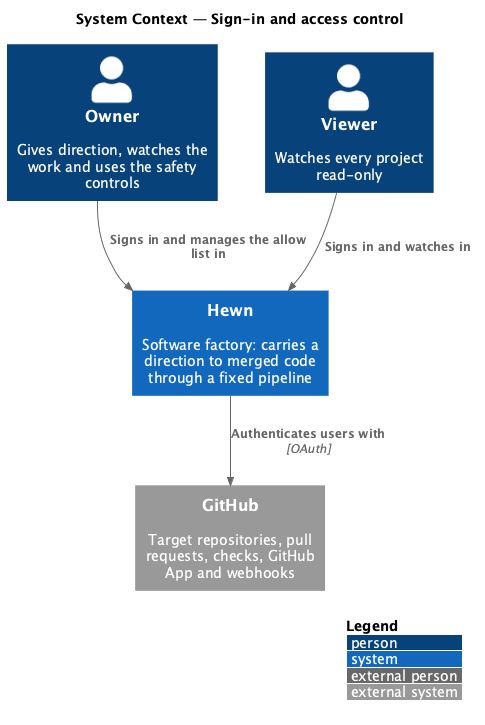
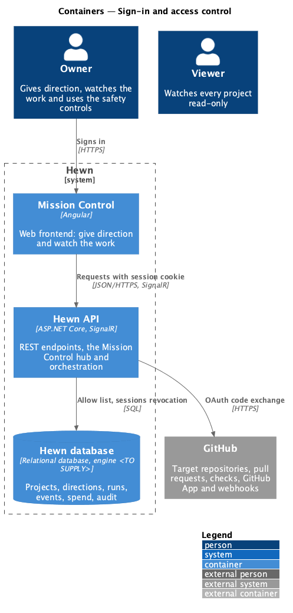
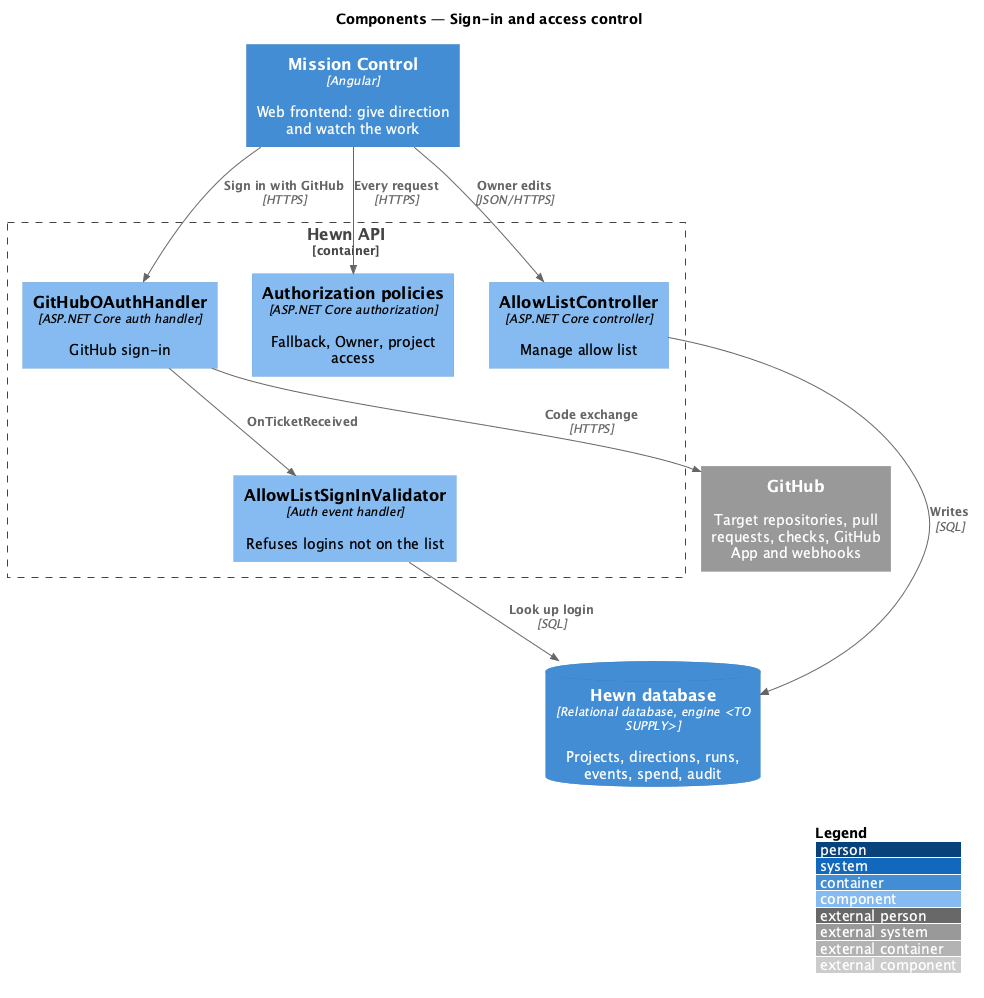
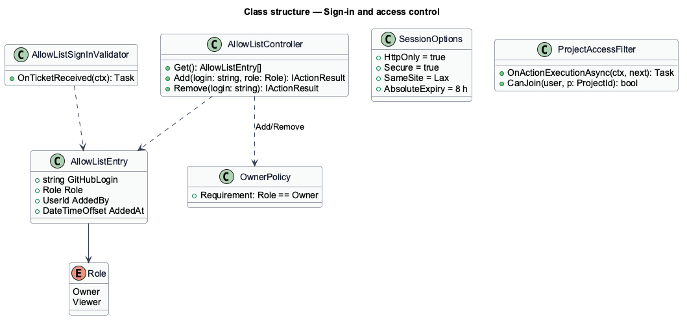
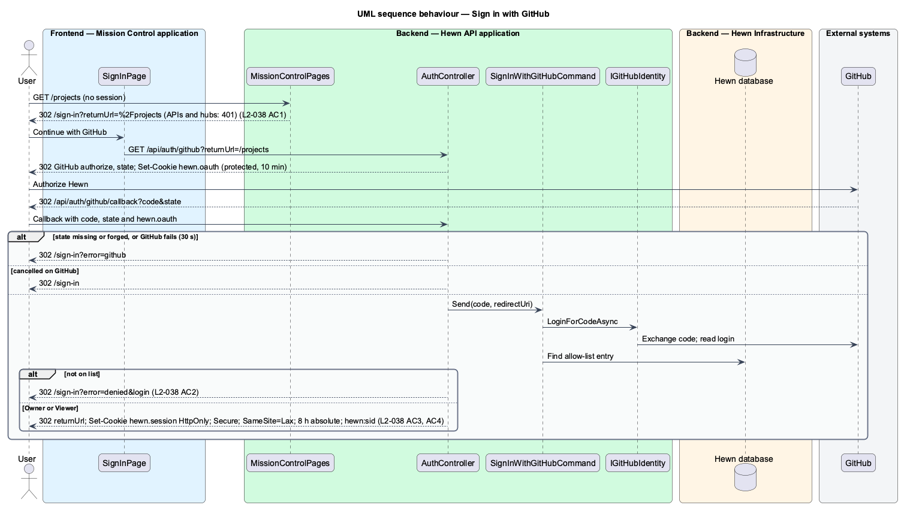
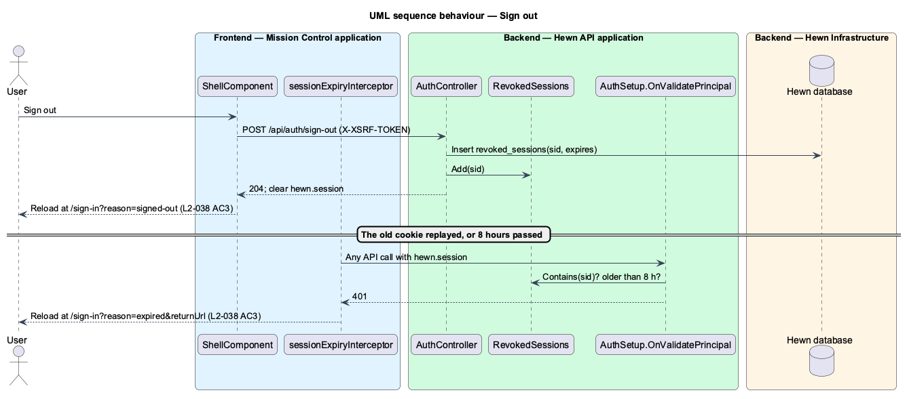
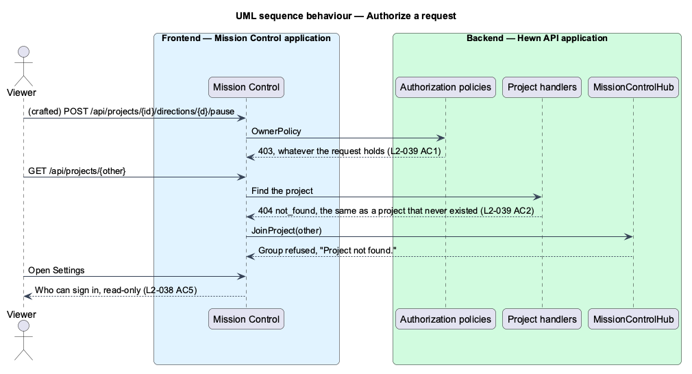

# Sign-in and access control

## Overview

Mission Control is private. Users sign in with GitHub, and only GitHub logins on Hewn's *allow list* get in. Each allow-list entry has a role: an *Owner* can change things, a *Viewer* can only watch. Every page, API and hub requires a session except `/health/*` and the GitHub webhook; unauthenticated pages redirect to sign-in and unauthenticated APIs and hubs return 401.

A session lasts at most 8 hours and ends on sign-out. Authorization is enforced on the server: a Viewer calling any state-changing endpoint gets 403 whatever the client shows, and a request for a project the user cannot access returns 404 so the project's existence is not revealed. Owners manage the allow list in Settings; Viewers see it read-only.

Terms used in this design:

- **allow list** — set of GitHub logins with access, each with the role Owner or Viewer
- **session** — server-issued authentication cookie valid for at most 8 hours

## Description

The slice uses ASP.NET Core authentication with a GitHub OAuth handler and policy-based authorization.

- **`GitHubOAuthHandler`** — ASP.NET Core OAuth handler for GitHub. On callback, `AllowListSignInValidator` looks up the login; a missing login is refused with "This account doesn't have access".
- **`SessionCookie`** — cookie authentication with `HttpOnly`, `Secure`, `SameSite=Lax` and an absolute expiry of 8 hours (no sliding renewal); `POST /auth/sign-out` ends it.
- **`FallbackAuthorizationPolicy`** — requires an authenticated user everywhere; `/health/*` and `/api/github/webhook` opt out with `AllowAnonymous`. Non-API routes challenge with a redirect to `/sign-in`; `/api/*` and `/hubs/*` return 401.
- **`OwnerPolicy`** — applied to every state-changing endpoint; Viewers get 403.
- **`ProjectAccessFilter`** — resolves `{projectId}` routes and hub `JoinProject`; when the user has no access it returns 404 or refuses the group. Every allow-listed user can access every project today; the filter is the single place a narrower rule would go.
- **`AllowListController / SettingsAccessSection`** — `GET/POST/DELETE /api/allow-list`; the Angular Settings section shows add and remove controls to Owners and a read-only table to Viewers.

## Requirements

The feature realizes the following level-2 (L2) requirements. Each L2 requirement refines the level-1 (L1) requirement cited beside it. The text is copied from `docs/specs/L2.md`.

| L2 ID | Refines (L1) | Requirement |
|-------|--------------|-------------|
| `L2-038` | `L1-019` | **Authentication.** 1. Given an unauthenticated request, when it targets any page, API or hub other than `/health/*` and the GitHub webhook, then pages redirect to sign-in and APIs and hubs return 401. 2. Given a user signs in with GitHub, when their GitHub account is not on the Hewn allow list, then sign-in is refused with "This account doesn't have access". 3. Given a session, when it is 8 hours old or the user signs out, then it ends, and later requests are treated as unauthenticated. 4. Given the session cookie, when it is set, then it is `HttpOnly`, `Secure` and `SameSite=Lax`. 5. Given an Owner, when they open Settings, then they can add a GitHub login to the allow list as Owner or Viewer, or remove one, and a Viewer sees the list read-only. |
| `L2-039` | `L1-019` | **Authorization.** 1. Given a Viewer, when they call any endpoint that changes state, then the server returns 403, whatever the client shows. 2. Given a user, when they request a project or join a hub group for a project they cannot access, then the server returns 404 or refuses the group, without revealing that the project exists. |

## Diagrams

### System context

GitHub proves identity; Hewn decides access from its own allow list.

### Containers

Authentication and authorization live entirely in the Hewn API; Mission Control only reflects the role it is told.

### Components

One fallback policy covers every endpoint and hub, so a new endpoint is protected unless it opts out explicitly.

### Class structure

`AllowListEntry` pairs a login with a `Role`; `OwnerPolicy` and `ProjectAccessFilter` are the two server-side checks of L2-039.

### Behaviour — sign in

Unauthenticated requests redirect or return 401 (L2-038 AC1). Logins not on the list are refused (AC2). The session cookie is HttpOnly, Secure, SameSite=Lax (AC4) and ends at 8 hours or sign-out (AC3).

### Behaviour — sign out

Sign out revokes the session's id, so a replayed cookie gets 401; a 401 while the app is open, from sign-out
elsewhere or the 8 hours passing, reloads at sign-in saying the session ended (L2-038 AC3).

### Behaviour — authorize a request

A Viewer's state change returns 403 (L2-039 AC1); an inaccessible project returns 404 or a refused group (AC2). Owners edit the allow list; Viewers read it (L2-038 AC5).

## Decisions made while building sign-in and sign-out

Journey 20 built L2-038 AC1 to AC4 ([ADR 0022](../../../adr/0022-the-api-serves-mission-control-and-ends-sessions-by-id.md)).

- **`AuthController` runs the OAuth flow**, not the `GitHubOAuthHandler` named above: `GET /api/auth/github?returnUrl`
  and `GET /api/auth/github/callback`, with the state in a protected `hewn.oauth` cookie. `IGitHubIdentity`
  (`GitHubOAuthIdentity`, 30 s timeout, `HEWN_GITHUB_CLIENT_ID` and `HEWN_GITHUB_CLIENT_SECRET`) exchanges the
  code; `SignInWithGitHubCommand` checks the allow list. `AllowListSignInValidator` is not a separate class.
- **The callback answers with a sign-in state**: `/sign-in?error=denied&login=` (not on the list),
  `/sign-in?error=github` (forged or missing state, or GitHub failed), `/sign-in` (cancelled), else the local
  `returnUrl` or `/`. `Hewn:Auth:PublicOrigin` sets the callback's origin behind a proxy.
- **Sign-out revokes by id**: the `hewn:sid` claim goes to `revoked_sessions`, cached in `RevokedSessions`, and
  `OnValidatePrincipal` refuses it. `POST /api/auth/sign-out` (no longer `/auth/sign-out`) needs the anti-forgery
  header.
- **The API serves Mission Control** (`MissionControlPages`): `/sign-in` and the app's files are anonymous, other
  pages redirect to `/sign-in?returnUrl=`.
- **Mission Control**: `SignInPage` shows the mocks' default, loading, denied, error, expired and signed-out
  states from its query. The sidebar's Sign out icon button, added to the Magic Patterns shell and the mocks for
  this journey, reloads at `/sign-in?reason=signed-out`. `sessionExpiryInterceptor` turns a 401 once signed in into
  `/sign-in?reason=expired&returnUrl=`.
- **Not built in this journey:** the allow list in Settings (AC5). Revocations past their 8 hours are pruned at each sign-out.
