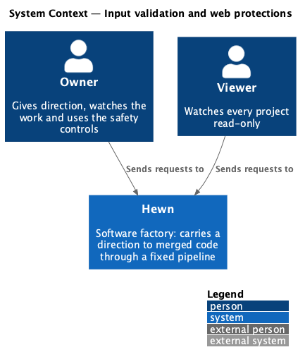
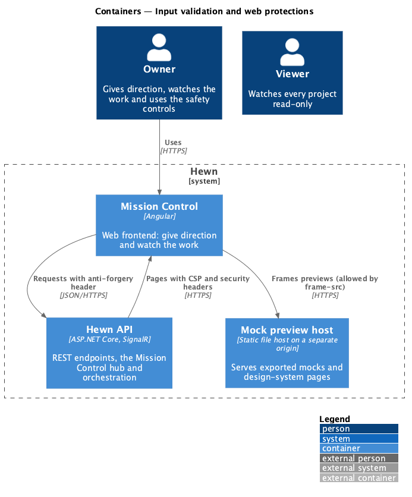
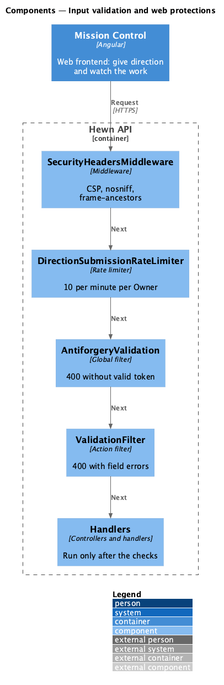
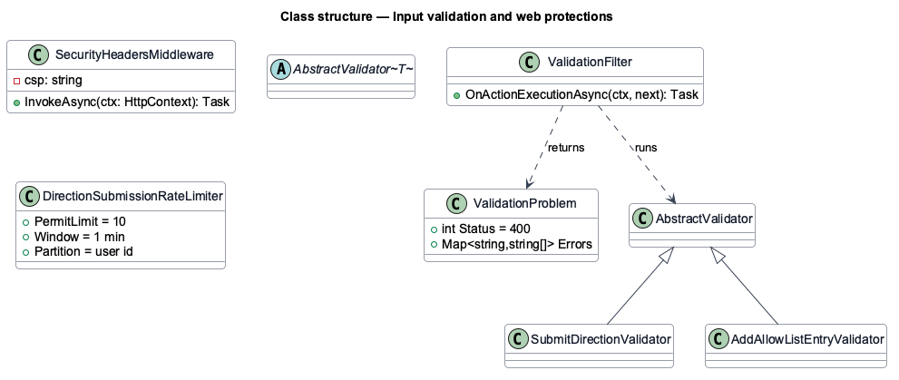
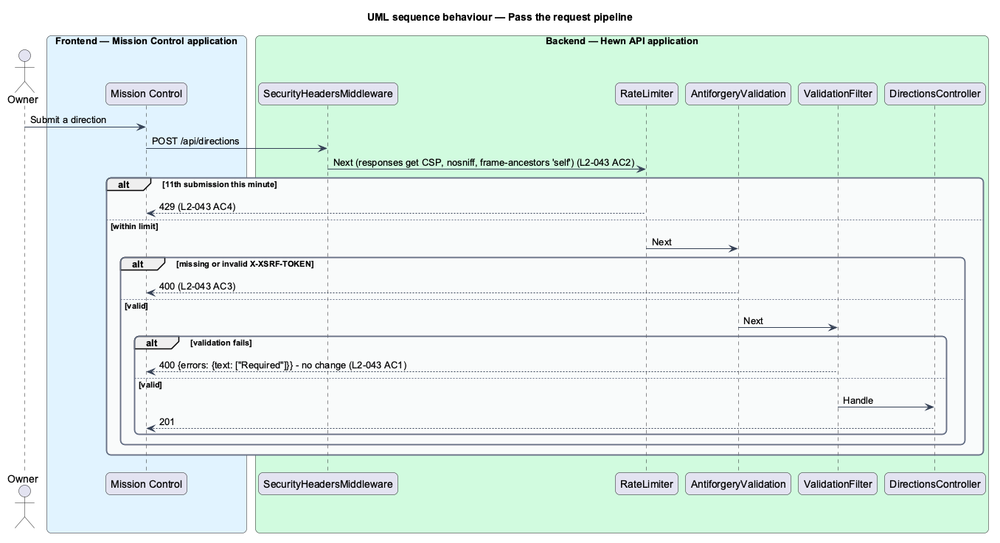

# Input validation and web protections

## Overview

Mission Control and the Hewn API face the internet, so they apply the usual web protections on every request. Every API input is validated on the server; a failure returns 400 with field errors and changes nothing. State-changing requests carry an anti-forgery token, and a request without a valid one returns 400.

Pages are served with a Content-Security-Policy that forbids inline scripts, plus `X-Content-Type-Options: nosniff` and `frame-ancestors 'self'`. An Owner can submit at most 10 directions a minute; extra requests get 429. CI runs the OWASP ZAP baseline scan against a running build and fails on any High finding.

Terms used in this design:

- **anti-forgery token** — per-session token sent in a header on state-changing requests to defeat cross-site request forgery
- **CSP** — Content-Security-Policy response header restricting where scripts, styles and frames may load from

## Description

The slice is a set of ASP.NET Core middleware and filters plus a CI job.

- **`Request validators`** — one FluentValidation validator per request DTO; `ValidationFilter` returns `400 application/problem+json` with `errors{field: [message]}` before the handler runs, so no change is made.
- **`SecurityHeadersMiddleware`** — sets `Content-Security-Policy: default-src 'self'; script-src 'self'; frame-src https://mocks.hewn.dev; frame-ancestors 'self'; …` with no `unsafe-inline` for scripts, and `X-Content-Type-Options: nosniff`, on every page response.
- **`AntiforgeryValidation`** — ASP.NET Core antiforgery; the token is issued in an `XSRF-TOKEN` cookie that Angular's `HttpClient` echoes in `X-XSRF-TOKEN`. A global filter validates it on POST, PUT, PATCH and DELETE, returning 400 on failure. The worker API and the webhook use bearer and signature authentication instead.
- **`DirectionSubmissionRateLimiter`** — ASP.NET Core fixed-window limiter, 10 permits per minute partitioned by user, on `POST /api/projects/*/directions` and `POST /api/directions`; rejections return 429.
- **`ZapBaselineJob`** — CI job that starts the app and runs `zap-baseline.py` against it, failing on any High alert.

## Requirements

The feature realizes the following level-2 (L2) requirements. Each L2 requirement refines the level-1 (L1) requirement cited beside it. The text is copied from `docs/specs/L2.md`.

| L2 ID | Refines (L1) | Requirement |
|-------|--------------|-------------|
| `L2-043` | `L1-019` | **Input validation and web protections.** 1. Given any API input, when it fails server-side validation, then the server returns 400 with field errors and makes no change. 2. Given Mission Control pages, when they are served, then they carry a Content-Security-Policy with no `unsafe-inline` scripts, plus `X-Content-Type-Options: nosniff` and `frame-ancestors 'self'`. 3. Given state-changing requests, when they arrive without a valid anti-forgery token, then they return 400. 4. Given an Owner, when they submit more than 10 directions in a minute, then the extra requests return 429. 5. Given the OWASP ZAP baseline scan, when it runs in CI, then it reports no High findings. |

## Diagrams

### System context

The protections apply to every user request.

### Containers

The CSP allows the preview origin as a frame source only, so sandboxed previews still load (L2-011).

### Components

Requests pass headers, rate limiting, anti-forgery and validation in that order before any handler runs.

### Class structure

Each request DTO has a validator; `ValidationFilter` turns failures into one `ValidationProblem` shape.

### Behaviour — pass the request pipeline

Pages carry the CSP and headers (L2-043 AC2). Missing anti-forgery tokens return 400 (AC3), an 11th submission in a minute returns 429 (AC4), and invalid input returns 400 with field errors and no change (AC1).

