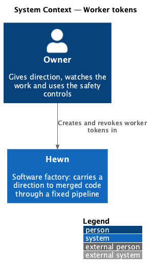
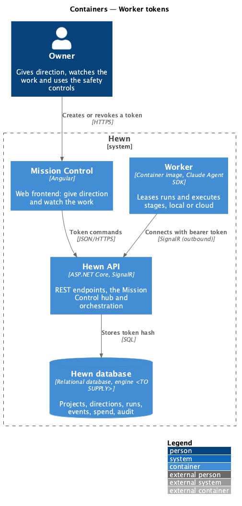
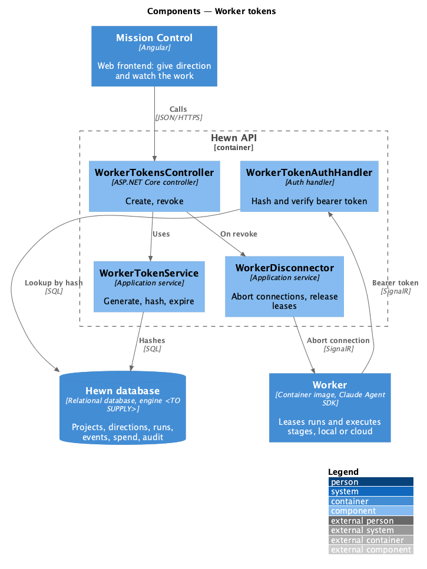
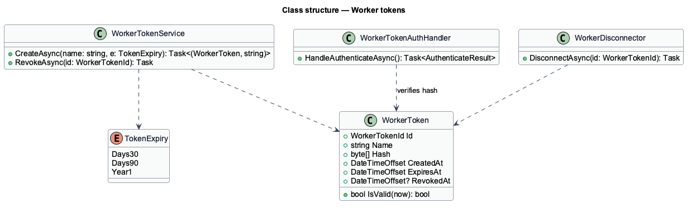
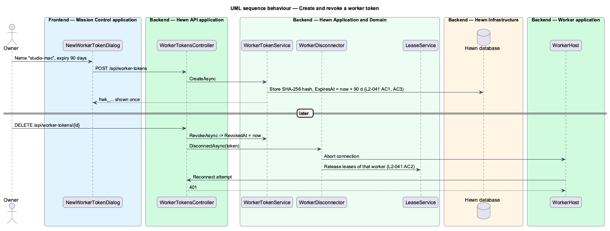

# Worker tokens

## Overview

A worker proves who it is with a *worker token*. An Owner creates one on the Workers page, picks an expiry of 30 days, 90 days or 1 year, and copies the token from a dialog that shows it once. Hewn stores only a hash, so a lost token cannot be shown again; the Owner creates a new one.

A token stops working when it expires or when an Owner revokes it. Revoking a token whose worker is connected disconnects that worker within 10 seconds and releases its lease, so the run returns to the queue and resumes elsewhere from its checkpoint (L2-026).

Terms used in this design:

- **worker token** — bearer secret a worker presents when it connects
- **token hash** — SHA-256 of the token, the only form stored

## Description

The slice spans token issue and revocation in the API, the worker connection check and the Workers page.

- **`WorkerTokensController`** — `POST /api/worker-tokens {name, expiry}` (Owner) returns the token once; `DELETE /api/worker-tokens/{id}` revokes it. Both write audit entries (L2-044).
- **`WorkerTokenService`** — generates 32 random bytes with a `hwk_` prefix, stores `SHA256(token)`, name, created-by, `ExpiresAt` (30 d, 90 d or 1 y) and `RevokedAt`.
- **`WorkerTokenAuthHandler`** — authenticates the worker hub and worker APIs by hashing the presented bearer token; expired or revoked tokens fail with 401.
- **`WorkerDisconnector`** — on revocation, aborts every hub connection authenticated with that token and calls `LeaseService.Release` for its leases; the 10-second bound is met because abort is immediate and the worker's next request fails authentication.
- **`NewWorkerTokenDialog (Angular)`** — name, expiry choice and a one-time reveal with Copy and the start command.

## Requirements

The feature realizes the following level-2 (L2) requirements. Each L2 requirement refines the level-1 (L1) requirement cited beside it. The text is copied from `docs/specs/L2.md`.

| L2 ID | Refines (L1) | Requirement |
|-------|--------------|-------------|
| `L2-041` | `L1-019` | **Worker authentication.** 1. Given an Owner, when they create a worker token, then the token is shown once and only its hash is stored. 2. Given a token is revoked, when its worker is connected, then the worker is disconnected within 10 seconds and its lease is released. 3. Given an Owner creates a token, when they choose an expiry of 30 days, 90 days or 1 year, then the token stops working at that time. |

## Diagrams

### System context

Only an Owner issues or revokes tokens.

### Containers

The Hewn API stores hashes only and checks the worker's token on every connection.

### Components

Revocation goes through `WorkerDisconnector`, which both drops the connection and releases the lease.

### Class structure

`WorkerToken.IsValid` is false after `ExpiresAt` or once `RevokedAt` is set.

### Behaviour — create and revoke a token

The token is shown once and only its hash stored (L2-041 AC1), with a chosen expiry (AC3). Revocation disconnects the worker within 10 seconds and releases its lease (AC2).

