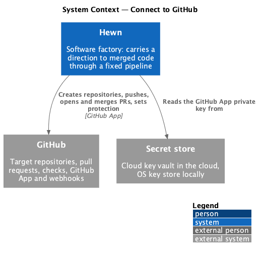
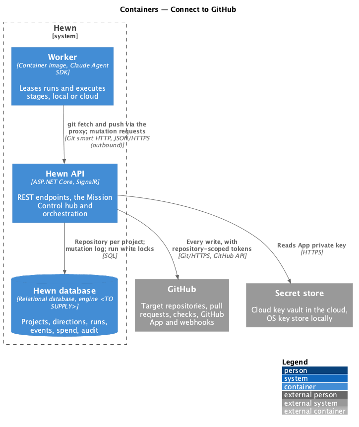
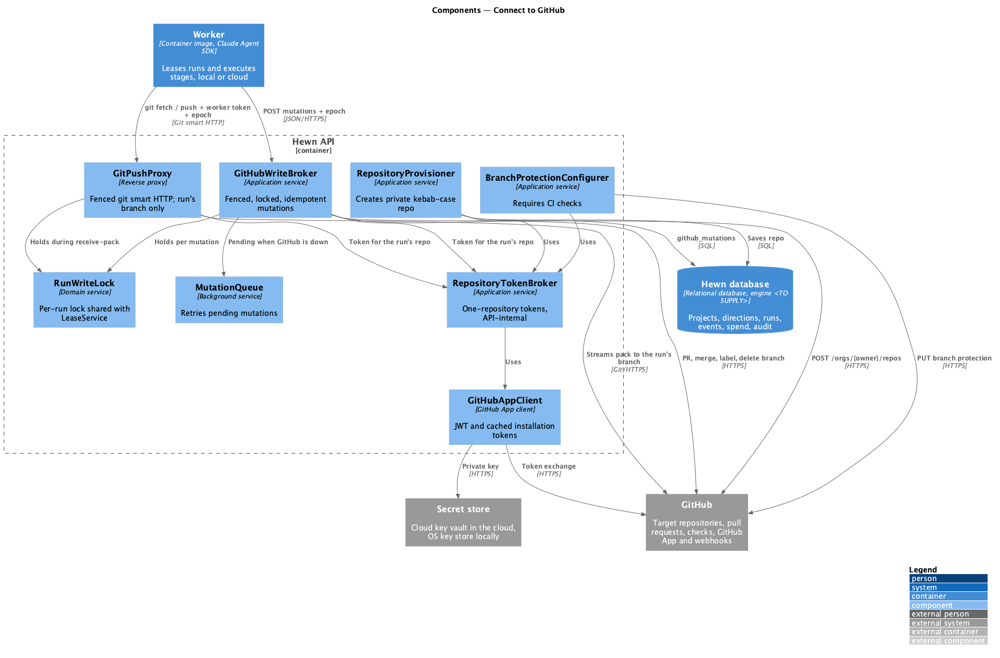
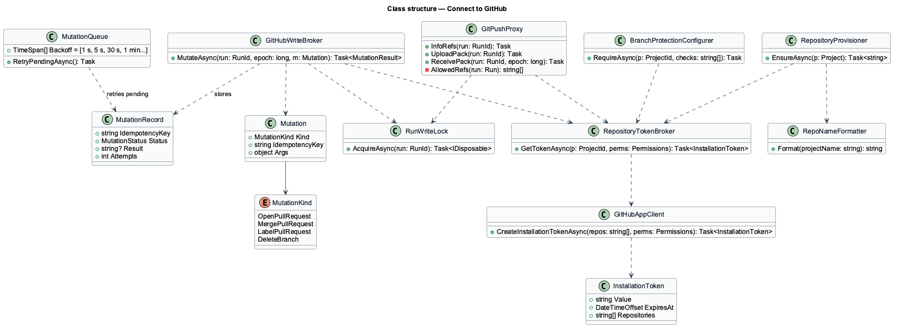
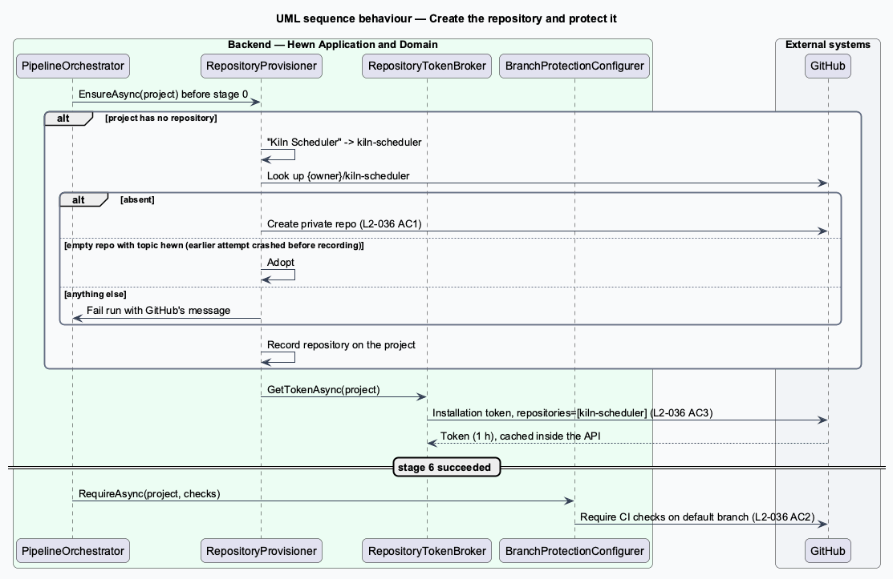
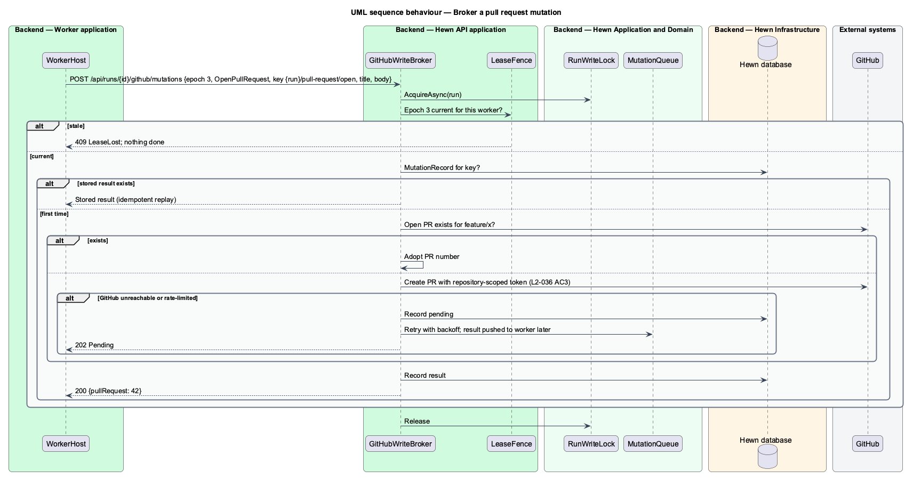

# Connect to GitHub

## Overview

Every Hewn project lives in a GitHub repository, and Hewn reaches GitHub only through a GitHub App. A GitHub App is installed on an account or organization and issues short-lived *installation tokens*; Hewn asks for a token scoped to exactly one repository each time it needs one, so work for one project can never touch another project's repository.

Those tokens never leave the Hewn API. Every write to GitHub, whether a git push or a REST mutation such as opening or merging a pull request, passes through the API's *write broker*. The broker checks the worker's lease epoch and holds the run's write lock before it touches GitHub, so a worker whose lease has been reassigned cannot change anything ([Worker loop](../../agent-runtime/worker-loop/README.md)). Git traffic from workers reaches the broker through a git smart-HTTP proxy that allows ref updates on the run's own branch only. Workers hold a worker token and nothing else.

A product direction submitted without a repository gets one: when stage 0 starts, Hewn creates a private repository under the configured GitHub owner, named from the project name in lowercase kebab case ("Kiln Scheduler" becomes `kiln-scheduler`). When stage 6 completes, Hewn sets branch protection on the default branch so the CI checks shall pass before any merge.

Terms used in this design:

- **GitHub App** — GitHub integration with its own identity and permissions, installed on the configured owner
- **installation token** — short-lived token the GitHub App issues, here limited to one repository and held only inside the API
- **configured owner** — GitHub user or organization under which Hewn creates repositories, set in Settings
- **write broker** — API component through which every GitHub write passes, fenced by lease epoch and serialized per run
- **mutation** — one GitHub REST write: open, merge or label a pull request, delete a branch, create a repository, set branch protection

## Description

The slice is a set of API services; workers call them and never call GitHub.

- **`GitHubAppClient`** — signs a JWT with the GitHub App private key from the secret store (L2-040) and exchanges it for installation tokens, which it caches per repository for their lifetime. No other component sees a token.
- **`RepositoryTokenBroker`** — `GetTokenAsync(project)` returns an installation token restricted with `repositories=[name]` and the permissions the caller needs. Its only callers are `GitHubWriteBroker`, `GitPushProxy` and the API's own read paths (webhook polling, trace indexing, previews). There is no endpoint that hands a token to a worker.
- **`GitHubWriteBroker`** — `POST /api/runs/{id}/github/mutations` with `{epoch, kind, idempotencyKey, args}`. Inside `RunWriteLock` it runs `LeaseFence`, looks up the idempotency key `{run}/{step}/{kind}` in the `github_mutations` table (returning the stored result if present), performs the mutation with a repository-scoped token, stores the result, and releases the lock. Each mutation kind checks GitHub's current state before acting: open adopts an existing open PR on the branch, merge treats an already-merged PR as success, label and delete-branch are no-ops when already done. Mutation kinds are restricted to the run's own branch and PR.
- **`MutationQueue`** — when GitHub is unreachable or rate-limits, the broker stores the mutation as pending and returns 202; a background retrier with backoff (1 s, 5 s, 30 s, then every minute for up to an hour) completes it under the same lock and fence, and reports the result to the worker over its connection. Readiness (`/health/ready`) does not depend on GitHub ([Observability and health checks](../../operations/observability-and-health/README.md)).
- **`GitPushProxy`** — git smart-HTTP reverse proxy at `/git/{runId}/…` serving `info/refs`, `git-upload-pack` and `git-receive-pack`. It authenticates the worker token and reads `X-Hewn-Epoch`. For `git-receive-pack` it acquires `RunWriteLock`, runs `LeaseFence`, parses the ref update commands in the pack protocol and rejects the push unless every command targets the run's branch (`refs/heads/feature/{slug}`, `refs/heads/hewn/scaffold` or `refs/heads/hewn/update-skills-*` as the run type dictates), then streams the request to GitHub with the installation token and the response back. On success it records the new head as `Run.BranchHead`. The proxy keeps no state and streams bodies, so it scales with API instances.
- **`RepositoryProvisioner`** — before the first stage-0 run of a product direction with no repository, creates `{owner}/{kebab-name}` as private and records it on the project. It is idempotent: it first looks the name up, adopts an existing empty repository that carries the `hewn` topic (left by an attempt that crashed before recording), and fails the run with GitHub's message if the name is taken by anything else or creation is refused.
- **`RepoNameFormatter`** — lowercases, replaces runs of non-alphanumerics with one hyphen and trims hyphens.
- **`BranchProtectionConfigurer`** — invoked when stage 6 succeeds; requires the stack template's CI checks on the default branch ([Scaffold the solution](../../stages/scaffold-solution/README.md)).

The GitHub App's exact permission set (contents, pull requests, checks, administration for branch protection) is <TO SUPPLY> until the App is registered.

Routing pushes through the API costs latency and bandwidth: a Local worker pushes through the cloud API, and a large repository makes the proxy the bottleneck. The design accepts this for what it buys: no GitHub credential in any worker, one fencing point for every write, and ref-level control over what a run may push. `git-upload-pack` (fetch and clone) goes through the same proxy so that workers need no read token either.

## Requirements

The feature realizes the following level-2 (L2) requirements. Each L2 requirement refines the level-1 (L1) requirement cited beside it. The text is copied from `docs/specs/L2.md`.

| L2 ID | Refines (L1) | Requirement |
|-------|--------------|-------------|
| `L2-036` | `L1-018` | **Connect to GitHub.** 1. Given a product direction without a repository, when stage 0 starts, then a private repository is created under the configured GitHub owner, named from the project name in lowercase kebab case. 2. Given a repository, when stage 6 completes, then branch protection on the default branch requires the CI checks to pass. 3. Given GitHub access, when Hewn calls GitHub, then it uses a GitHub App installation token limited to the project's repository. |

## Diagrams

### System context

GitHub is reached only as a GitHub App, only from the Hewn API; its private key lives in the secret store.

### Containers

Only the Hewn API holds the App key or any installation token. Workers send git traffic and mutation requests to the API, which forwards them to GitHub after fencing.

### Components

`GitPushProxy` and `GitHubWriteBroker` are the two entry points for worker writes; both take `RunWriteLock`, run the fence and draw a one-repository token from `RepositoryTokenBroker`, which is the one place where the single-repository limit of L2-036 AC3 is applied.

### Class structure

`Mutation` carries an idempotency key that `MutationRecord` stores, so a repeated request returns the stored result; `MutationQueue` retries records left pending by a GitHub outage.

### Behaviour — create the repository

A product direction without a repository gets a private kebab-case repository (L2-036 AC1). Every call uses a token limited to that repository and made inside the API (AC3); protection follows stage 6 (AC2).

### Behaviour — broker a pull request mutation

The worker asks the API to open a pull request. The broker fences the epoch inside the run write lock, checks the idempotency key and GitHub's current state, performs the write with a repository-scoped token (L2-036 AC3), and stores the result so a retry returns the same answer.

