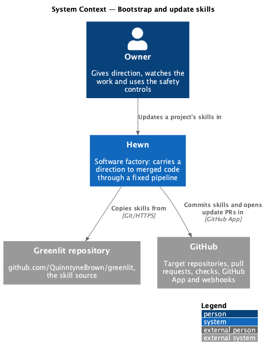
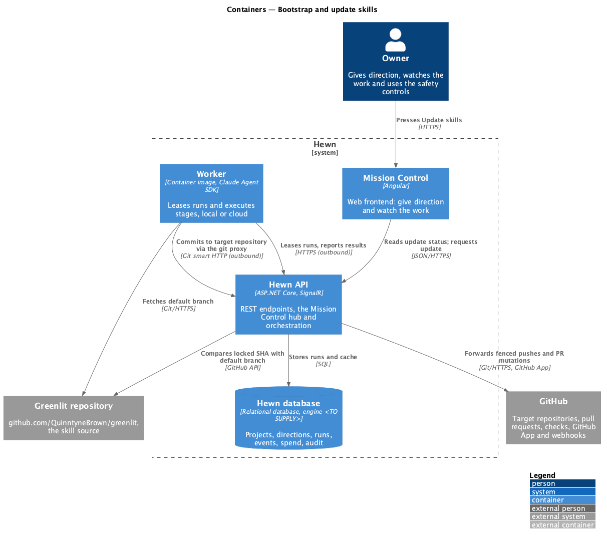
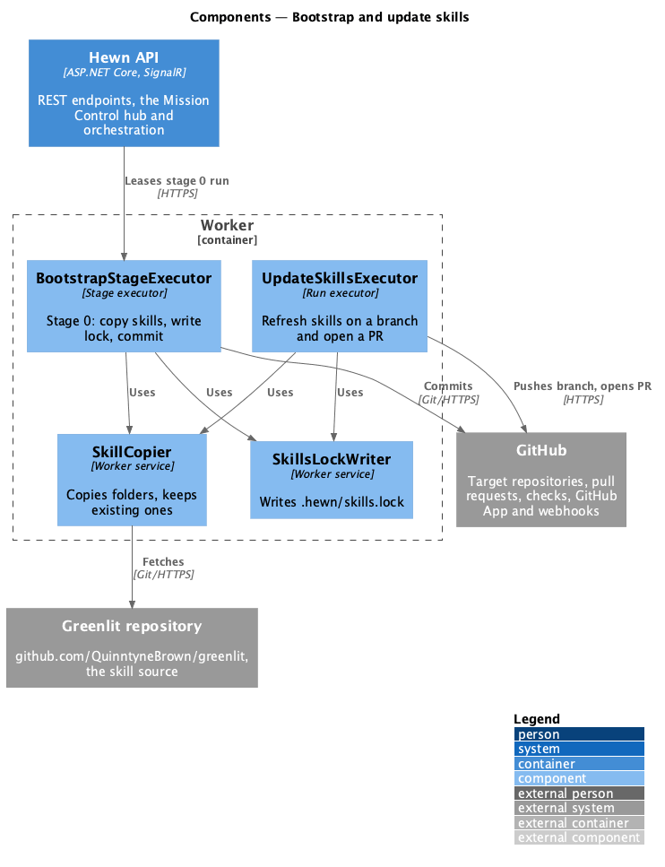
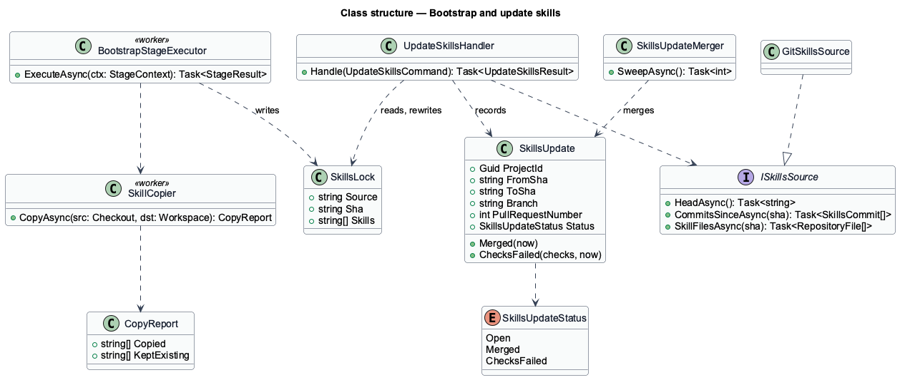
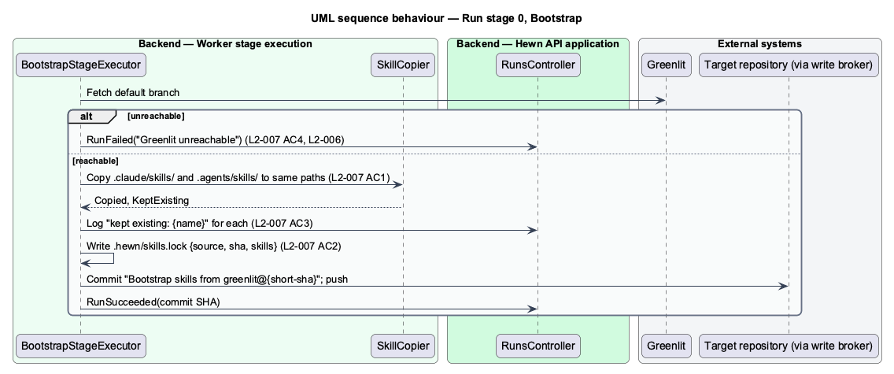
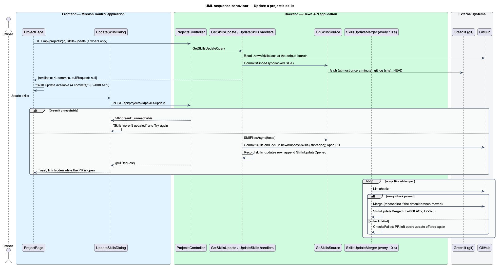

# Bootstrap and update skills

## Overview

Every agent in Hewn follows a *skill*: a folder of instructions, references and scripts. The skill library comes from the Greenlit repository (`github.com/QuinntyneBrown/greenlit`), whose `.claude/skills/` and `.agents/skills/` folders are the reference set. Stage 0, Bootstrap, copies those folders into the target repository so every later stage works from a known, versioned set of instructions.

Stage 0 records where the skills came from in `.hewn/skills.lock`: the source URL, the full commit SHA and the copied skill names. Skill folders the target repository already has are kept unchanged. Later, when Greenlit's default branch moves ahead of the locked SHA, the project page tells Owners "Skills update available ({n} commits)", and Update skills opens a pull request that refreshes the files and the lock and merges automatically when checks pass.

Terms used in this design:

- **skill** — folder of agent instructions under `.claude/skills/` or `.agents/skills/`
- **skills lock** — `.hewn/skills.lock`, the record of the Greenlit source URL, commit SHA and copied skill names

## Description

The slice is a stage executor in the worker plus an update check and command in the API.

- **`BootstrapStageExecutor (worker)`** — fetches Greenlit's default branch, copies every file under both skill folders to the same paths, skips existing skill folders and logs each as "kept existing", writes `.hewn/skills.lock`, and commits "Bootstrap skills from greenlit@{short-sha}". An unreachable Greenlit fails the run with "Greenlit unreachable".
- **`SkillsLock`** — JSON document: `source`, `sha`, `skills[]`.
- **`SkillsUpdateChecker`** — API service that compares the project's locked SHA with Greenlit's default branch through the GitHub compare API and caches `{ahead: n}` per project.
- **`SkillsUpdateBanner (Angular)`** — the "Skills update available ({n} commits)" link in the project header, shown only to Owners; it opens `UpdateSkillsDialog` listing the new commits.
- **`UpdateSkillsCommand / handler`** — `POST /api/projects/{id}/update-skills`, Owner policy. It queues an `UpdateSkills` run.
- **`UpdateSkillsExecutor (worker)`** — creates branch `hewn/update-skills-{short-sha}`, refreshes the skill files and the lock, and opens a pull request that the merge path in [Open and merge the pull request](../../increments/open-and-merge-pull-request/README.md) merges when checks pass.

## Requirements

The feature realizes the following level-2 (L2) requirements. Each L2 requirement refines the level-1 (L1) requirement cited beside it. The text is copied from `docs/specs/L2.md`.

| L2 ID | Refines (L1) | Requirement |
|-------|--------------|-------------|
| `L2-007` | `L1-003` | **Copy skills from Greenlit.** 1. Given stage 0 runs, when Greenlit is reachable, then every file under Greenlit's `.claude/skills/` and `.agents/skills/` is copied to the same paths in the target repository and committed as "Bootstrap skills from greenlit@{short-sha}". 2. Given stage 0 completes, when the repository is inspected, then `.hewn/skills.lock` exists and records the source repository URL, the full commit SHA and the list of copied skill names. 3. Given the target repository already has a skill folder with the same name, when stage 0 runs, then that folder is left unchanged and listed in the run log as "kept existing". 4. Given Greenlit cannot be reached, when stage 0 runs, then the run fails with "Greenlit unreachable" and is retried per L2-006. |
| `L2-008` | `L1-003` | **Update a project's skills.** 1. Given Greenlit's default branch is ahead of the SHA in `.hewn/skills.lock`, when an Owner loads the project page, then it shows "Skills update available ({n} commits)". Viewers do not see it, because they cannot act on it. 2. Given the Owner chooses Update skills, when the update runs, then a pull request updates the skill files and `.hewn/skills.lock`, and it merges automatically when checks pass (L2-025). |

## Diagrams

### System context

Hewn copies skills from Greenlit into the project's GitHub repository, and an Owner can later pull in newer skills.

### Containers

The worker does the copying and committing; the Hewn API checks for updates and queues the update run.

### Components

Both executors share the copier and lock writer, so a bootstrap and an update produce the same file layout.

### Class structure

`SkillsLock` is the single record of provenance; `SkillsUpdateChecker` reads its SHA to compute `CommitsAhead`.

### Behaviour — run stage 0

Files are copied to the same paths and committed with the Greenlit short SHA (L2-007 AC1); the lock is written (AC2); existing folders are kept (AC3); an unreachable Greenlit fails the run for retry (AC4).

### Behaviour — update a project's skills

The project page shows the update count to Owners (L2-008 AC1); Update skills opens a pull request that merges when checks pass (AC2).

## Decisions made while building the slice

Journey 1, part 3 built L2-007 AC1-AC3 and the failure of AC4 (retry comes with L2-006).

- **Where the executor writes.** `BootstrapStageExecutor` commits through the API's `commit` mutation, not a
  git push; see [ADR 0006](../../../adr/0006-commit-mutation-before-git-proxy.md). It reads existing skill
  folders through `GET /api/worker/runs/{id}/repository/skill-folders`.
- **Steps.** Two checkpointed steps: "Fetch Greenlit" (shallow clone of the lease's `skillsSource`) and
  "Copy skills" (keep existing folders, write the lock, commit with key `{run}/2/commit`). A resumed run at
  step 2 fetches again in its fresh workspace and repeats the commit, which returns the first SHA.
- **Lock.** `{ "source": <clone URL without .git>, "sha": <40-hex>, "skills": [copied names, sorted] }`.
  Names appear once even when a skill exists under both roots; kept folders are not listed.
- **"Greenlit unreachable"** is the whole failure message: git's own output can echo the URL, so it is not
  passed on.
- **Source.** `HEWN_SKILLS_SOURCE` on the API (default `https://github.com/QuinntyneBrown/greenlit.git`)
  travels with each lease. The e2e stack builds a fixture repository from `e2e/fixtures/greenlit`.
- **Not built yet:** `SkillsUpdateChecker`, the update banner and dialog, and `UpdateSkillsExecutor`
  (L2-008, a later journey).
