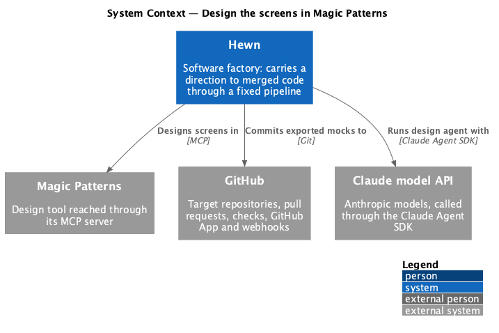
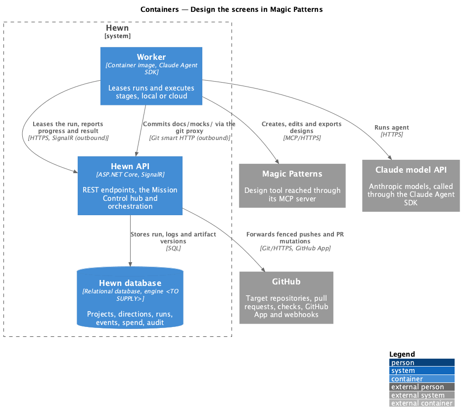
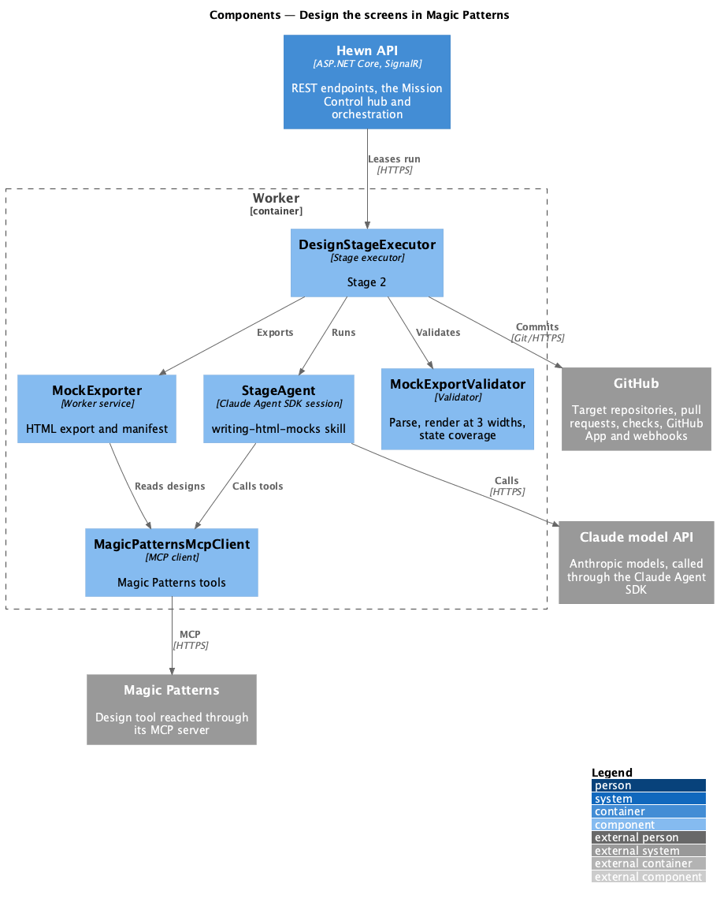
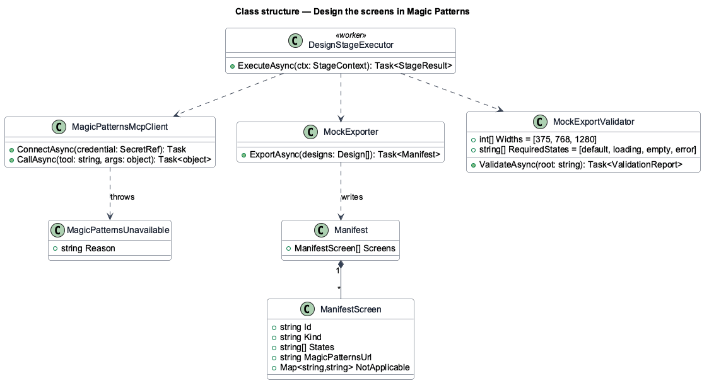
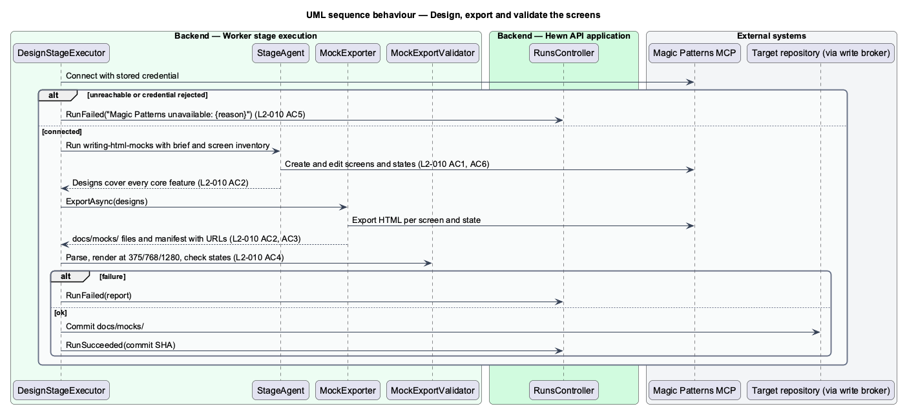

# Design the screens in Magic Patterns

## Overview

Stage 2 turns the product brief into designs. All user interface design in Hewn happens in Magic Patterns (magicpatterns.com), reached through its MCP server; agents never hand-write mocks. The agent follows the `writing-html-mocks` skill's screen inventory and state rules: every screen gets default, loading, empty and error states, or a recorded reason why a state does not apply.

When the designs are done, the stage exports a static HTML copy of every screen and state into `docs/mocks/` so later stages and tests work from files in the repository, and records each design's Magic Patterns URL with its screen and state in `docs/mocks/manifest.json`. It validates the export: every HTML file parses and every screen renders at 375, 768 and 1280 px with no horizontal scroll. For a feature direction with UI changes, the stage updates or adds designs and refreshes the export.

Terms used in this design:

- **MCP server** — Model Context Protocol endpoint through which the agent calls Magic Patterns tools
- **screen inventory** — list of every page, dialog and notification and the states each needs
- **manifest** — `docs/mocks/manifest.json`, mapping each screen and state to its file and Magic Patterns URL

## Description

The slice is a stage executor that drives Magic Patterns, exports, and validates.

- **`DesignStageExecutor (worker)`** — runs `StageAgent` with the `writing-html-mocks` skill and the Magic Patterns MCP tools on the allow list. It maps every core feature in the brief to at least one design.
- **`MagicPatternsMcpClient`** — MCP connection using the stored Magic Patterns credential (L2-040). Connection or credential failure raises `MagicPatternsUnavailable(reason)`.
- **`MockExporter`** — exports each design's HTML into `docs/mocks/{screen}/{state}.html` and writes the manifest with `magic_patterns_url`, screen and state.
- **`MockExportValidator`** — parses every HTML file, renders every screen in a headless browser at 375, 768 and 1280 px, checks for horizontal scroll, and checks each screen for default, loading, empty and error states or a recorded not-applicable reason.

No fallback exists: if Magic Patterns is unavailable, the run fails with "Magic Patterns unavailable: {reason}" and retries per L2-006 (L2-010 AC5).

## Requirements

The feature realizes the following level-2 (L2) requirements. Each L2 requirement refines the level-1 (L1) requirement cited beside it. The text is copied from `docs/specs/L2.md`.

| L2 ID | Refines (L1) | Requirement |
|-------|--------------|-------------|
| `L2-010` | `L1-005` | **Design the screens in Magic Patterns.** All UI design is done in Magic Patterns (magicpatterns.com) through its MCP server. Agents do not hand-write mocks. 1. Given stage 2 runs, when the agent designs screens, then it creates and edits them in Magic Patterns through the Magic Patterns MCP server, guided by the `writing-html-mocks` skill's screen inventory and state rules. 2. Given stage 2 completes, when the project is inspected, then every core feature in the brief maps to at least one Magic Patterns design, and each design's Magic Patterns URL is recorded in `docs/mocks/manifest` along with its screen and state. 3. Given the designs, when stage 2 exports them, then a static HTML export of every screen and state is committed to `docs/mocks/` so later stages and tests work from files in the repository. 4. Given the exported mocks, when stage 2 validates them, then every HTML file parses, and every screen renders at 375, 768 and 1280 px with no horizontal scroll. Every screen must also have default, loading, empty and error states, or a recorded reason why a state does not apply. Any failure fails the run. 5. Given the Magic Patterns MCP server is unreachable or rejects the credential, when stage 2 runs, then the run fails with "Magic Patterns unavailable: {reason}" and retries per L2-006. Agents never fall back to hand-written mocks. 6. Given a feature direction with UI changes, when stage 2 runs, then existing Magic Patterns designs are updated, or new ones are added, and the export in `docs/mocks/` is refreshed. |

## Diagrams

### System context

Stage 2 is the only stage that talks to Magic Patterns. Its output lands in the project's GitHub repository.

### Containers

The worker drives Magic Patterns over MCP and commits the export; the Hewn API records the run.

### Components

The agent designs through MCP tools; the exporter and validator run after the agent, so validation is deterministic code, not model judgment.

### Class structure

`Manifest` holds one `ManifestScreen` per screen with its states, its Magic Patterns URL and any not-applicable reasons.

### Behaviour — design, export and validate

Designs are made through MCP (L2-010 AC1), recorded with URLs (AC2), exported (AC3) and validated (AC4). An unreachable server fails the run without fallback (AC5).

## Decisions made while building the slice

- **One executor.** Stage 2 is a definition in `DocumentStageExecutor` with two hooks, a required Magic Patterns
  connection and an export step, rather than a separate `DesignStageExecutor`.
- **Fail before the agent.** The executor pings Magic Patterns before the agent starts. An unconfigured,
  unreachable or refused server fails the run with "Magic Patterns unavailable: not configured | unreachable |
  credential rejected", never the server's own message, and the agent never runs, so no mock is hand-written.
- **Export format (ADR 0007).** Each design holds `default.html`, `loading.html`, `empty.html` and `error.html` as
  raw HTML; `MockExporter` reads them with `read_artifact_files` and writes `docs/mocks/{screen}/{state}.html`.
- **Manifest.** `docs/mocks/manifest.json`: `{ screens: [{ screen, feature, magicPatternsUrl, editorId, states,
  notApplicable }] }`. A feature is covered when a screen names it; the brief's feature title is the text before
  " — ".
- **Validation.** parse5 parse errors fail a file; Chromium (playwright-core) loads each file at 375, 768 and
  1280 px and fails it when `scrollWidth > clientWidth`. All problems are reported together.
- **Credential.** `HEWN_MAGIC_PATTERNS_URL` and `HEWN_MAGIC_PATTERNS_TOKEN` on the worker until L2-040's store.
- **Feature directions (L2-010 AC6, journey 2).** Stage 2 runs only when stage 1 recorded a UI change. The agent
  keeps every existing manifest entry, updating its design in Magic Patterns where the feature changes it, and
  adds designs for new screens. The export then refreshes every design in the manifest. Validation fails with
  "docs/mocks/manifest.json dropped the {screen} design" when an entry disappears.
