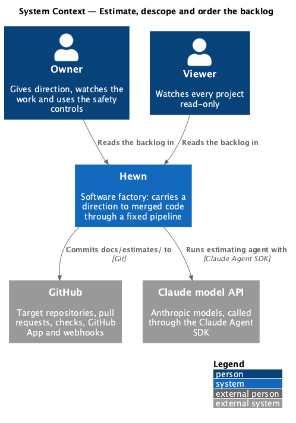
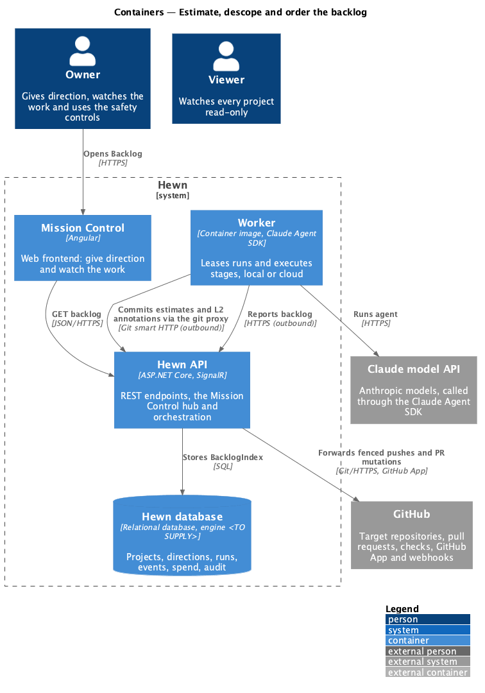
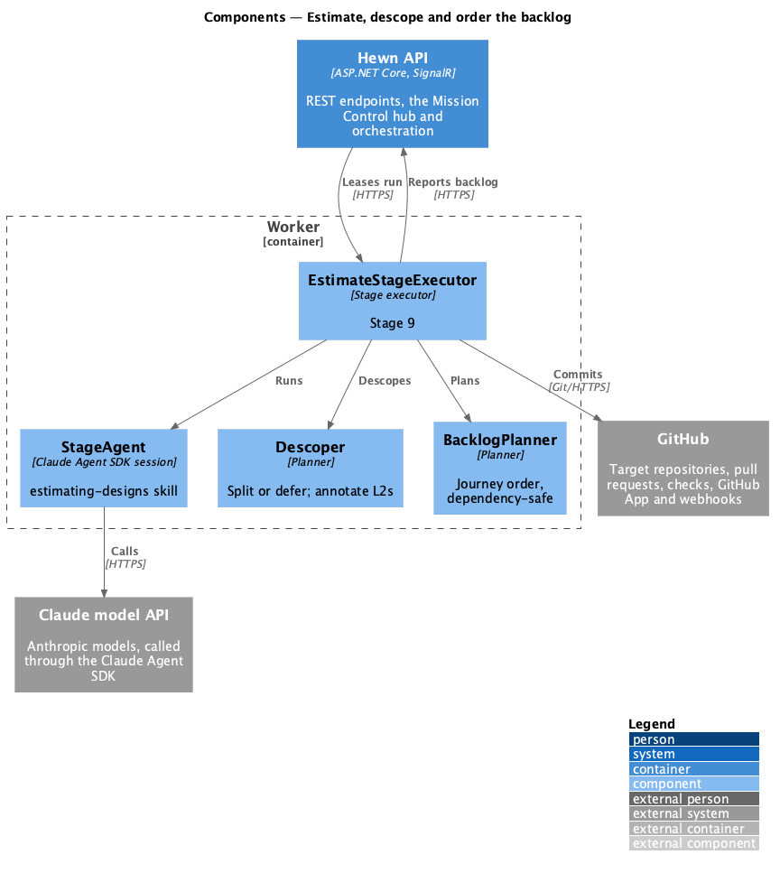
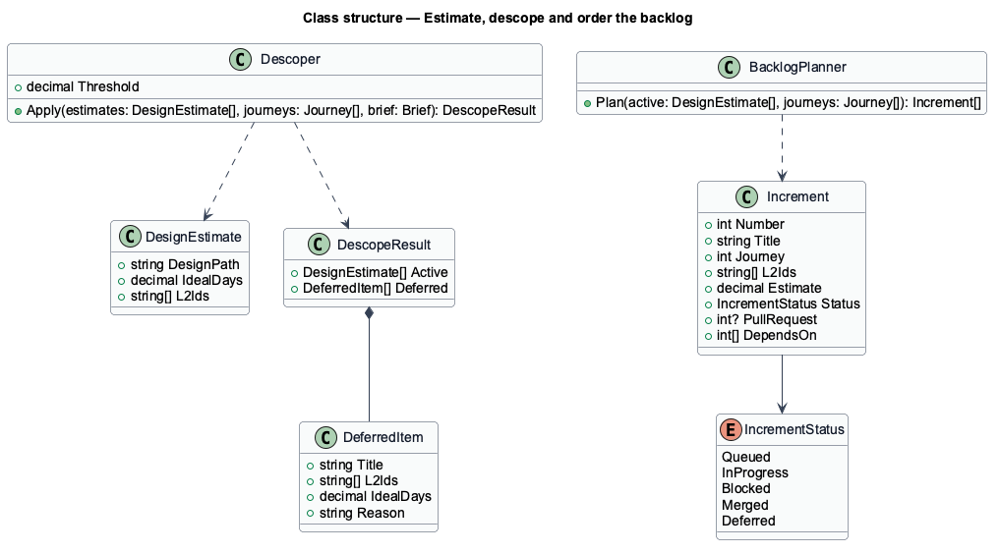
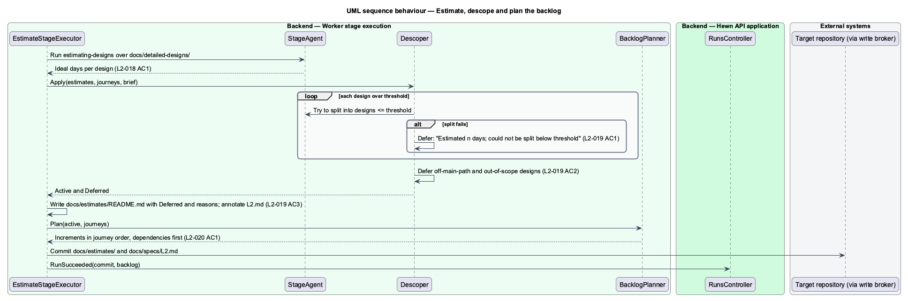
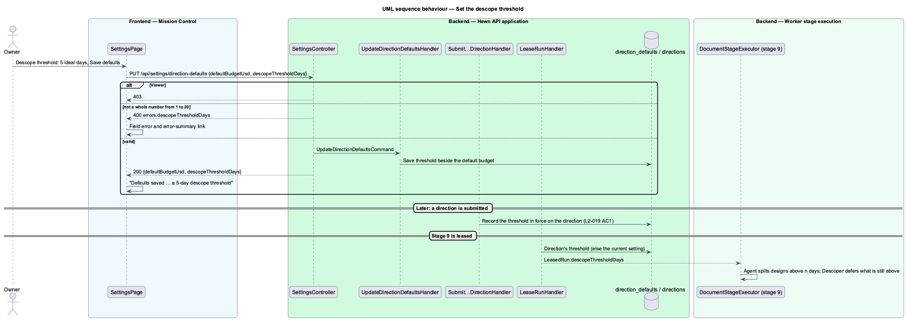
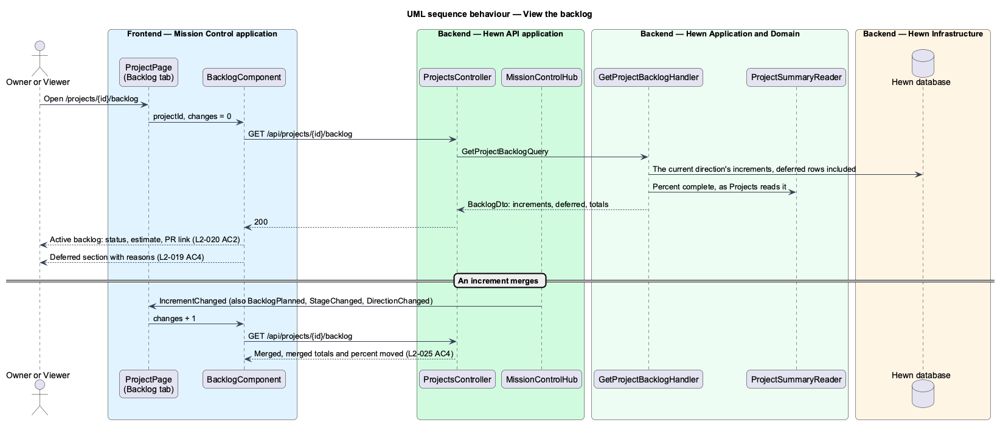

# Estimate, descope and order the backlog

## Overview

Stage 9 sizes the work and turns it into an implementation plan. It runs the `estimating-designs` skill to estimate each detailed design in ideal days, writes `docs/estimates/`, and produces the ordered backlog that stage 10 delivers one increment at a time.

Oversized or off-path work is descoped automatically. A design above the descope threshold (3 ideal days by default, set by an Owner in Settings) is first split into designs at or below the threshold; if no split works, it is descoped. A design whose L2s appear in no journey's main path, or that the brief lists as out of scope or nice-to-have, is descoped too. Each descoped design is listed under "Deferred" with its reason, and its L2s in `docs/specs/L2.md` gain `**Status:** Deferred ({reason})`. The Backlog page in Mission Control shows the active increments with status, estimate and pull request link, and the deferred items apart with their reasons.

Terms used in this design:

- **ideal day** — one day of focused work with no interruptions, the unit of every estimate
- **descope threshold** — largest estimate a design may have before Hewn tries to split or defer it
- **increment** — one backlog item: one journey or part of one, with its L2 IDs
- **deferred** — descoped from this direction, with a recorded reason

## Description

The slice spans the stage executor, three planners and the Backlog page.

- **`EstimateStageExecutor (worker)`** — runs `StageAgent` with `estimating-designs`, then the planners, then writes `docs/estimates/README.md` (overall estimate, percent complete, roadmap, Deferred) and `docs/estimates/{subsystem}.md` (ideal days per design).
- **`Descoper`** — applies the threshold rule with one split attempt, then the journey-main-path and out-of-scope rules, and annotates each deferred L2 in `docs/specs/L2.md`.
- **`BacklogPlanner`** — builds increments of one journey or part of one, orders them by journey number, and topologically sorts so no increment precedes one it depends on.
- **`BacklogIndex`** — Hewn database table of increments (number, title, journey, L2 IDs, estimate, status, PR number) updated by stage 9 and by stage 10 events.
- **`BacklogComponent (Angular)`** — the project page's Backlog tab: lists increments with status (Queued, In progress, Blocked, Merged), estimate and PR link, and a separate Deferred section with reasons, read from `GET /api/projects/{id}/backlog`.

## Requirements

The feature realizes the following level-2 (L2) requirements. Each L2 requirement refines the level-1 (L1) requirement cited beside it. The text is copied from `docs/specs/L2.md`.

| L2 ID | Refines (L1) | Requirement |
|-------|--------------|-------------|
| `L2-018` | `L1-012` | **Estimate the work.** 1. Given stage 9 runs with `estimating-designs`, when it completes, then `docs/estimates/README.md` gives the overall estimate, percent complete and roadmap, and `docs/estimates/{subsystem}.md` gives an estimate in ideal days for each detailed design. |
| `L2-019` | `L1-012` | **Descope automatically.** 1. Given a design estimated at more than the descope threshold (3 ideal days by default; an Owner sets a whole number from 1 to 20 in Settings, Viewers see it read-only, and each direction keeps the threshold in force when it was submitted), when stage 9 runs, then the agent first tries to split it into designs at or below the threshold. If that fails, the design is descoped. 2. Given a design whose L2s appear in no journey's main path, or which the brief lists as out of scope or nice-to-have, when stage 9 runs, then it is descoped. 3. Given a design is descoped, when stage 9 completes, then it appears under "Deferred" in `docs/estimates/README.md` with its reason, and its L2s in `docs/specs/L2.md` gain the line `**Status:** Deferred ({reason})`. 4. Given deferred items, when a user opens the project's Backlog in Mission Control, then they are shown apart from the active backlog, with their reasons. |
| `L2-020` | `L1-012` | **Order the backlog.** 1. Given stage 9 completes, when the backlog is produced, then each increment covers one journey, or one part of a journey, with its L2 IDs, ordered by journey number, and no increment comes before an increment it depends on. 2. Given the backlog, when a user opens Backlog, then each increment shows its status (Queued, In progress, Blocked, Merged, Deferred), its estimate and a link to its pull request once one exists. |

## Diagrams

### System context

Hewn estimates with Claude and commits the plan; Owners and Viewers read the backlog in Mission Control.

### Containers

The worker computes and commits the plan, and reports the backlog to the Hewn API for the Backlog page.

### Components

The agent estimates; the descoper and planner are deterministic code applied to its estimates.

### Class structure

`Descoper` splits estimates into active designs and `DeferredItem`s; `BacklogPlanner` turns active designs into ordered `Increment`s with dependencies.

### Behaviour — estimate, descope and plan

Estimates are written (L2-018 AC1). Oversized designs are split or deferred (L2-019 AC1), off-path ones deferred (AC2) and annotated (AC3). Increments are ordered by journey and dependency (L2-020 AC1).

### Behaviour — set the threshold

An Owner saves the threshold in Settings; each direction records the one in force when it is submitted, and stage 9 is leased with it (L2-019 AC1).

### Behaviour — view the backlog

Active increments show status, estimate and PR link (L2-020 AC2); deferred items appear apart with reasons (L2-019 AC4).

## Decisions made while building the slice

- **Agent then planners.** Stage 9 is a definition in `DocumentStageExecutor`. The `estimating-designs` agent writes
  `docs/estimates/{subsystem}.md` (columns Design, Estimate (days), Complete) and splits oversized designs; the
  deterministic `Descoper` and `BacklogPlanner` (`worker/src/estimates/backlog-planner.ts`) then write
  `docs/estimates/README.md`, `docs/estimates/backlog.json` and the Deferred status lines.
- **Splits.** The commit mutation cannot delete, so a split design's README gains `**Status:** Split into …` and is
  ignored from then on; the new designs carry its L2s.
- **Descope rules, in order.** Above the threshold after the split attempt; listed under the brief's Out of scope
  or Nice to have (case-insensitive containment of the bullet and the design title); no L2 in any journey's
  `**Covers:**`; depends on a deferred design (repeated until stable). Each deferred design keeps its first reason.
- **Deferred L2s.** An L2 is marked only when every design covering it is deferred; the status line sits directly
  under its heading and is replaced, not duplicated, on a rerun.
- **Increments.** Journeys in number order; each journey's designs are placed after their dependencies (pulled
  forward from later journeys when needed), then split greedily into parts of at most the threshold, titled
  "{journey} (part k of n)". A dependency cycle fails the run naming the designs.
- **Threshold.** `HEWN_DESCOPE_THRESHOLD_DAYS` on the API (default 3) is sent with every lease. Journey 28 replaced
  this with the Owner's setting; see below.
- **`BacklogIndex`.** The `increments` table: number, title, journey, L2 IDs, estimate, depends-on, status
  (Queued, InProgress, Blocked, Merged, Deferred), reason and pull request number. `PUT
  /api/worker/runs/{id}/backlog` (stage 9 only) replaces a direction's rows and appends `BacklogPlanned`; the API
  rejects numbering gaps and any dependency on a later or missing increment.
- **The Backlog page (journey 12).** `GET /api/projects/{id}/backlog` (`GetProjectBacklogHandler`) returns the
  current direction's backlog (the active direction, else the latest, as Projects shows it): the increments in
  number order with status, estimate, journey, L2s, depends-on, iterations, failing tests, pull request number and
  `https://github.com/{repository}/pull/{n}`; the deferred designs apart, with their reasons; and the totals,
  merged of total, merged of estimated ideal days, and the project's percent complete from `ProjectSummaryReader`.
  There is no `BacklogController` or separate `BacklogPage`. The Backlog is a tab of the project page at
  `/projects/{id}/backlog`, beside Pipeline in a new `phead__tabs` header. The other tabs in the mock (Designs,
  Design system, Decisions, Artifacts, Traceability) come with their own journeys.
- **Live.** The project page already follows the project's events. Each `BacklogPlanned`, `IncrementChanged`,
  `StageChanged` or `DirectionChanged` bumps a counter the Backlog tab watches, and the tab reads the backlog again.
  That costs one read per event and keeps the totals right, so `IncrementChanged` payloads are not applied in place.
- **Blocked.** A blocked increment gets the mock's danger callout: its iterations, its failing tests as the gate
  reported them, and the first increment left that doesn't depend on it, directly or through another.
- **Not in the mock's header.** The project header has no "Complete" figure yet, so the totals line adds
  "· {n}% complete" after the ideal days. Increment titles are plain text until the increment page (journey 13)
  exists.

## Decisions made while configuring automatic descoping (journey 28)

- **Where it is stored.** `direction_defaults` gains `DescopeThresholdDays` beside the default budget, so the
  Settings form saves both through `PUT /api/settings/direction-defaults` (Owner only; Viewers get 403) and reads
  them through `GET`. Until an Owner saves one it is `HEWN_DESCOPE_THRESHOLD_DAYS` (default 3). A save that leaves
  the threshold out keeps the saved one.
- **Validation.** A whole number of ideal days from 1 to 20, as the mock's error says ("Descope threshold must be a
  whole number of days from 1 to 20.", summary "Descope threshold must be 1 to 20 days"). Text that is not a number
  is sent as 0, so it gets the same field error.
- **Running directions keep theirs.** The mock's callout says "Directions already running keep theirs", so a
  direction records the threshold in force when it is submitted (`directions.DescopeThresholdDays`), as it does its
  budget, and every lease carries that one. Directions submitted before journey 28 have none and use the current
  setting ([ADR 0029](../../../adr/0029-a-direction-keeps-the-descope-threshold-it-was-submitted-with.md)).
- **The agent is told the number.** The stage 9 task says "split any design above the descope threshold of
  {n} ideal days"; before journey 28 it named the threshold without its value.
- **No new mocks.** `pages/settings/{default,invalid,submitting,success,viewer}.html` already show the field, its
  error, the saved callout and the read-only Viewer view.
