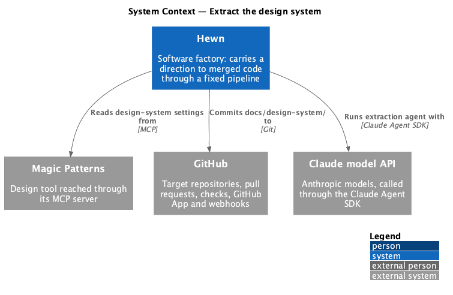
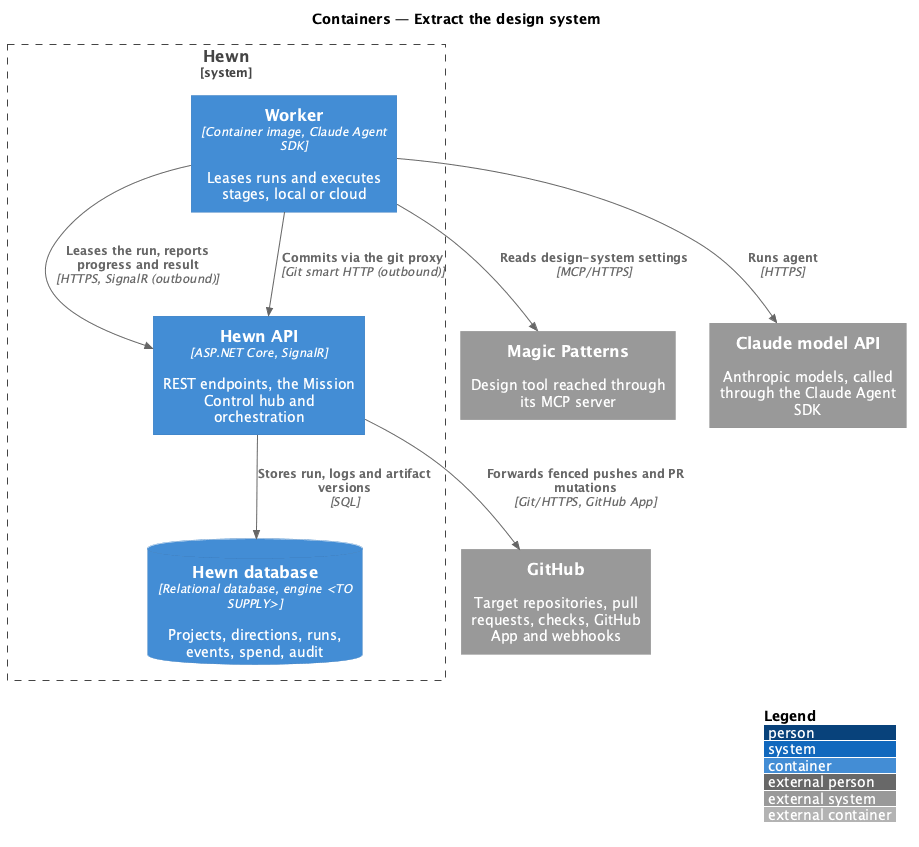
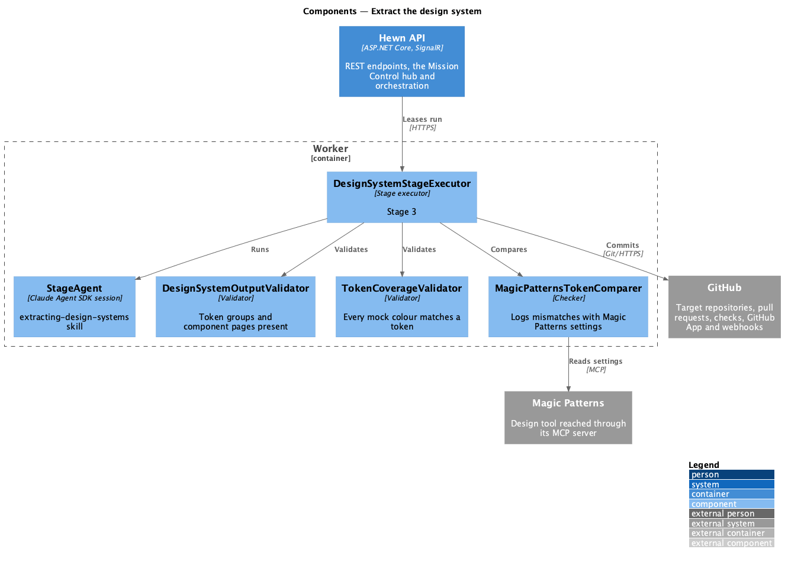
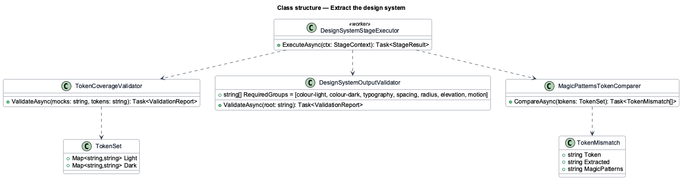
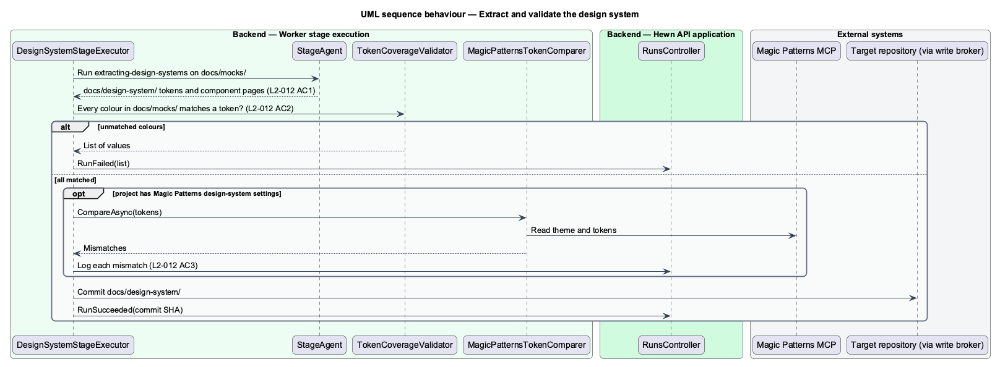

# Extract the design system

## Overview

Stage 3 turns the exported mocks into a reusable design system with the `extracting-design-systems` skill. The output in `docs/design-system/` holds tokens for colour (light and dark), typography, spacing, radius, elevation and motion, plus one page per component. Implementation in stage 10 builds on these tokens and components.

The stage validates its output against the mocks: every colour value used in `docs/mocks/` shall match a token, and any that does not is listed and fails the run. Where Magic Patterns holds design-system settings for the project, such as theme or tokens, the extracted tokens are compared with them and mismatches are listed in the run log. Mission Control's Design system tab then lets users browse the token and component pages in the same sandboxed preview as Designs ([Preview designs and the design system](../../mission-control/preview-designs/README.md)).

Terms used in this design:

- **token** — named design value such as `--color-fg-default` or `--space-4`
- **design-system page** — HTML page in `docs/design-system/` documenting one foundation or component

## Description

The slice is a stage executor with two checks.

- **`DesignSystemStageExecutor (worker)`** — runs `StageAgent` with `extracting-design-systems` over `docs/mocks/` and commits `docs/design-system/`.
- **`TokenCoverageValidator`** — collects every colour value from the mocks' CSS and inline styles, resolves each against the token files for both themes, and fails with the unmatched values listed.
- **`MagicPatternsTokenComparer`** — reads the project's design-system settings from Magic Patterns through MCP, when present, and logs each mismatch with the extracted tokens.
- **`DesignSystemOutputValidator`** — checks that token groups for colour (light and dark), typography, spacing, radius, elevation and motion exist and that each component has a page.

## Requirements

The feature realizes the following level-2 (L2) requirements. Each L2 requirement refines the level-1 (L1) requirement cited beside it. The text is copied from `docs/specs/L2.md`.

| L2 ID | Refines (L1) | Requirement |
|-------|--------------|-------------|
| `L2-012` | `L1-006` | **Extract the design system.** 1. Given stage 3 runs with `extracting-design-systems` on the exported Magic Patterns mocks, when it completes, then `docs/design-system/` contains tokens for colour (light and dark), typography, spacing, radius, elevation and motion, plus one page per component. 2. Given the mocks, when stage 3 validates, then every colour value used in `docs/mocks/` matches a token, and any that doesn't is listed and fails the run. 3. Given Magic Patterns holds design-system settings for the project (such as theme or tokens), when stage 3 runs, then the extracted tokens match them, and any mismatch is listed in the run log. 4. Given a project with a design system, when a user opens Design system in Mission Control, then the token and component pages can be browsed in the same sandboxed preview as L2-011. |

L2-012 AC4 (browsing in Mission Control) is realized in [Preview designs and the design system](../../mission-control/preview-designs/README.md).

## Diagrams

### System context

Stage 3 reads the mocks from the repository, optionally reads Magic Patterns settings, and commits the design system.

### Containers

All work runs in the worker; the Hewn API records the run and its artifact version.

### Components

Two validators can fail the run; the Magic Patterns comparison only logs, as L2-012 AC3 requires.

### Class structure

`TokenCoverageValidator` resolves colours against a `TokenSet` for both themes; the comparer returns `TokenMismatch` rows for the log.

### Behaviour — extract and validate

Tokens and component pages are produced (L2-012 AC1). Unmatched mock colours fail the run (AC2). Magic Patterns mismatches are logged (AC3).

## Decisions made while building the slice

- **Tokens file.** `docs/design-system/tokens.json` in DTCG form. `DesignSystemOutputValidator` requires
  non-empty `color.light`, `color.dark`, `typography`, `spacing`, `radius`, `elevation` and `motion` groups and at
  least one page under `docs/design-system/components/`. Matching pages to the mocks' components is left to the
  skill until components can be identified in exported HTML.
- **Colour coverage.** `TokenCoverageValidator` normalises hex (3, 4, 6, 8 digits), `rgb()` and `hsl()` to
  `#rrggbb[aa]` in both the mocks and the colour tokens, and lists each unmatched colour once per file. Named
  colours are not checked.
- **Magic Patterns comparison.** Optional: when Magic Patterns is reachable and the project has an active custom
  design system, `MagicPatternsTokenComparer` reads its `index.css` custom properties (light values) and logs
  each colour no extracted token matches. Without Magic Patterns the stage logs that the comparison was skipped
  and continues; the run does not fail on mismatches (L2-012 AC3 asks only that they are listed).
- **Deferred.** L2-012 AC4 (browse the design system in Mission Control) with journey 15.
