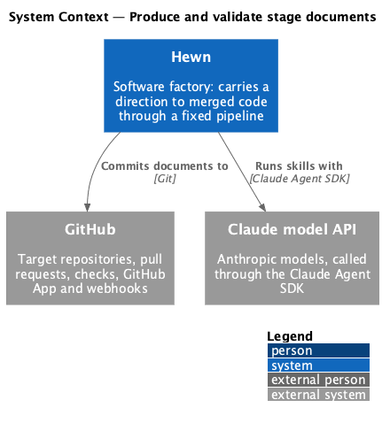
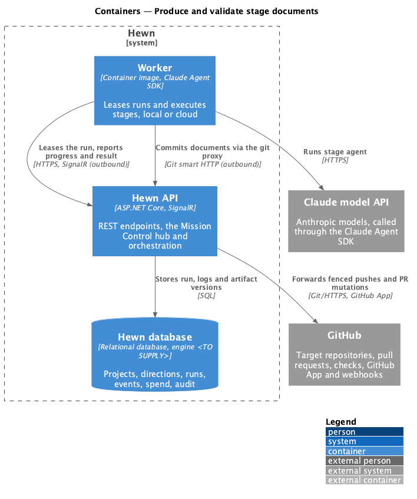
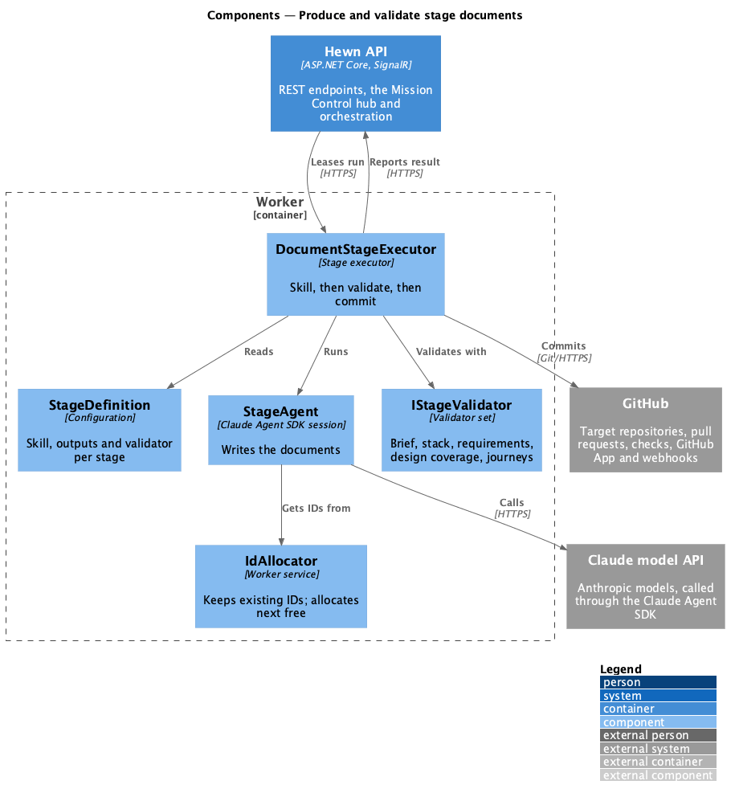
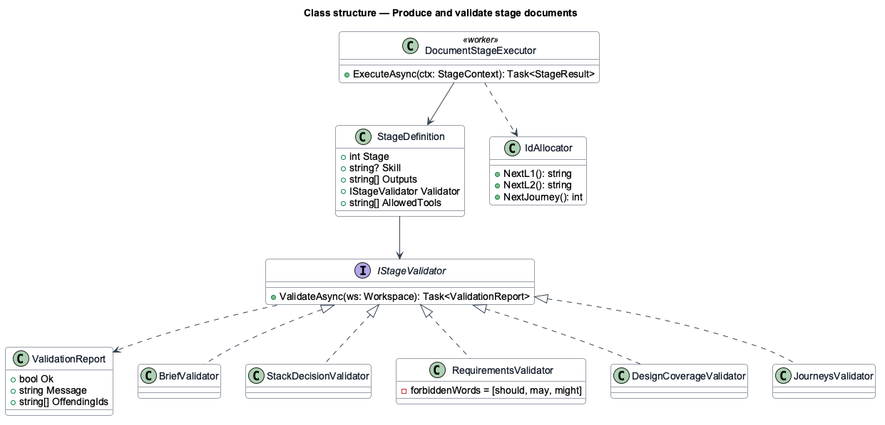
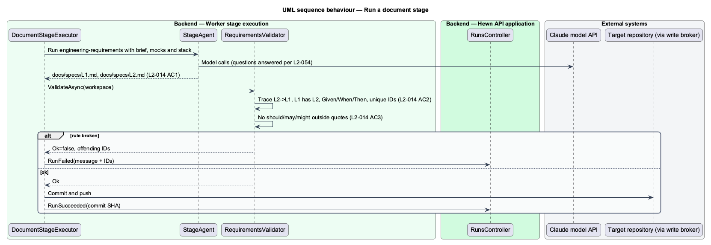

# Produce and validate stage documents

## Overview

Five stages produce a document and nothing else: Idea (1) writes the product brief, Stack (4) writes the stack decision record, Requirements (5) writes the L1 and L2 requirements, Detailed designs (7) writes one design per feature, and User journeys (8) writes the numbered journeys. Each runs a Greenlit skill where one exists, answers its own questions (L2-054), validates its output against fixed rules, and fails the run if a rule is broken.

This design treats the five as one slice because they share one shape: a `DocumentStageExecutor` runs a skill in the agent, then a stage-specific `IStageValidator` checks the files, then the executor commits. Only the skill, the output paths and the validator differ. For a feature direction, stages 5 and 8 keep existing L1/L2 IDs and journey numbers and give new items the next free numbers.

Terms used in this design:

- **product brief** — `docs/brief.md` with the sections Problem, Users, Core features, Out of scope and Assumptions
- **stack decision record** — `docs/adr/0001-stack.md` with Context, Decision, Alternatives and Consequences
- **journey** — numbered end-to-end user scenario with a title, actor, steps, mocks used and L2 IDs covered

## Description

The slice is one generic executor configured five ways.

- **`DocumentStageExecutor (worker)`** — runs `StageAgent` with the stage's skill and tool allow list, runs the stage's validator, and commits on success. Validation failures fail the run with the validator's message and the offending IDs.
- **`StageDefinition`** — per stage: skill (`grilling`, none, `engineering-requirements`, `writing-software-design-documents`, none), output paths and validator.
- **`BriefValidator`** — stage 1: `docs/brief.md` exists and Problem, Users, Core features, Out of scope and Assumptions are present and non-empty.
- **`StackDecisionValidator`** — stage 4: `docs/adr/0001-stack.md` has Context, Decision, Alternatives and Consequences. The agent picks the current LTS .NET backend with the current major Angular frontend unless the direction names a stack, and requests no human input.
- **`RequirementsValidator`** — stage 5: every L2 traces to an existing L1, every L1 has at least one L2, every L2 has at least one Given/When/Then criterion, IDs are unique, and none of "should", "may" or "might" appear outside quoted text.
- **`DesignCoverageValidator`** — stage 7: one design per feature under `docs/detailed-designs/{subsystem}/{feature}/`, each listing the L2 IDs it covers, and every L2 covered.
- **`JourneysValidator`** — stage 8: `docs/journeys.md` lists numbered journeys with title, actor, steps, mocks and L2 IDs, and every L2 with a user interface criterion appears in at least one journey.
- **`IdAllocator`** — for feature directions, reads existing IDs and journey numbers from the `ScopeSnapshot` and hands out the next free values.

The rule for deciding which L2s have a user interface criterion (L2-017 AC2) is <TO SUPPLY>. The starting rule is that an L2 has one when any of its criteria names a page, dialog, control or visible message.

## Requirements

The feature realizes the following level-2 (L2) requirements. Each L2 requirement refines the level-1 (L1) requirement cited beside it. The text is copied from `docs/specs/L2.md`.

| L2 ID | Refines (L1) | Requirement |
|-------|--------------|-------------|
| `L2-009` | `L1-004` | **Produce the product brief.** 1. Given stage 1 runs, when it completes, then `docs/brief.md` exists with the non-empty sections Problem, Users, Core features, Out of scope and Assumptions. 2. Given stage 1 runs the `grilling` skill, when the skill poses a question, then the agent answers it itself (L2-054), and each question and answer appears in the run log. 3. Given `docs/brief.md` is missing a required section, when stage 1 validates its output, then the run fails. |
| `L2-013` | `L1-007` | **Choose the stack.** 1. Given a direction with no stack preference, when stage 4 runs, then the stack is the current LTS .NET backend with the current major Angular frontend. 2. Given a direction that names a stack, when stage 4 runs, then that stack is chosen. 3. Given stage 4 completes, when the repository is inspected, then `docs/adr/0001-stack.md` exists with Context, Decision, Alternatives and Consequences sections. 4. Given stage 4, when it runs, then no human input is requested. |
| `L2-014` | `L1-008` | **Generate requirements.** 1. Given stage 5 runs with `engineering-requirements`, when it completes, then `docs/specs/L1.md` and `docs/specs/L2.md` exist. 2. Given the requirements, when stage 5 validates them, then every L2 traces to an existing L1, every L1 has at least one L2, every L2 has at least one Given/When/Then criterion, and IDs are unique. Any violation fails the run and lists the offending IDs. 3. Given requirements text, when validated, then it contains none of the words "should", "may" or "might" outside quoted text. |
| `L2-016` | `L1-010` | **Write detailed designs.** 1. Given stage 7 runs with `writing-software-design-documents`, when it completes, then `docs/detailed-designs/{subsystem}/{feature}/` holds one design per feature. 2. Given the designs, when validated, then each design lists the L2 IDs it covers, and every L2 is covered by at least one design. Uncovered L2s are listed and fail the run. |
| `L2-017` | `L1-011` | **Define user journeys.** 1. Given stage 8 runs, when it completes, then `docs/journeys.md` lists numbered journeys, each with a title, actor, steps, the mocks it uses and the L2 IDs it covers. 2. Given the journeys, when validated, then every L2 with a user interface criterion appears in at least one journey. 3. Given a feature direction, when stage 8 runs, then existing journey numbers are kept and new journeys take the next free numbers. |

## Diagrams

### System context

These stages involve no human. Hewn runs a skill on Claude and commits the document to the project's repository.

### Containers

The worker does all of the work; the Hewn API only leases the run and records its result and artifact version.

### Components

The executor is generic. `StageDefinition` selects the skill and the validator, and `IdAllocator` keeps numbering stable for feature directions.

### Class structure

Five validators implement `IStageValidator`; each returns a `ValidationReport` whose `OffendingIds` feed the failure message.

### Behaviour — run a document stage

Shown for stage 5. A broken rule fails the run with the offending IDs (L2-014 AC2, AC3) and the retry policy applies (L2-006); the other four stages follow the same path with their own validator.

## Decisions made while building the slice

- **Checkout by archive.** The worker downloads the default branch as a gzipped tarball through
  `GET /api/worker/runs/{id}/repository/archive`, fenced by the lease, and commits through the commit mutation
  (ADR 0006). It holds no GitHub credential and needs no git remote until the push proxy exists.
- **Two steps.** "Check out repository", then "Write documents", which checks out again on a resumed run,
  runs the agent, validates and commits at step 2 with the key `{run}/2/commit`. A resumed run reruns the agent
  rather than trusting a half-written workspace; the key keeps the commit single.
- **Only the stage's files are committed.** The executor diffs the working copy against the checkout and commits
  changed files under the stage's outputs plus `docs/decisions.md`; anything else is logged as "Ignored a change
  outside this stage" and dropped. `CommitPolicy` on the API enforces the same paths.
- **Decisions are read from the log.** The agent appends to `docs/decisions.md` (date, stage, question, answer,
  rationale); the executor logs each new entry's question and answer to the run log (L2-009 AC2, L2-054).
- **Validators return every problem.** Each returns a list of messages naming the file, section or IDs, and the
  run fails with all of them joined. Banned words are checked outside double quotes, curly quotes and code.
- **User interface criterion (L2-017 AC2).** The starting rule: a Given/When/Then line naming a page, dialog,
  screen, control, button, form, field, link, message, toast, banner, view, tab or menu.
- **Stack check (L2-013).** With no preference the Decision section must name .NET and Angular; with one it must
  contain the named stack.
- **Scripted agent first.** `ScriptedStageAgent` writes valid documents from the direction and earlier documents
  for tests and the e2e stack. The Claude Agent SDK agent arrives with run isolation (agent-isolation design), so
  no model runs on the worker host unsandboxed.
- **Feature directions (journey 2).** Instead of an `IdAllocator`, the agent numbers new requirements and journeys
  from the files it reads, and the executor checks the result: before the agent runs it copies `docs/specs/L1.md`,
  `docs/specs/L2.md` and `docs/journeys.md`, and validation fails with "{file} dropped {ID}" or "{file} numbers new
  {ID} below the next free number, {ID}" (L2-005 AC3, L2-014 AC4, L2-017 AC3). Stage 1 of a feature adds the feature
  to the brief's Core features and must answer "Does this feature change the user interface?" in the decision
  log; the executor reports the answer to the API after the commit ([ADR 0008](../../../adr/0008-feature-scope-is-a-recorded-decision.md)).
  Stage 9 plans only designs below 100% complete.
