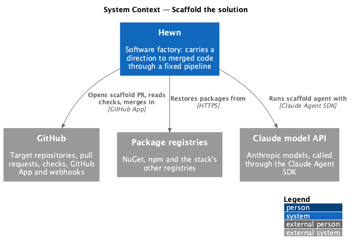
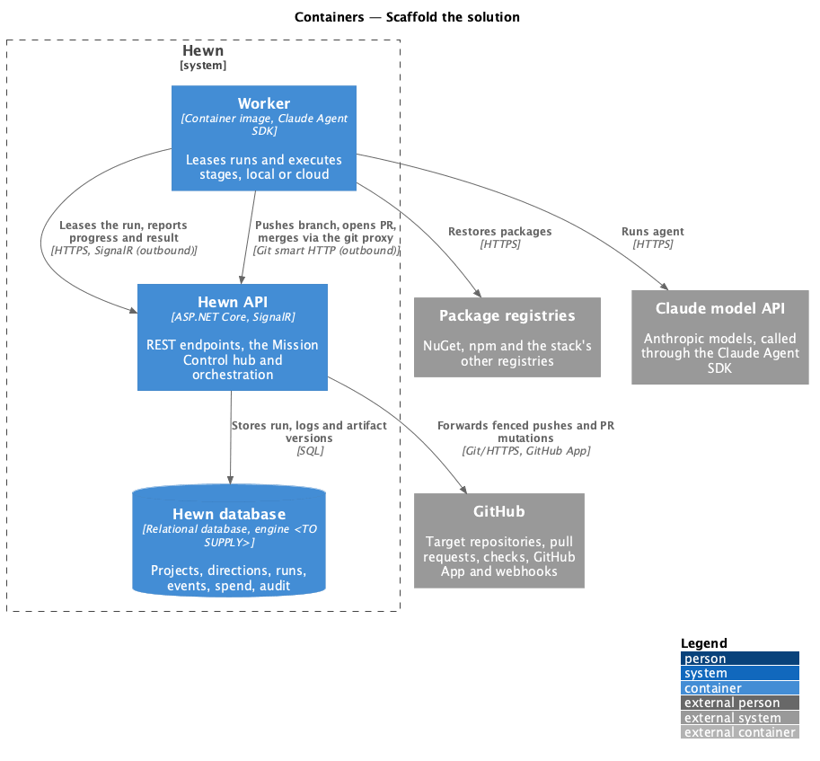
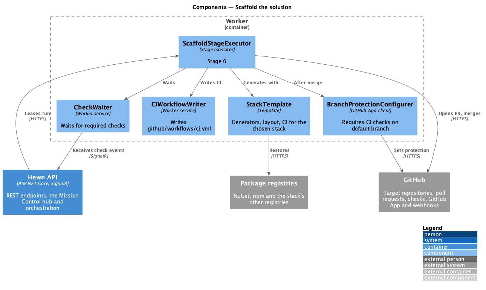
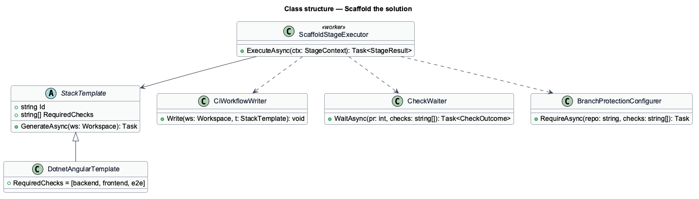
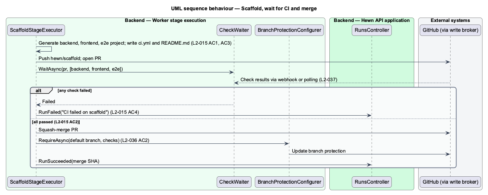

# Scaffold the solution

## Overview

Stage 6 creates the empty but working solution that every increment builds on. For the default stack it generates a backend solution, a frontend workspace, an end-to-end test project and a GitHub Actions CI workflow, and merges them to the default branch through a pull request. `README.md` documents the folder structure and the commands to build, test and run.

The scaffold is accepted only when CI passes on it: backend build and tests, frontend lint, build and unit tests, and an empty end-to-end suite. If CI fails on the scaffold pull request, the run fails and retries per L2-006. Once the scaffold is merged, branch protection on the default branch is set to require these CI checks ([Connect to GitHub](../../source-control/connect-to-github/README.md)).

Terms used in this design:

- **scaffold** — stack-specific solution skeleton with build, test and CI wiring but no product features
- **required checks** — CI jobs that branch protection requires before a merge

## Description

The slice is a stage executor plus a CI wait.

- **`ScaffoldStageExecutor (worker)`** — selects a `StackTemplate` from the stage 4 decision, generates the solution on branch `hewn/scaffold`, writes `README.md`, opens the pull request and waits for checks.
- **`StackTemplate`** — per stack: generator commands, folder layout and the CI workflow file. The default template is .NET backend, Angular frontend and a Playwright e2e project; templates for other stacks are <TO SUPPLY>.
- **`CiWorkflowWriter`** — writes `.github/workflows/ci.yml` with the jobs `backend`, `frontend` and `e2e`.
- **`CheckWaiter`** — waits for check results through the events in [Open and merge the pull request](../../increments/open-and-merge-pull-request/README.md) and returns pass or fail.
- **`BranchProtectionConfigurer`** — after merge, requires the CI jobs on the default branch through the GitHub App.

## Requirements

The feature realizes the following level-2 (L2) requirements. Each L2 requirement refines the level-1 (L1) requirement cited beside it. The text is copied from `docs/specs/L2.md`.

| L2 ID | Refines (L1) | Requirement |
|-------|--------------|-------------|
| `L2-015` | `L1-009` | **Scaffold the solution.** 1. Given the default stack, when stage 6 completes, then the repository has a backend solution, a frontend workspace, an e2e test project and a GitHub Actions CI workflow, merged to the default branch through a pull request. 2. Given the scaffold, when CI runs on the default branch, then backend build and tests, frontend lint, build and unit tests, and an empty e2e suite all pass. 3. Given the scaffold, when the repository is inspected, then `README.md` documents the folder structure and the commands to build, test and run. 4. Given CI fails on the scaffold pull request, when stage 6 ends, then the run fails and retries per L2-006. |

## Diagrams

### System context

Stage 6 works entirely in GitHub and the package registries; no human reviews the scaffold.

### Containers

The worker generates and pushes; check results arrive through the Hewn API's event stream.

### Components

The template supplies both the generators and the list of required checks, so branch protection always matches the CI file.

### Class structure

`DotnetAngularTemplate` is the default `StackTemplate`; the executor depends on the writer, the waiter and the configurer.

### Behaviour — scaffold, wait for CI and merge

The scaffold merges through a pull request (L2-015 AC1) only after CI passes (AC2). `README.md` documents structure and commands (AC3). A CI failure fails the run for retry (AC4).

